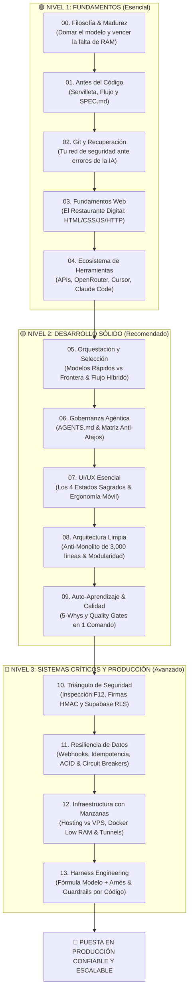

# 🧭 Guía Práctica y Abierta de Vibe Coding & Harness Engineering
### De la Idea a Producción con Inteligencia Artificial

> **Mandamiento #1 del Constructor:**  
> *"Antes de tirar la primera línea de código, diseña en una servilleta: documentación clara, diagramas de flujo y arquitectura básica. Si tú no tienes claro el mapa, la IA inventará un laberinto."*

---

## 🌟 ¿De qué se trata este repositorio?

Este no es un curso teórico ni un manual académico inflado con términos de moda. **Es una guía de trinchera**, nacida de meses de trabajo real construyendo sistemas funcionales (desde pasarelas de cobro y paneles de datos hasta servicios de mensajería transaccional y plataformas web) mano a mano con modelos de Inteligencia Artificial como Claude, GPT, Gemini, Cursor y Antigravity.

Aquí aprenderás a dar el salto fundamental: **dejar de ser un usuario que copia y pega código a ciegas para convertirte en un director de orquesta (Harness Engineer)** que sabe qué pedir, cómo proteger su sistema con Git, cómo validar cada paso con compuertas de calidad automáticas y cómo construir software profesional, sin importar si vienes de la informática tradicional o si estás programando por primera vez.

---

## 👋 ¿Para quién es este repositorio?

Este proyecto fue diseñado con **neutralidad absoluta de casos de uso**. Sirve exactamente igual para crear una tienda de comercio electrónico, un sistema de reservas para un consultorio, un bot automatizado, un panel de control empresarial o un SaaS:

* 🟢 **Para Creadores, Emprendedores y Vibe Coders sin trasfondo técnico:**  
  Aprenderás a pensar antes de programar, a dialogar con los modelos con analogías cotidianas y a estructurar tus ideas para que la IA no arruine tu proyecto al tercer día.
* 🟡 **Para Personas con Presupuesto o Hardware Limitado (Poca RAM):**  
  Desmentimos el mito de que necesitas computadoras costosas de 32GB de RAM o servidores caros. Te enseñamos a desarrollar ligero en local y a delegar el trabajo pesado a herramientas gratuitas en la nube.
* 🔵 **Para Desarrolladores Tradicionales y Líderes Técnicos:**  
  Descubrirás cómo aplicar ingeniería de arneses (*Harness Engineering*), compuertas de calidad automáticas (*Quality Gates*), máquinas de estado finito y catálogos de auto-aprendizaje continuo (5-Whys) para evitar que los asistentes agénticos degraden tu base de código.

---

## 🪜 Los 4 Estados de Madurez de un Proyecto

Uno de los mayores errores en el desarrollo asistido es asumir que *"si funciona en mi máquina cuando yo hago clic, ya está listo para venderse o lanzarse"*. Para evitar frustraciones, esta guía clasifica el software en cuatro estados evolutivos claros:

1. **Prototipo / PoC (Validar si la idea tiene sentido):** Código rápido, permisivo y descartable.
2. **Aplicación Funcional (El camino feliz funciona):** Resuelve el problema central en local, pero aún es frágil ante desconexiones, inputs raros o reinicios.
3. **Aplicación Validada (Desarrollo Sólido):** Cuenta con Git limpio, compuertas de calidad automáticas (*Quality Gates*), manejo explícito de errores y pruebas mínimas.
4. **Preparada para Producción (Sistemas Críticos):** Protegida contra cobros duplicados (idempotencia), seguridad defensiva (RLS, HMAC), infraestructura dimensionada y monitoreo activo.

> 📖 *Profundiza en la guía completa:* **[Los 4 Estados de Madurez: De Prototipo a Producción](docs/00-filosofia-y-primeros-pasos/05-los-cuatro-estados-de-madurez-prototipo-a-produccion.md)**.

---

## 🗺️ Mapa de Ruta: Estructurado en 3 Niveles Pedagógicos

Para evitar la sobrecarga cognitiva, el repositorio está organizado en **3 niveles progresivos** con **14 módulos prácticos**. No necesitas leer los 14 módulos de una sola sentada; avanza según el estado actual de tu proyecto.

---

## 📚 Índice Detallado por Niveles

### 🟢 Nivel 1: Fundamentos `[Esencial]`
*La base obligatoria para cualquier persona. Aprende a pensar, proteger tu trabajo y entender qué hay bajo el capó sin ahogarte en tecnicismos.*

| Módulo | Enfoque Central | Documentos Clave |
|---|---|---|
| **[00. Filosofía y Primeros Pasos](docs/00-filosofia-y-primeros-pasos/)** | Mentalidad pragmática, domar la complacencia del modelo, hardware humilde y escalera de madurez. | • [01. ¿Qué es Vibe Coding con criterio?](docs/00-filosofia-y-primeros-pasos/01-que-es-vibe-coding-con-criterio.md) • [02. La complacencia de los modelos](docs/00-filosofia-y-primeros-pasos/02-la-complacencia-de-los-modelos-y-como-domarla.md) • [03. De copia-pegador a director de orquesta](docs/00-filosofia-y-primeros-pasos/03-de-copia-pegador-a-director-de-orquesta.md) • [04. Construye con lo que tienes (RAM humilde)](docs/00-filosofia-y-primeros-pasos/04-construye-con-lo-que-tienes-vencer-la-falta-de-ram.md) • [05. Los 4 estados de madurez: Prototipo a producción](docs/00-filosofia-y-primeros-pasos/05-los-cuatro-estados-de-madurez-prototipo-a-produccion.md) |
| **[01. Antes del Código: Diseño y Arquitectura](docs/01-antes-del-codigo-diseno-y-arquitectura/)** | 🌟 **EL PASO CERO OBLIGATORIO:** No abras el chat a ciegas. Diagramas simples, datos y SPEC.md. | • [01. La regla de oro: No abras el chat a ciegas](docs/01-antes-del-codigo-diseno-y-arquitectura/01-la-regla-de-oro-no-abras-el-chat-a-ciegas.md) • [02. Diagramas de flujo simples (El viaje)](docs/01-antes-del-codigo-diseno-y-arquitectura/02-diagramas-de-flujo-simples-el-viaje-del-usuario.md) • [03. Arquitectura en servilleta](docs/01-antes-del-codigo-diseno-y-arquitectura/03-arquitectura-en-servilleta-quien-habla-con-quien.md) • [04. El mapa de datos esencial](docs/01-antes-del-codigo-diseno-y-arquitectura/04-el-mapa-de-datos-las-tablas-esenciales.md) • [05. Cómo redactar tu primer SPEC.md](docs/01-antes-del-codigo-diseno-y-arquitectura/05-como-redactar-tu-primer-spec-md.md) |
| **[02. Git y Recuperación: Tu Red de Seguridad](docs/02-git-y-recuperacion-tu-red-de-seguridad/)** | 🛡️ **TU SALVAVIDAS:** Git explicado sin miedo. Puntos de guardado, revisión de diffs y recuperación ante alucinaciones. | • [01. Git sin tecnicismos: El punto de guardado](docs/02-git-y-recuperacion-tu-red-de-seguridad/01-git-sin-tecnicismos-el-punto-de-guardado.md) • [02. Git vs GitHub: Tu disco local vs la nube](docs/02-git-y-recuperacion-tu-red-de-seguridad/02-git-vs-github-tu-disco-local-vs-la-nube.md) • [03. El flujo sagrado con IA: Revisar el diff](docs/02-git-y-recuperacion-tu-red-de-seguridad/03-el-flujo-sagrado-con-ia-revisar-el-diff.md) • [04. Cómo recuperar tu proyecto cuando la IA lo rompe](docs/02-git-y-recuperacion-tu-red-de-seguridad/04-como-recuperar-tu-proyecto-cuando-la-ia-lo-rompe.md) • [05. Ramas ligeras para experimentos arriesgados](docs/02-git-y-recuperacion-tu-red-de-seguridad/05-ramas-ligeras-para-experimentos-arriesgados.md) |
| **[03. Fundamentos Web sin Tecnicismos](docs/03-fundamentos-web-sin-tecnicismos/)** | La analogía del restaurante digital, cómo viajan los datos por internet y qué ve el navegador. | • [01. La analogía del restaurante (HTML/CSS/JS)](docs/03-fundamentos-web-sin-tecnicismos/01-la-analogia-del-restaurante-html-css-js.md) • [02. Cómo viajan los datos (HTTP y WebSockets)](docs/03-fundamentos-web-sin-tecnicismos/02-como-viajan-los-datos-por-internet-http-y-ws.md) • [03. El renderizado y el DOM](docs/03-fundamentos-web-sin-tecnicismos/03-el-renderizado-que-ve-el-usuario.md) |
| **[04. El Ecosistema de Herramientas y Modelos](docs/04-el-ecosistema-de-herramientas-y-modelos/)** | 🛠️ APIs vs Suscripciones, OpenRouter, familias de modelos, Cursor, Antigravity, Claude Code y Multiagentes. | • [01. ¿Qué es una API y cómo se paga?](docs/04-el-ecosistema-de-herramientas-y-modelos/01-que-es-una-api-y-como-se-paga-tokens-vs-suscripcion.md) • [02. ¿Qué es OpenRouter? El mercado central](docs/04-el-ecosistema-de-herramientas-y-modelos/02-que-es-openrouter-el-mercado-central-de-modelos.md) • [03. Modelos de referencia (DeepSeek, Claude, Gemini, GPT)](docs/04-el-ecosistema-de-herramientas-y-modelos/03-los-modelos-de-referencia-deepseek-claude-gemini-gpt.md) • [04. Editores y entornos (Cursor vs Antigravity vs Copilot)](docs/04-el-ecosistema-de-herramientas-y-modelos/04-editores-y-entornos-cursor-vs-antigravity-vs-copilot.md) • [05. Agentes de terminal (Claude Code y Hermes)](docs/04-el-ecosistema-de-herramientas-y-modelos/05-agentes-de-terminal-claude-code-y-hermes.md) • [06. Orquestación multiagente y la nube (Orca)](docs/04-el-ecosistema-de-herramientas-y-modelos/06-orquestacion-multiagente-y-plataformas-en-la-nube-orca.md) |

---

### 🟡 Nivel 2: Desarrollo Sólido `[Recomendado]`
*Construye aplicaciones limpias, modulares y confiables controlando los costos y atajos de la IA.*

| Módulo | Enfoque Central | Documentos Clave |
|---|---|---|
| **[05. Orquestación y Selección de Modelos](docs/05-orquestacion-y-seleccion-de-modelos/)** | Cómo hablarle al modelo, abstracción y combinación híbrida para ahorrar costos sin caer en el impuesto del reintento (*Retry Tax*). | • [01. Cómo hablarle a un modelo](docs/05-orquestacion-y-seleccion-de-modelos/01-como-hablarle-a-un-modelo-lenguaje-y-abstraccion.md) • [02. Modelos modestos vs de frontera](docs/05-orquestacion-y-seleccion-de-modelos/02-modelos-modestos-vs-modelos-de-frontera.md) • [03. El flujo híbrido de eficiencia y medición](docs/05-orquestacion-y-seleccion-de-modelos/03-el-flujo-hibrido-ahorro-y-eficiencia.md) |
| **[06. Gobernanza del Asistente (AGENTS.md)](docs/06-gobernanza-del-asistente-agents-md/)** | Instrucciones inquebrantables, matriz anti-atajos y ciclo SDLC agéntico en 6 pasos. | • [01. ¿Qué es un arnés de instrucciones?](docs/06-gobernanza-del-asistente-agents-md/01-que-es-un-harness-de-instrucciones.md) • [02. La matriz anti-atajos del modelo](docs/06-gobernanza-del-asistente-agents-md/02-la-matriz-anti-atajos-del-modelo.md) • [03. El ciclo SDLC agéntico en 6 pasos](docs/06-gobernanza-del-asistente-agents-md/03-el-ciclo-sdlc-agentico-en-6-pasos.md) |
| **[07. Diseño UI/UX para Vibe Coders](docs/07-diseno-ui-ux-para-vibe-coders/)** | Los 4 estados sagrados de interfaz, tokens visuales, ergonomía táctil móvil y microinteracciones. | • [01. Los 4 estados: Loading, Empty, Error, Success](docs/07-diseno-ui-ux-para-vibe-coders/01-los-cuatro-estados-sagrados-loading-empty-error-success.md) • [02. Tokens CSS y paletas coherentes](docs/07-diseno-ui-ux-para-vibe-coders/02-tokens-css-y-paletas-coherentes.md) • [03. Mobile First y ergonomía táctil](docs/07-diseno-ui-ux-para-vibe-coders/03-mobile-first-y-ergonomia-tactil.md) • [04. Microinteracciones y feedback inmediato](docs/07-diseno-ui-ux-para-vibe-coders/04-microinteracciones-y-feedback-inmediato.md) |
| **[08. Arquitectura Limpia y Modularidad](docs/08-arquitectura-limpia-y-modularidad/)** | Cómo evitar el archivo monstruo de 3,000 líneas, pureza de imports sin efectos secundarios y separación. | • [01. El archivo monstruo y cómo evitarlo](docs/08-arquitectura-limpia-y-modularidad/01-como-evitar-el-archivo-monstruo-de-3000-lineas.md) • [02. Pureza de importación (Zero Side-Effects)](docs/08-arquitectura-limpia-y-modularidad/02-pureza-de-importacion-cero-efectos-colaterales.md) • [03. Separación de responsabilidades](docs/08-arquitectura-limpia-y-modularidad/03-separacion-de-responsabilidades.md) |
| **[09. Auto-Aprendizaje y Calidad](docs/09-auto-aprendizaje-y-calidad/)** | La técnica de los 5-Whys para bugs, catálogo persistente de errores, pruebas <5s con mocks y Quality Gates. | • [01. Técnica de los 5-Porqués](docs/09-auto-aprendizaje-y-calidad/01-la-tecnica-de-los-5-porques-para-bugs.md) • [02. Catálogo de errores persistente](docs/09-auto-aprendizaje-y-calidad/02-catalogo-de-errores-persistente.md) • [03. Pruebas rápidas sub-5 segundos con mocks](docs/09-auto-aprendizaje-y-calidad/03-pruebas-rapidas-sub-5-segundos-con-mocks.md) • [04. Quality Gates en 1 solo comando](docs/09-auto-aprendizaje-y-calidad/04-quality-gates-en-un-solo-comando.md) |

---

### 🔴 Nivel 3: Sistemas Críticos y Producción `[Avanzado]`
*Para software que cobra dinero, procesa datos sensibles o debe mantenerse en pie 24/7.*

| Módulo | Enfoque Central | Documentos Clave |
|---|---|---|
| **[10. El Triángulo de Seguridad Defensiva](docs/10-el-triangulo-de-seguridad-defensiva/)** | Prueba F12, firmas criptográficas HMAC, Row Level Security (RLS) y la trampa del `display: none`. | • [01. Seguridad Web: F12 y cero fugas](docs/10-el-triangulo-de-seguridad-defensiva/01-seguridad-en-la-web-f12-xss-y-cero-fugas.md) • [02. Seguridad Backend: HMAC y Rate Limiting](docs/10-el-triangulo-de-seguridad-defensiva/02-seguridad-en-el-backend-firmas-hmac-y-rate-limiting.md) • [03. Seguridad en BD: RLS y Mínimo Privilegio](docs/10-el-triangulo-de-seguridad-defensiva/03-seguridad-en-la-bd-row-level-security-rls-y-minimo-privilegio.md) • [04. La trampa mortal del display: none](docs/10-el-triangulo-de-seguridad-defensiva/04-la-trampa-mortal-del-display-none.md) |
| **[11. Resiliencia de Datos en el Mundo Real](docs/11-resiliencia-de-datos-en-el-mundo-real/)** | Webhooks como timbres, Idempotencia anti-duplicados, Transacciones ACID y proporcionalidad de Circuit Breakers. | • [01. Webhooks: El timbre de tu casa](docs/11-resiliencia-de-datos-en-el-mundo-real/01-que-es-un-webhook-el-timbre-de-tu-casa.md) • [02. Idempotencia: Cero cobros duplicados](docs/11-resiliencia-de-datos-en-el-mundo-real/02-idempotencia-como-evitar-cobros-y-mensajes-duplicados.md) • [03. Atomicidad ACID: Todo o nada](docs/11-resiliencia-de-datos-en-el-mundo-real/03-atomicidad-acid-la-regla-de-oro-del-todo-o-nada.md) • [04. Circuit Breakers y Outbox (cuándo SÍ y cuándo NO)](docs/11-resiliencia-de-datos-en-el-mundo-real/04-circuit-breaker-y-outbox-cuando-las-apis-se-caen.md) |
| **[12. Infraestructura Explicada con Manzanas](docs/12-infraestructura-explicada-con-manzanas/)** | Hosting estático vs VPS vs Serverless, Docker liviano, GitHub Actions gratuitos, Cloudflare Tunnels y blindaje de costos. | • [01. Hosting vs VPS vs Serverless](docs/12-infraestructura-explicada-con-manzanas/01-que-es-un-hosting-vs-vps-vs-serverless.md) • [02. Dimensionamiento de Hardware (RAM/CPU)](docs/12-infraestructura-explicada-con-manzanas/02-dimensionamiento-de-hardware-cuanta-ram-y-cpu-necesitas.md) • [03. Docker y cómo convivir con tu RAM](docs/12-infraestructura-explicada-con-manzanas/03-que-es-docker-y-por-que-lo-amas-u-odias-segun-tu-ram.md) • [04. GitHub Actions: Tu inspector gratuito](docs/12-infraestructura-explicada-con-manzanas/04-github-actions-tu-robot-gratuito-de-inspeccion.md) • [05. Tunnels: Probar webhooks en casa](docs/12-infraestructura-explicada-con-manzanas/05-tunnels-cloudflare-y-ngrok-probar-webhooks-en-casa.md) • [06. La trampa del pago por uso y arquitectura desacoplada](docs/12-infraestructura-explicada-con-manzanas/06-la-trampa-del-pago-por-uso-y-arquitectura-desacoplada.md) |
| **[13. Harness Engineering y Lógica Robusta](docs/13-harness-engineering-y-logica-robusta/)** | La fórmula Modelo + Harness, Máquinas de Estado vs Enums simples, Guardrails por código y Progressive Disclosure. | • [01. La fórmula Modelo + Harness](docs/13-harness-engineering-y-logica-robusta/01-la-formula-modelo-mas-harness.md) • [02. Máquinas de estado en flujos de negocio](docs/13-harness-engineering-y-logica-robusta/02-maquinas-de-estado-en-flujos-de-negocio.md) • [03. Guardrails por código vs texto](docs/13-harness-engineering-y-logica-robusta/03-guardrails-por-codigo-vs-guardrails-por-texto.md) • [04. Gestión de contexto progresivo](docs/13-harness-engineering-y-logica-robusta/04-gestion-de-contexto-y-progressive-disclosure.md) |

---

## 🧰 Plantillas Rigurosas Listas para Copiar y Pegar (`templates-plug-and-play/`)

Todas las plantillas han sido verificadas con pruebas negativas e incluyen advertencias explícitas sobre **qué detectan y qué NO detectan**:

* 📄 **[`spec-de-proyecto-starter.md`](templates-plug-and-play/spec-de-proyecto-starter.md)**: Plantilla para diseñar tu aplicación y definir límites antes de abrir el chat de IA.
* 🤖 **[`AGENTS-universal.md`](templates-plug-and-play/AGENTS-universal.md)**: Arnés universal de instrucciones con mapeo por editor (Cursor, Claude Code, Copilot, Antigravity).
* 📓 **[`self_learning_error_catalog.md`](templates-plug-and-play/self_learning_error_catalog.md)**: Formato estructurado 5-Whys para registrar fallas y evitar que la IA repita errores pasados.
* 🐍 **[`quality_gate_python.py`](templates-plug-and-play/quality_gate_python.py)**: Script en Python con modo `--self-test` para auditar tipos, sintaxis, secretos expuestos y tests en menos de 1 segundo.
* ⚡ **[`quality_gate_node.ts`](templates-plug-and-play/quality_gate_node.ts)**: Script equivalente para TypeScript/Node.js con análisis estático y escaneo de credenciales.
* 🔐 **[`supabase-rls-starter.sql`](templates-plug-and-play/supabase-rls-starter.sql)**: Modelo didáctico de referencia para Row Level Security (RLS) con exención de responsabilidad y pruebas negativas de aislamiento.
* 🛡️ **[`webhook-verifier-node.ts`](templates-plug-and-play/webhook-verifier-node.ts)**: Validador criptográfico HMAC con protección contra ataques de repetición (timestamp drift) y tests negativos.
* 🐳 **[`docker-compose-low-ram.yml`](templates-plug-and-play/docker-compose-low-ram.yml)**: Configuración ultra-optimizada con límites estrictos de memoria para no ahogar tu computadora.
* 🤖 **[`github-actions-ci.yml`](templates-plug-and-play/github-actions-ci.yml)**: Flujo de integración continua para correr tus Quality Gates automáticamente en cada push.
* 🎨 **[`ui-feedback-states.css`](templates-plug-and-play/ui-feedback-states.css)**: Clases CSS para manejar estados de carga, listas vacías, alertas de error y mensajes de éxito.
* 🛫 **[`checklist_preflight.md`](templates-plug-and-play/checklist_preflight.md)**: Lista de verificación proporcional dividida en 3 perfiles de riesgo (Web informativa, App interactiva con BD, Transaccional/Pagos).

---

## 📌 Hojas de Consulta Rápida (`cheat-sheets/`)

* 🗺️ **[`mapa-del-ecosistema-ia.md`](cheat-sheets/mapa-del-ecosistema-ia.md)**: Cuadro comparativo de IDEs (Cursor, Antigravity), modelos y plataformas (OpenRouter).
* 📖 **[`diccionario-dev-para-todos.md`](cheat-sheets/diccionario-dev-para-todos.md)**: Glosario sin enredos de términos técnicos comunes (API, JWT, Webhook, Mock, Transacción, DNS, etc.).
* 📊 **[`plantillas-diagramas-mermaid.md`](cheat-sheets/plantillas-diagramas-mermaid.md)**: Diagramas visuales en texto listos para pegar en tu documentación.
* 💬 **[`prompts-de-control-arquitectonico.md`](cheat-sheets/prompts-de-control-arquitectonico.md)**: Fórmulas exactas para dar instrucciones firmes a la IA y evitar atajos destructivos.
* 🚦 **[`semaforo-de-riesgo-de-codigo.md`](cheat-sheets/semaforo-de-riesgo-de-codigo.md)**: Guía rápida para saber qué partes del código generado por IA debes revisar con lupa.
* 💰 **[`guia-hardware-y-costos.md`](cheat-sheets/guia-hardware-y-costos.md)**: Recomendaciones realistas de RAM, CPU y servicios gratuitos para arrancar con $0 USD.

---

## 🚀 Cómo Empezar a Usar Esta Guía Hoy Mismo

1. **Si vas a iniciar una idea desde cero:**  
   Ve directamente al **[Módulo 01: Antes del Código](docs/01-antes-del-codigo-diseno-y-arquitectura/01-la-regla-de-oro-no-abras-el-chat-a-ciegas.md)** y copia la plantilla [`spec-de-proyecto-starter.md`](templates-plug-and-play/spec-de-proyecto-starter.md). Llena los 4 pasos antes de dialogar con la IA.
2. **Si tienes miedo de que la IA rompa tu código:**  
   Aprende de inmediato el flujo de guardado en el **[Módulo 02: Git y Recuperación](docs/02-git-y-recuperacion-tu-red-de-seguridad/01-git-sin-tecnicismos-el-punto-de-guardado.md)**.
3. **Si ya tienes un proyecto en marcha que se siente frágil o desordenado:**  
   Lee el **[Módulo 06: Gobernanza del Asistente](docs/06-gobernanza-del-asistente-agents-md/01-que-es-un-harness-de-instrucciones.md)** y coloca [`AGENTS-universal.md`](templates-plug-and-play/AGENTS-universal.md) en la raíz de tu proyecto.
4. **Si vas a conectar usuarios, bases de datos o pasarelas de pago:**  
   Revisa el **[Módulo 10: Triángulo de Seguridad](docs/10-el-triangulo-de-seguridad-defensiva/01-seguridad-en-la-web-f12-xss-y-cero-fugas.md)** y el **[Módulo 11: Resiliencia de Datos](docs/11-resiliencia-de-datos-en-el-mundo-real/01-que-es-un-webhook-el-timbre-de-tu-casa.md)**.
5. **Si te preocupa que una factura en la nube o un ataque arruine tu bolsillo:**  
   Revisa **[La Trampa del Pago por Uso y la Arquitectura Desacoplada](docs/12-infraestructura-explicada-con-manzanas/06-la-trampa-del-pago-por-uso-y-arquitectura-desacoplada.md)** para blindar tu tarjeta de crédito con un VPS de costo fijo ($5/mes).

---

## 🤝 Cómo Contribuir

Este repositorio es una bitácora abierta y en evolución. Si aprendiste una lección dura en la trinchera, descubriste un nuevo atajo dañino que los modelos suelen tomar, o tienes una analogía más clara para explicar un concepto difícil:

1. Lee nuestras pautas en [`CONTRIBUTING.md`](CONTRIBUTING.md).
2. Abre un Issue o un Pull Request.
3. Ayúdanos a mantener este recurso pragmático, accesible y con rigor técnico.

---

## ⚖️ Licencias

* **Código de plantillas y scripts:** [Licencia MIT](LICENSE) (úsalos, cópialos y adáptalos libremente en tus proyectos personales o comerciales).
* **Guías escritas y documentación:** [Creative Commons Atribución-CompartirIgual 4.0 Internacional (CC BY-SA 4.0)](LICENSE).
