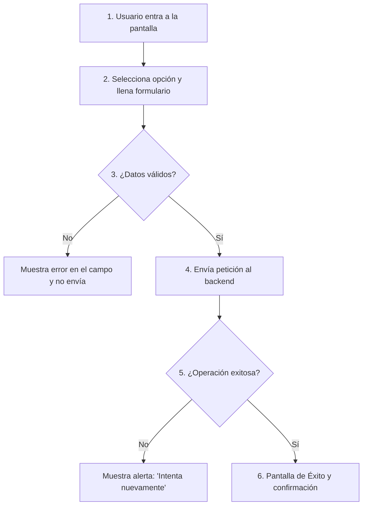
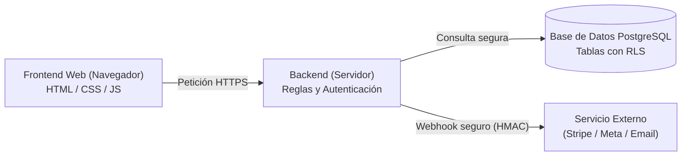
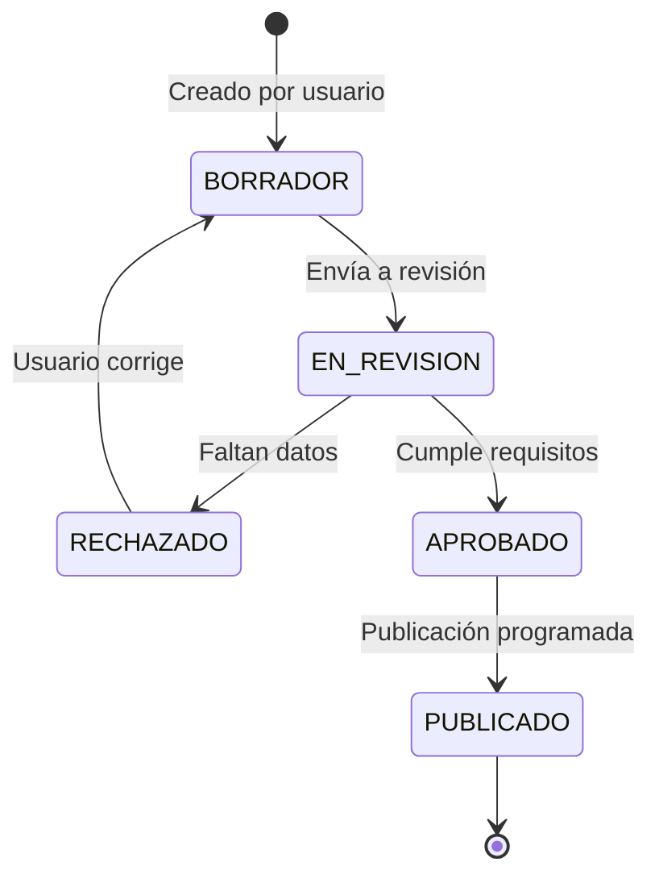
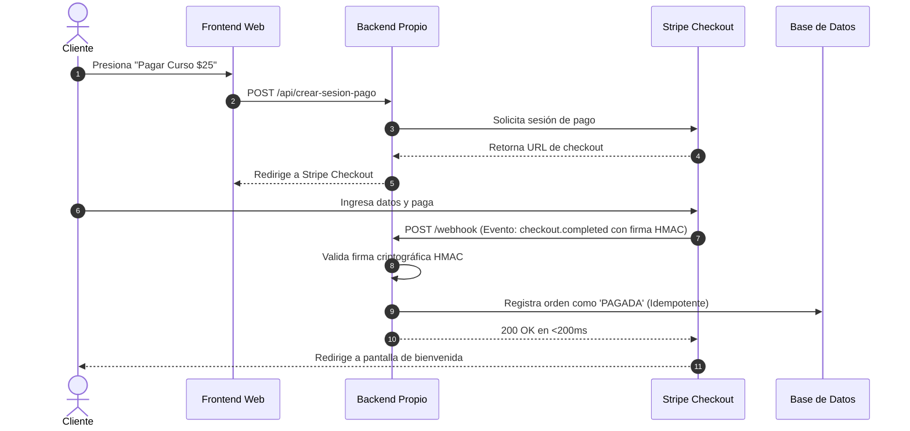
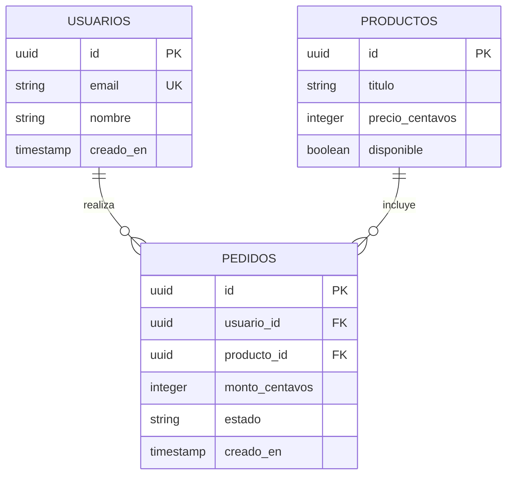

# 📊 Plantillas de Diagramas Mermaid Listas para Copiar

> **Instrucciones:**  
> Copia cualquiera de estos bloques de texto y pégalos directamente en tus archivos Markdown (`SPEC.md` o documentación). Se renderizarán como diagramas visuales en GitHub, Obsidian, Notion y la mayoría de editores modernos.

---

## 1. El Viaje del Usuario (User Journey Flowchart)

---

## 2. Arquitectura en Servilleta (¿Quién habla con quién?)

---

## 3. Máquina de Estados Finitos (State Machine)

---

## 4. Diagrama de Secuencia de un Cobro con Webhook

---

## 5. Mapa de Datos Mínimo (Diagrama Entidad-Relación)

