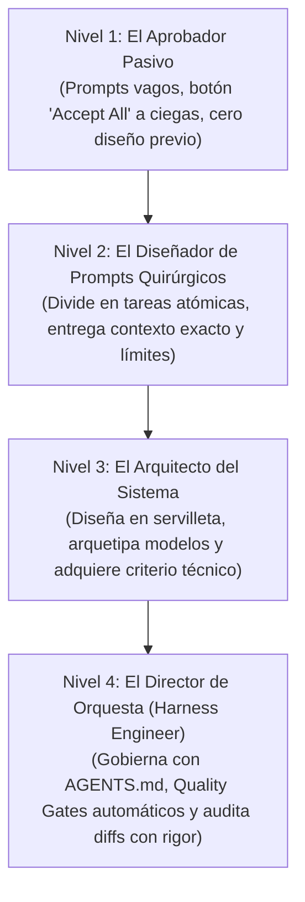

# 🎼 De Aprobador Pasivo a Director de Orquesta
### La Verdadera Evolución del Vibe Coder en la Era Agéntica

> *"El vibe coder aficionado es un espectador pasivo que aprieta 'Accept All' a ciegas y reza para que funcione. El director de orquesta diseña la arquitectura, da prompts con criterio técnico y sabe exactamente cuándo el agente está desafinando."*

---

## ⏳ De la Era del "Copia y Pega" a la Era Agéntica

En los inicios del desarrollo asistido por IA (2022-2023), la dinámica típica era abrir ChatGPT o Claude en el navegador, pedir un trozo de código, seleccionarlo con el mouse, copiarlo y pegarlo manualmente en VS Code. 

A muchos de nosotros esa etapa nos sirvió como una **escuela inicial obligatoria**: nos obligó a abrir carpetas, ver el código de cerca, buscar en qué línea estaba el error y familiarizarnos con la anatomía de un archivo.

**Pero hoy en día, esa forma de trabajar es historia:**
Prácticamente ningún *vibe coder* copia y pega código a mano. Hoy se desarrolla directamente desde **entornos agénticos** (como Cursor, Antigravity, Claude Code, Codex, OpenCode o Hermes) donde el modelo tiene acceso directo a tu terminal y a tus archivos: lee el proyecto, escribe los cambios, ejecuta comandos de compilación y crea carpetas por sí mismo.

Sin embargo, al desaparecer la fricción de copiar y pegar, **nació una trampa moderna mucho más peligrosa**: la trampa del **Aprobador Pasivo**.

---

## 🚨 La Trampa del Aprobador Pasivo (*The "Accept All" Trap*)

El nuevo error que cometen miles de personas al programar con agentes no es pegar mal un texto, sino **actuar como espectadores pasivos**:
1. Le lanzan al agente un prompt vago y desmedido: *"Hazme una plataforma como Uber pero para paseadores de perros"*.
2. El agente se desboca y modifica 15 archivos simultáneamente, inventando librerías y estructuras que nadie le pidió.
3. El usuario simplemente hace clic en **"Accept All" (Aceptar todo)** sin revisar el `git diff`, asumiendo que la IA siempre sabe lo que hace.
4. Cuando algo se rompe, el usuario no sabe qué cambió, pega el mensaje de error en el chat diciendo *"No funciona, arréglalo"*, y el agente entra en un bucle destructivo que termina arruinando el proyecto.

Al cabo de 3 días, la base de código es un laberinto incomprensible que ni el propio modelo de IA es capaz de reparar.

---

## 🧗 La Escalera de Madurez del Vibe Coder Moderno

Para construir software real que no se autodestruya, todo creador debe transitar por cuatro niveles evolutivos:

### Nivel 1: El Aprobador Pasivo (El espectador ciego)
* Escribe prompts gigantescos esperando que la IA adivine su modelo de negocio.
* Acepta todos los cambios del agente sin mirar las líneas verdes y rojas.
* No sabe qué librerías tiene instaladas ni cómo viajan los datos.
* **Consecuencia:** Su proyecto se vuelve frágil y muere antes de llegar a producción.

### Nivel 2: El Diseñador de Prompts Quirúrgicos
* Descubre que **la calidad de la respuesta depende de la precisión de la entrada**.
* En lugar de pedir una pantalla completa de golpe, divide el trabajo en pasos atómicos: *"Primero creemos solo el componente visual del botón de pago con sus 4 estados"*.
* Entrega contexto exacto: referencia los archivos pertinentes y define restricciones explícitas (*"Usa únicamente Tailwind CSS sin librerías de estilos adicionales"*).
* Le pide al agente que le explique el plan antes de tocar el código: *"Descríbeme qué vas a modificar antes de hacer los cambios"*.

### Nivel 3: El Arquitecto del Sistema (Arquetipado y Fundamentos)
* **Aplica el Paso Cero:** Antes de abrir el chat de IA, diseña en una servilleta o en un documento [`SPEC.md`](../../templates-plug-and-play/spec-de-proyecto-starter.md) el viaje del usuario, la estructura de tablas y las carpetas del proyecto.
* **Adquiere criterio técnico fundamental:** No necesita memorizar la sintaxis de memoria, pero entiende los conceptos que gobiernan el software: qué es un endpoint HTTP, qué es una transacción en base de datos, qué es un estado de carga y qué datos jamás deben viajar al navegador.
* Sabe **cómo abordar el problema** y guía al agente con firmeza en lugar de dejarse arrastrar por las alucinaciones del modelo.

### Nivel 4: El Director de Orquesta (*Harness Engineer*)
* Configura su arnés de instrucciones ([`AGENTS.md`](../../templates-plug-and-play/AGENTS-universal.md)) como un documento vivo que evoluciona con las lecciones aprendidas de su propio proyecto.
* Implementa **compuertas de calidad automáticas (*Quality Gates*)**: el agente no termina su trabajo hasta que un script local verifique que los tipos compilan, los tests pasan y no hay contraseñas expuestas.
* Utiliza **Git** de forma religiosa: cada funcionalidad completada es un commit limpio. Si el agente comete una alucinación grave, revierte en 2 segundos con `git restore` sin perder la calma.
* Revisa cada `git diff` con criterio clínico: sabe detectar atajos engañosos (datos falsos en producción, bloques `try/catch` vacíos o evasión de tipos con `any`).

---

## 🧠 El Secreto del Director: Criterio Técnico por Encima de la Sintaxis

La gran ventaja del desarrollo asistido con IA no es que te exima de pensar, sino que te libera de la memoria mecánica de la sintaxis:

| Lo que la IA hace a la perfección | Lo que TÚ debes aportar obligatoriamente |
|---|---|
| Escribir la sintaxis exacta de una función. | Decidir qué tablas y relaciones necesita tu negocio. |
| Generar código de maquetación HTML y CSS. | Diseñar el flujo lógico de lo que ve el cliente. |
| Sugerir algoritmos de ordenamiento o filtrado. | Exigir que los datos de un cliente no los vea otro (RLS). |
| Escribir pruebas unitarias repetitivas. | Definir qué casos extremos deben probarse obligatoriamente. |

> **Conclusión:**  
> La IA es el mejor violinista del mundo: puede tocar a velocidades asombrosas sin cansarse. Pero si tú no actúas como el Director de Orquesta que marca el compás, define la partitura y detiene la música ante la primera nota desafinada, lo único que obtendrás será ruido ensordecedor.
