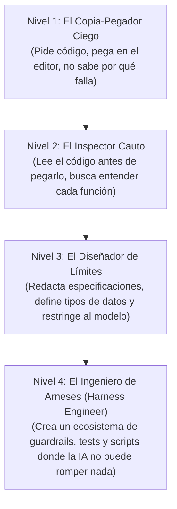

# 🎼 De Copia-Pegador a Director de Orquesta

> *"El mal desarrollador copia código que no entiende esperando que funcione. El director de orquesta no toca todos los instrumentos, pero sabe exactamente cuándo un violín está desafinado."*

---

## 🎻 La Metáfora de la Orquesta Digital

Imagina una orquesta sinfónica:
- Los **Músicos (Modelos de IA):** Son virtuosos técnicos. Pueden tocar pasajes a velocidades sobrehumanas.
- La **Partitura (`SPEC.md` / Documentación):** Es la guía donde cada compás, tiempo y nota está escrito con claridad.
- El **Director de Orquesta (TÚ):** No necesita soplar la trompeta ni pulsar las cuerdas del violonchelo personalmente. Su rol es:
  1. Conocer la obra completa de principio a fin.
  2. Marcar el tempo y evitar que un instrumento tape a los demás.
  3. Detener la música en seco si detecta una nota fuera de tono.

---

## 🧗 La Escalera de Madurez en el Desarrollo Asistido

Todos los que empezamos en el desarrollo asistido por IA pasamos por cuatro etapas naturales:

### Nivel 1: El Copia-Pegador Ciego
- Pide archivos completos en el chat.
- Cuando hay un error en la línea 40, copia el mensaje de error completo y le dice: *"Me dio este error, arréglalo"*.
- El modelo genera otro archivo de 400 líneas, perdiendo los cambios anteriores.
- **Resultado:** Frustración extrema al cabo de 3 días.

### Nivel 2: El Inspector Cauto
- Empieza a pedir cambios pequeños e incrementales: *"Modifica únicamente la función de cálculo de impuestos"*.
- Revisa las diferencias (*git diff*) antes de aceptar el cambio.
- Pregunta: *"¿Por qué usaste este método y no este otro?"*.

### Nivel 3: El Diseñador de Límites
- Crea contratos de datos claros (esquemas de validación, tablas SQL definidas).
- Dicta las reglas de juego: *"Usa únicamente Vanilla JS sin librerías externas"*, *"No toques la tabla de usuarios"*.
- No permite que la IA agregue dependencias innecesarias a `package.json` o `requirements.txt`.

### Nivel 4: El Director de Orquesta (Harness Engineer)
- Dispone de un archivo de reglas (`AGENTS.md`) que el asistente lee automáticamente al inicio de cada sesión.
- Cuenta con scripts de validación automática que se ejecutan en 2 segundos.
- Usa modelos pequeños y veloces para tareas mecánicas repetitivas, y reserva los modelos más potentes para decisiones arquitectónicas.
- Si surge un fallo, lo registra en un catálogo de auto-aprendizaje para que ningún modelo futuro cometa el mismo desliz.

---

## 💡 El Secreto del Director
No necesitas memorizarte la sintaxis exacta de cada lenguaje de programación. **Lo que necesitas dominar son los conceptos fundamentales:**
- Saber qué es una petición HTTP.
- Saber qué es una transacción en base de datos.
- Saber qué es una variable de entorno.
- Saber qué información jamás debe salir al navegador.

Cuando comprendes estos conceptos, puedes dirigir a cualquier modelo de Inteligencia Artificial para construir lo que tu imaginación se proponga.
