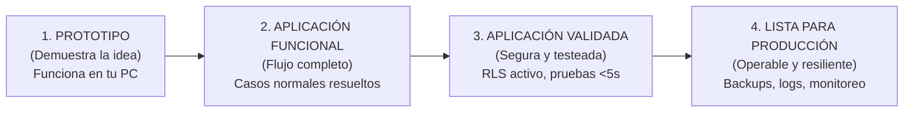

# 🚦 Los Cuatro Estados de Madurez: Del Prototipo a Producción

> *"El error más peligroso de un vibe coder novato es ver que un botón funciona en localhost e inmediatamente asumir que su aplicación está lista para recibir dinero de usuarios reales."*

---

## 🏗️ La Escalera de Madurez del Software

En el desarrollo asistido por Inteligencia Artificial, ver algo funcionando en tu navegador toma solo 10 minutos. Pero que funcione en condiciones ideales (*Happy Path*) no equivale a que esté listo para enfrentar la realidad de internet (caídas de red, usuarios con malas intenciones, reintentos duplicados y cortes de luz).

Todo proyecto atraviesa **4 estados de madurez progresivos**:

---

## 📊 Las 4 Fases en Detalle

| Estado | ¿Qué significa realmente? | ¿Qué controles debe superar? | ¿A quién se le muestra? |
|---|---|---|---|
| **1. Prototipo** | Demuestra la viabilidad de la idea. Es un boceto interactivo rápido. | Ninguno estricto. Puede tener datos simulados (*mocks*) y diseño preliminar. | Solo a ti y a amigos cercanos para validar si la idea tiene sentido. |
| **2. Aplicación Funcional** | El usuario puede completar el viaje principal (registrarse, ver catálogo, simular compra). | Validación básica de entradas de texto, sin bloqueos del navegador. | A usuarios de prueba (*Beta Testers*) en entornos de prueba con datos falsos. |
| **3. Aplicación Validada** | El código está protegido contra accidentes y descuidos. | **Prueba F12:** Cero claves secretas en cliente. **Base de Datos:** RLS activado. **Quality Gate:** Pasa pruebas unitarias en verde. | Lista para lanzamiento privado o primeros clientes controlados. |
| **4. Lista para Producción** | El sistema es operable a largo plazo y sobrevive a fallos externos. | Backups de base de datos automáticos, variables de entorno en servidor, monitoreo de errores y plan de recuperación en caso de caída. | Público general y transacciones de dinero real. |

---

## ⚖️ El Principio de Proporcionalidad: No Mates Moscas a Cañonazos

No todos los proyectos necesitan llegar al Estado 4 con la misma infraestructura:

* **Caso A: Una página informativa o menú de un restaurante:**  
  No guarda dinero ni tarjetas de crédito. No necesita transacciones distribuidas ni Circuit Breakers. Con estar en **Estado 2 o 3** (HTML semántico, hosting estático gratuito y formulario validado) es 100% suficiente.
* **Caso B: Una plataforma de reservas médicas o venta de entradas:**  
  Guarda información privada de pacientes y cobra dinero por tarjeta. **Debe estar obligatoriamente en Estado 4** (RLS blindado, firmas HMAC verificadas e idempotencia contra cobros dobles).

> [!TIP]
> **Tu esfuerzo de ingeniería debe ser proporcional al riesgo del proyecto.** No gastes 3 semanas implementando patrones complejos para una landing page de captura de emails; pero nunca abras una pasarela de cobro sin haber blindado tu base de datos.
