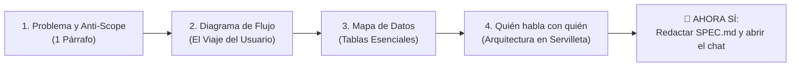

# 🌟 La Regla de Oro: No Abras el Chat a Ciegas

> *"El 90% de los proyectos asistidos por IA fracasan en la semana 2 no por culpa de la IA, sino porque el humano le pidió construir una casa sin haber decidido cuántas habitaciones necesitaba."*

---

## 🌪️ La Anatomía del Fracaso Prematuro

Imagina que entras a una ferretería con albañiles y les dices:  
*«¡Hola! Quiero un negocio. Empiecen a poner ladrillos ya mismo».*

Los albañiles levantarán paredes de inmediato. Al día siguiente dirás: *«Ah, pero quería que fuera un restaurante, no una farmacia»*. Tendrán que demoler. Al tercer día: *«Y necesito un segundo piso»*. Los cimientos no estaban calculados para soportarlo y todo se vendrá abajo.

Esto es exactamente lo que ocurre cuando abres el chat de tu IA y escribes:  
❌ *«Hazme una plataforma para vender cursos online con pagos, certificados y chat en vivo»*.

### ¿Qué hace la IA cuando le das una orden abierta?
1. **Asume por ti:** Decide cómo se llaman las tablas, qué librería de diseño usar, cómo estructurar las contraseñas y qué pasarela de cobro integrar.
2. **Genera código inflado:** Escribe cientos de líneas de código que no pediste (sistemas de insignias, configuraciones complejas de correo, etc.) para "impresionarte".
3. **Pega todo con cinta adhesiva:** Mezcla la lógica de pago con los botones visuales y conecta la base de datos de manera improvisada.

A los tres días, cuando quieres cambiar un solo campo de registro, descubres que la aplicación entera está amarrada en un nudo ciego.

---

## 📐 El Paso Cero: La Regla de la Servilleta

Antes de instalar cualquier paquete, antes de crear un solo archivo `.js` o `.py`, y antes de escribir una sola palabra en la ventana del asistente, debes completar **El Método de los 4 Pasos Previos**:

### La Transformación Radical
Cuando sigues este método, tu primera instrucción a la IA cambia por completo:
- **Antes (Amateur):** *«Hazme una app de cursos»*.
- **Ahora (Arquitecto):** *«He preparado este archivo `SPEC.md` donde especifico el flujo del usuario, las 3 tablas de datos y los límites estrictos de lo que NO construiremos. Léelo y genera únicamente la estructura inicial de carpetas sin escribir código aún»*.

La IA pasa de ser un generador caótico de texto a un **francotirador de precisión milimétrica**.
