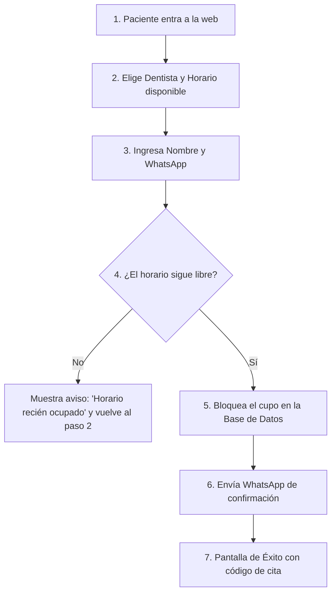

# 🗺️ Diagramas de Flujo Simples: El Viaje del Usuario

> *"Si no puedes dibujar el camino que recorre una persona en tu pantalla usando 5 cajas y 2 flechas, la IA inventará un laberinto en el que ambos quedarán atrapados."*

---

## 🚶‍♂️ ¿Qué es el "Viaje del Usuario"?

El viaje del usuario (*User Journey*) es la secuencia cronológica de acciones que una persona realiza desde que aterriza en tu sistema hasta que consigue su objetivo.

No necesitas software de diseño costoso (como Figma o herramientas avanzadas de modelado). Una hoja de papel, una servilleta o unas cuantas líneas de texto con flechas son más que suficientes.

---

## 🧭 Ejemplo Práctico: Un Sistema de Reservas para un Consultorio Dental

Analicemos cómo se ve un flujo antes de programar:

---

## ⚠️ Los 3 Errores que este Diagrama Evita de Inmediato

1. **Evita la trampa de la doble reserva:**  
   Al dibujar la caja número 4 (*¿El horario sigue libre?*), ya sabes que tu sistema necesita verificar disponibilidad antes de guardar la cita, evitando que dos pacientes reserven la misma hora al mismo tiempo.
2. **Evita pedir datos innecesarios:**  
   Si en el dibujo solo necesitas Nombre y WhatsApp, le prohíbes a la IA inventar campos de dirección postal, fecha de nacimiento o número de pasaporte que solo complicarían la vida del usuario.
3. **Define el caso de error amigable:**  
   La caja roja (*Horario recién ocupado*) le enseña a la IA exactamente qué mensaje mostrar si algo falla, en lugar de dejar que la pantalla se quede congelada en blanco.

---

## ✍️ Ejercicio Práctico para tu Proyecto
Dibuja en un papel las respuestas a estas tres preguntas:
1. **¿Dónde empieza el usuario?** (Página principal, mensaje de WhatsApp, enlace de correo).
2. **¿Cuál es la bifurcación crítica?** (¿Tiene cuenta o no? ¿El pago pasó o falló? ¿Es administrador o cliente?).
3. **¿Cuál es la pantalla o mensaje final de éxito?**

Guarda este dibujo: será la base de tu archivo de especificación técnica (`SPEC.md`).
