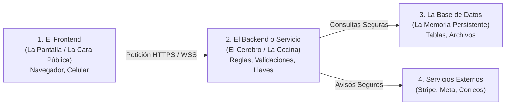

# 📦 Arquitectura en Servilleta: ¿Quién Habla con Quién?

> *"La arquitectura de software no es más que definir los buzones y las carreteras por donde viajan las cartas de tu sistema."*

---

## 🍽️ Los 3 Actores Fundamentales de Cualquier Aplicación

Sin importar si estás construyendo una tienda virtual, un bot de mensajería, un juego o un panel de análisis de datos, toda aplicación moderna tiene los mismos tres componentes:



1. **La Pantalla (Frontend):**  
   Es lo que el usuario toca o ve con sus propios ojos. Solo tiene una responsabilidad: **mostrar información atractiva y recoger los clics o textos que la persona introduce**.
2. **El Cerebro (Backend / API):**  
   Es la cocina a puerta cerrada. Recibe lo que la pantalla le pide, comprueba si la persona tiene permisos o dinero suficiente, y ejecuta las acciones sensibles.
3. **El Archivador (Base de Datos):**  
   Es la memoria de largo plazo. Guarda registros organizados en cajones (tablas) para que no se pierdan si se va la luz.

---

## ☕ La Servilleta en la Práctica: Ejemplo de una Tienda de Café

Imagina que quieres vender café artesanal por internet. Tu arquitectura en servilleta se resume así:

```text
[ Cliente en su Teléfono ]
       │
       ▼ (1. Presiona "Comprar Café Geisha $15")
[ Frontend Web ]
       │
       ▼ (2. Envía pedido al backend: { productoId: "cafe-01", cantidad: 1 })
[ Backend Node / Servidor ] 
       │
       ├─► (3. Pregunta a Stripe: "Genera un enlace de cobro por $15")
       ├─► (4. Stripe responde: "Aquí está el link seguro de pago")
       │
[ Cliente paga en Stripe ]
       │
       ▼ (5. Stripe toca el timbre del Backend vía Webhook: "¡El pago fue confirmado!")
[ Backend ]
       │
       ├─► (6. Guarda la orden como 'PAGADA' en la Base de Datos)
       └─► (7. Envía correo al tostador: "Prepara el paquete de Juan")
```

---

## 🎯 Por qué esta Servilleta es tu Escudo Protector

Cuando le muestras esta servilleta a la Inteligencia Artificial:
* **Le impides inventar intermediarios:** La IA no te creará un microservicio innecesario ni te pedirá instalar Kafka o Redis para una tienda que apenas vende 10 cafés al día.
* **Le marcas las fronteras:** Sabe que el cobro lo gestiona Stripe, que el inventario se guarda en la base de datos, y que el frontend solo redirige al usuario.
* **Ganas claridad mental:** Si un cliente dice que no le llegó el correo, ya sabes exactamente en qué flecha del diagrama ocurrió el problema (en la flecha 7), sin perder tiempo revisando la pantalla de inicio.
