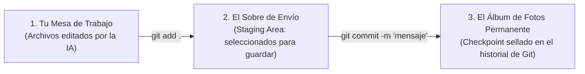

# 💾 Git sin Tecnicismos: El Punto de Guardado (Savepoint)

> *"Programar con un asistente de Inteligencia Artificial sin usar Git es como jugar un videojuego de 50 horas en modo muerte permanente: si cometes un error o la IA inventa una tontería, pierdes toda la partida."*

---

## 🎮 La Analogía del Checkpoint en los Videojuegos

Imagina que estás jugando una aventura gráfica o un juego de acción:
- Estás a punto de cruzar una puerta peligrosa o enfrentarte a un enemigo difícil.
- ¿Qué es lo primero que haces? **Pausas y guardas la partida (Save / Checkpoint).**
- Si entras a la habitación, te equivocas y caes en una trampa: no te pones a llorar ni compras otra consola; simplemente **cargas la partida guardada hace 2 minutos** y vuelves a intentarlo sano y salvo.

**Git es exactamente la máquina de puntos de guardado para tus proyectos de software.**

---

## 📦 Los Conceptos Clave Explicados con Manzanas

| Término | Analogía Cotidiana | ¿Qué es técnicamente? |
|---|---|---|
| **Repositorio (`repo`)** | **La carpeta mágica de tu proyecto.** Parece una carpeta común de Windows o Mac, pero tiene una libreta oculta (`.git`) donde anota cada cambio en la historia. | La carpeta raíz de tu código donde Git está activado para rastrear archivos. |
| **Commit (Punto de guardado)** | **Una foto instantánea sellada con fecha y hora.** Congela el estado exacto de todos tus archivos en ese segundo. | Una confirmación en el historial con un mensaje descriptivo: `git commit -m "feat: login básico funcionando"`. |
| **Working Directory (Tu mesa de trabajo)** | **El escritorio donde estás cocinando o escribiendo ahora mismo.** Los cambios aún no están guardados en piedra. | Los archivos actuales que estás editando en tu editor de código. |

---

## ⚡ El Ciclo de 3 Pasos para Guardar tu Progreso

Cada vez que completes una pequeña tarea con la IA que funcione bien (por ejemplo, creaste un botón que abre una ventana emergente y no da errores):

1. **`git add .`**  
   Le dices a Git: *«Toma todos los archivos que acabo de modificar o crear y prepáralos en el sobre»*.
2. **`git commit -m "mensaje claro"`**  
   Cierras el sobre y le pones una etiqueta descriptiva:  
   `git commit -m "feat: agregar formulario de contacto con validacion de email"`.
3. **¡Listo!** Ese punto de la historia ya está a salvo para siempre. Aunque la IA borre 500 líneas en el siguiente prompt, podrás regresar a este punto exacto en 2 segundos.
