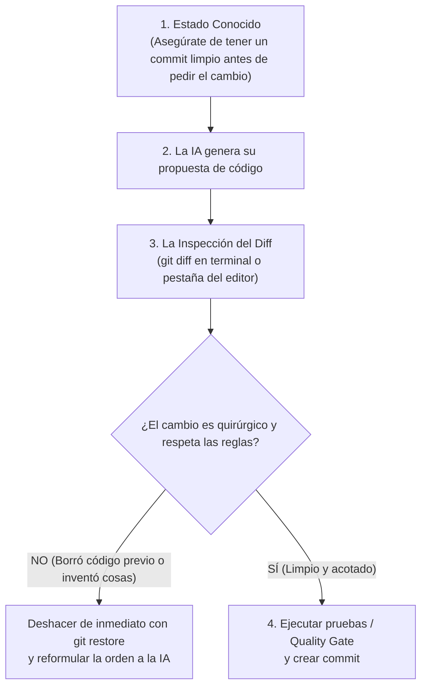

# 🔍 El Flujo Sagrado con IA: Inspeccionar Siempre el Diff

> *"Aceptar ciegamente lo que un modelo de IA escribió en tus archivos sin mirar las diferencias es como firmar un contrato legal con los ojos vendados."*

---

## 🟥🟩 ¿Qué es un "Diff"?

La palabra **diff** viene de *difference* (diferencia).  
Es la herramienta más poderosa de la ingeniería de software: te muestra en un solo vistazo exactamente qué líneas se borraron y qué líneas se agregaron entre tu versión anterior y la versión nueva:

```diff
- const total = subtotal + impuestos;       // 🟥 En rojo: lo que se eliminó
+ const total = calcularTotalConDescuento(subtotal, cupo); // 🟩 En verde: lo que se agregó
```

---

## 🪜 El Bucle de 4 Pasos Antes de Aceptar Cambios

Cuando le pidas a cualquier modelo (Cursor, Claude, Antigravity) modificar un archivo, sigue religiosamente este protocolo:



---

## 🚨 La Lista de Verificación al Mirar un Diff

Cuando estés viendo las líneas rojas y verdes en tu pantalla, busca estos **4 síntomas de peligro**:

1. **¿Borrados masivos no solicitados?**  
   Si pediste cambiar el color de un botón y ves 40 líneas rojas que desaparecieron de otra función: **rechaza el cambio inmediatamente**.
2. **¿Archivos que no tenían nada que ver?**  
   Si pediste editar la pantalla de login y el diff muestra modificaciones en la carpeta de base de datos o en `package.json`: detén la operación.
3. **¿Secretos o contraseñas en texto plano?**  
   Si la IA puso `const apiKey = "sk_..."` directamente en el archivo en verde: recházalo y exígele usar variables de entorno `.env`.
4. **¿Atajos con `any` o `@ts-ignore`?**  
   Comprueba que no haya tapado errores de compilación ignorando los tipos.

---

## 💻 El Comando Esencial
Para ver el diff en tu terminal en cualquier momento:
```bash
git diff
```
O para ver únicamente la lista de nombres de archivos que la IA tocó:
```bash
git status -s
```
Si algo no te gusta, no intentes borrarlo a mano línea por línea: usas la máquina del tiempo de Git.
