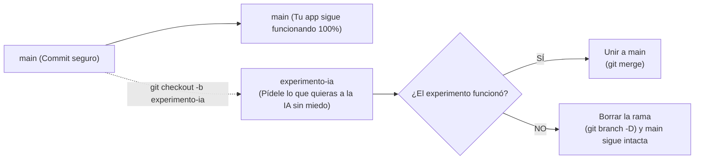

# 🌿 Ramas Ligeras: Un Laboratorio Aislado para Experimentos

> *"Una rama de Git es una realidad paralela: puedes pedirle a la IA que intente una locura técnica en esa realidad alternativa; si sale bien, la unes a tu mundo; si sale mal, simplemente destruyes esa realidad sin que tu código principal sufra un rasguño."*

---

## 🔬 ¿Qué es una Rama (`branch`)?

Por defecto, tu proyecto vive en una rama principal llamada `main`.  
Imagina que quieres pedirle a la IA:  
*«Quiero cambiar toda la librería de diseño de CSS puro a Tailwind CSS a ver cómo queda»*.

Hacer eso directamente en `main` es un peligro enorme: si la IA se traba a la mitad, tu aplicación quedará con estilos rotos durante horas.

### La Solución: El Laboratorio Aislado
En lugar de experimentar sobre `main`:



---

## 🛠️ Cómo se Hace en 3 Comandos Fáciles

### 1. Abre el laboratorio paralelo:
```bash
git checkout -b experimento-estilos
```
Ahora estás en una copia aislada de tu proyecto. Tu código en `main` está blindado.

### 2. Deja que la IA trabaje:
Pídele el cambio arriesgado, prueba en el navegador, experimenta todo lo que quieras.

### 3. Toma tu decisión:

* **Caso A: Salió perfecto y te encanta:**  
  Vuelves a tu rama principal y unes los cambios:
  ```bash
  git checkout main
  git merge experimento-estilos
  ```

* **Caso B: Fue un desastre y no te gustó:**  
  Vuelves a la rama principal y borras el experimento como si jamás hubiera existido:
  ```bash
  git checkout main
  git branch -D experimento-estilos
  ```

En ningún momento pusiste en riesgo tu aplicación que ya funcionaba. Este es el verdadero secreto de la experimentación ágil con Inteligencia Artificial.
