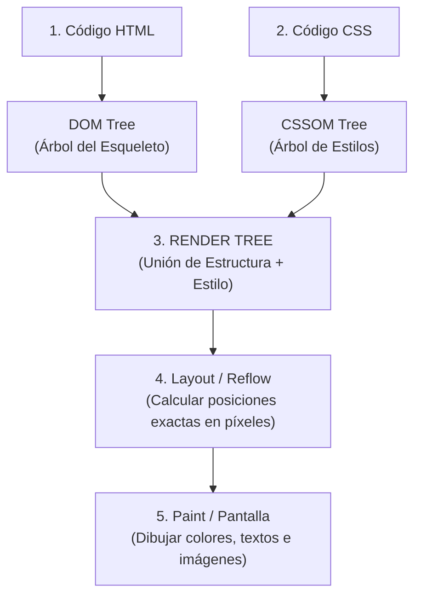

# 👁️ El Renderizado: Lo que Realmente Ve el Navegador

> *"El navegador no 'entiende' tu código como un humano: lo convierte en un árbol de objetos en memoria y luego lo pinta píxel por píxel 60 veces por segundo."*

---

## 🌳 El Árbol Invisible: El DOM y el CSSOM

Cuando el navegador descarga tu archivo HTML y CSS, no los muestra directamente en la pantalla. Pasa por tres pasos mecánicos fundamentales:

---

## ⚡ 3 Conceptos Clave para Evitar que tu Web Vaya Lenta

### 1. El DOM no es de piedra (JavaScript lo modifica)
Cuando haces un clic y JavaScript cambia un texto, estás alterando el **DOM (Document Object Model)**.
- Si cambias una sola letra de un botón: el navegador solo repinta ese botón.
- Si borras y vuelves a crear 500 elementos de golpe dentro de un bucle: el navegador tiene que recalcular la posición de toda la página (*Reflow masivo*), congelando el scroll y la pantalla.

### 2. La trampa del parpadeo (Layout Shift)
¿Alguna vez has entrado a una página donde ibas a tocar un botón, y de repente una imagen cargó tarde, empujó todo hacia abajo e hiciste clic en la publicidad por accidente?
- Esto ocurre porque no le definiste el tamaño a la imagen en el HTML (`width="400" height="250"`).
- Al dejarlo vacío, el navegador asume un tamaño de cero píxeles hasta que la imagen termina de descargarse, provocando un salto brusco.

### 3. El peso de los scripts (Bloqueo del render)
Si colocas tus etiquetas `` arriba del todo en el `<head>` sin el atributo `defer`, el navegador **detiene por completo la pintura de la página** hasta terminar de descargar ese archivo.
- El usuario ve una pantalla blanca durante 3 segundos y se va de tu sitio.
- **La regla:** Carga los scripts con `defer` o al final del `<body>` para que el esqueleto y los estilos aparezcan primero en pantalla.
