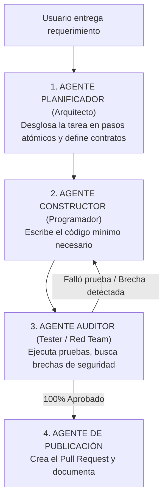

# ☁️ Orquestación Multiagente y Plataformas en la Nube: Orca y Más Allá

> *"Poner a 5 agentes de IA a hablar entre sí sin un árbitro estricto no es una empresa autónoma: es una reunión improductiva que te quema \$50 dólares en tokens en 10 minutos."*

---

## 👥 ¿Qué es un Sistema Multiagente?

Un **Sistema Multiagente (SMA)** es una arquitectura donde en lugar de pedirle a un solo modelo que haga todo (investigar, diseñar, programar, auditar y documentar), creas un **equipo de agentes especializados** con roles y herramientas distintas que colaboran entre sí:

---

## ☁️ Plataformas Multiagente en la Nube: Orca, CrewAI y LangGraph

Cuando los agentes necesitan correr de forma continua en internet sin depender de que tu laptop personal esté encendida, se recurre a plataformas de orquestación en la nube:

* **Orca y Entornos Cloud Agénticos:**  
  Plataformas que ejecutan flujos de agentes en contenedores remotos aislados. Pueden activarse mediante un webhook (por ejemplo, cuando alguien abre un Issue en GitHub) y trabajar de madrugada revisando código.
* **CrewAI / AutoGen / LangGraph:**  
  Librerías de código abierto que permiten definir agentes con personalidades, metas y herramientas (buscar en Google, consultar PostgreSQL, enviar correos) y coordinar el traspaso de información (*handoff*).

---

## ⚠️ Los 3 Peligros Mortales del Hype Multiagente

Muchos principiantes se entusiasman con la idea de "un ejército de agentes trabajando solos" y sufren accidentes costosos:

### 1. El Bucle Infinito de Charlatanería (Token Burning)
Si el Agente A le dice al Agente B: *«Por favor revisa esto»*, y el Agente B le responde: *«Me parece bien, pero ¿qué opinas de este detalle?»*, y no pusiste un límite estricto de iteraciones:
- Se quedarán conversando en un bucle infinito toda la noche.
- Al despertar, tu factura de API habrá consumido cientos de dólares en mensajes circulares inútiles.

### 2. Dilución de Responsabilidad
Cuando algo se rompe en un sistema de 4 agentes, es extremadamente difícil saber cuál de los cuatro tomó la mala decisión o dónde se corrompió el dato original.

### 3. Pérdida de Determinismo
El código tradicional (un script de Python o Node bien escrito) es 100% predecible y cuesta \$0 USD. Usar un agente para hacer lo que un script de 10 líneas puede hacer de forma fija es derroche técnico.

---

## 💎 La Regla de Oro Multiagente
> **Nunca uses tres agentes si uno solo con un buen arnés (`AGENTS.md` + Quality Gate) puede resolver el problema.**  
> Si usas múltiples agentes, diseña flujos unidireccionales (DAG) con un máximo estricto de 3 iteraciones y compuertas de parada automáticas.
