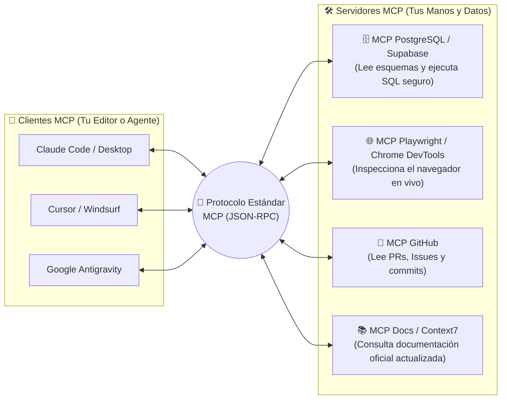

# 🔌 ¿Qué es MCP (Model Context Protocol)? El Puerto USB-C de la IA

> *"Antes del puerto USB, cada impresora, teclado, cámara y teléfono tenía un cable y un enchufe completamente distintos. El protocolo MCP es el estándar universal que permite conectar cualquier herramienta o base de datos a cualquier agente de IA con un solo enchufe."*

---

## 🧩 1. El Problema que Resuelve MCP

Imagina que quieres que tu asistente de programación (Cursor, Claude Code, Antigravity o Windsurf) pueda:
- Consultar directamente las tablas de tu base de datos en **Supabase / PostgreSQL**.
- Leer los tickets pendientes de tu equipo en **GitHub Issues o Linear**.
- Abrir un navegador real con **Playwright** para probar tu página web y tomar capturas de pantalla.

Antes de **MCP (*Model Context Protocol*)**, cada editor tenía que programar integraciones a medida para cada servicio del mundo. Si cambiabas de editor o de modelo, perdías todas tus conexiones.



Con **MCP**, cualquier servicio publica un pequeño **Servidor MCP** una sola vez, y automáticamente todos los agentes y editores del mercado saben cómo hablar con él.

---

## 🏆 2. Los 4 Servidores MCP que Sí Valen la Pena en tus Proyectos

No instales 30 servidores MCP (recuerda que cada herramienta extra consume tokens de la ventana de contexto de tu modelo). Estos son los **4 conectores esenciales** que multiplican tu velocidad real:

| Servidor MCP | ¿Para qué sirve en la trinchera? | Cuándo activarlo |
|---|---|---|
| **1. Playwright / Chrome DevTools MCP** | Le da "ojos" a tu agente: abre tu web local, hace clic en botones, lee errores de la consola F12 y verifica que el diseño no esté roto. | Al construir o depurar interfaces UI/UX y flujos de frontend. |
| **2. Postgres / Supabase MCP** | Permite que el agente inspeccione las columnas reales de tus tablas y verifique políticas RLS sin que tengas que copiar y pegar esquemas en el chat. | Al diseñar consultas, migraciones o auditar bases de datos. |
| **3. GitHub / Git MCP** | Permite revisar Pull Requests, leer el historial de issues y auditar ramas directamente desde el flujo del agente. | En trabajo colaborativo o revisión de código automatizada. |
| **4. Contexto de Documentación Actualizada** | Inyecta la documentación oficial reciente de librerías (Next.js, Stripe, Tailwind) para evitar que la IA invente funciones de hace 2 años. | Al integrar SDKs que cambian frecuentemente de versión. |

---

## 🛠️ 3. Cómo Crear tu Propio Servidor MCP para tu Negocio

Más allá de usar servidores de terceros, puedes crear un **Servidor MCP propio en menos de 30 líneas** (en TypeScript o Python) para que tu agente interno consulte datos de tu empresa:

```typescript
// Ejemplo conceptual de un Servidor MCP minimalista en TypeScript
import { McpServer } from "@modelcontextprotocol/sdk/server/mcp.js";
import { z } from "zod";

const server = new McpServer({
  name: "mcp-inventario-interno",
  version: "1.0.0",
});

// Exponemos una herramienta con contrato estricto Zod
server.tool(
  "consultar_stock_producto",
  "Consulta las unidades disponibles de un SKU en el almacén central",
  { sku: z.string().min(3).max(20) },
  async ({ sku }) => {
    const stock = await db.inventario.obtenerPorSku(sku);
    if (!stock) {
      return {
        isError: true,
        content: [{ type: "text", text: `Error: El SKU ${sku} no existe.` }],
      };
    }
    return {
      content: [{ type: "text", text: JSON.stringify(stock) }],
    };
  }
);
```

---

## 🛡️ 4. Las 3 Reglas de Seguridad Obligatorias al Usar MCP

Un servidor MCP ejecuta código real en tu máquina con tus permisos. Nunca olvides estas tres reglas de higiene:

1. **Conexiones en Modo Solo-Lectura (*Read-Only*) por Defecto:**  
   Cuando conectes un MCP de PostgreSQL a una base de datos importante, úsalo con un usuario de base de datos que **solo tenga permiso `SELECT`**. Jamás conectes un MCP con credenciales de superusuario a tu base de datos de producción en vivo.
2. **Cuidado con Servidores MCP Desconocidos:**  
   Un servidor MCP descargado de un repositorio dudoso con `npx paquete-desconocido-mcp` tiene acceso a tus archivos locales y variables de entorno. Usa únicamente servidores oficiales verificados o auditados por ti.
3. **Apaga los MCPs que no uses en la sesión actual:**  
   Si cada servidor MCP inyecta 15 definiciones de herramientas en el prompt del sistema, tener 10 servidores encendidos al mismo tiempo consumirá miles de tokens en cada mensaje y confundirá al modelo. Mantén activos solo los 2 o 3 que necesites.
