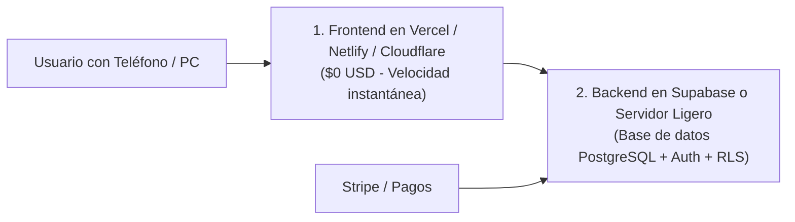

# 🍎 ¿Qué es un Hosting vs. VPS vs. Serverless?

> *"No le pagues \$100 dólares al mes a un proveedor de servidores si tu sistema solo necesita un escaparate gratuito en la calle."*

---

## 🏘️ La Gran Comparación Cotidiana de Servidores

Toda aplicación necesita vivir en algún lugar conectado a internet las 24 horas del día. Existen tres modelos principales:

| Modelo | Analogía Cotidiana | ¿Qué es técnicamente? | ¿Cuándo usarlo? | Costo Típico |
|---|---|---|---|---|
| **Hosting Estático / Edge** *(Vercel, Netlify, Cloudflare Pages)* | **Un escaparate de carteles en la plaza.** Solo exhibe afiches fijos; no hay cocina adentro. | Red mundial de servidores (CDN) que reparten tus archivos HTML, CSS y JS ya compilados a ultra velocidad. | Para la web pública, landings, dashboards frontend, blogs. | **$0 USD / mes** (Nivel gratuito muy generoso) |
| **VPS (Servidor Privado Virtual)** *(Hetzner, DigitalOcean, Linode)* | **Tu propia oficina o apartamento alquilado 24/7.** Tienes tu propia llave y haces lo que quieras adentro. | Una máquina Linux virtual con su propia CPU, RAM y disco duro donde puedes correr procesos continuos. | Bots de WhatsApp/Telegram, tareas cron continuas, bases de datos propias. | **$4 – $10 USD / mes** |
| **Serverless / Funciones Cloud** *(Supabase Edge Functions, AWS Lambda)* | **Un chef a domicilio que solo viene 30 segundos, cocina un plato y se va.** | Servidores que solo se encienden durante los milisegundos exactos que tarda tu función en ejecutarse. | Procesar webhooks de pagos, enviar correos, validar tokens. | **$0 USD** para los primeros 500,000 llamados |

---

## 🗺️ La Combinación Ganadora para Empezar

Para el 95% de los proyectos asistidos por IA, la combinación más económica, rápida y profesional es la siguiente:

* **Cero mantenimiento de servidores:** No tienes que preocuparte por actualizar parches de seguridad de Linux ni configurar cortafuegos complejos al empezar.
* **Coste $0 USD:** Puedes lanzar tu producto al mercado y validar si a la gente le interesa antes de gastar un solo centavo de tu bolsillo.
