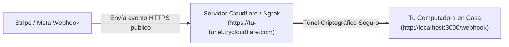

# 🚇 Túneles con Cloudflare y Ngrok: Probar Webhooks en Casa sin Servidores

> *"No necesitas pagar un VPS ni configurar un dominio público solo para probar un webhook de WhatsApp o Stripe un sábado por la tarde."*

---

## 🔒 El Problema del "Localhost"

Cuando programas en tu computadora, tu servidor corre en `http://localhost:3000`.
- Para ti, es visible en tu pantalla.
- Pero para Meta, Stripe o Google, tu computadora está oculta detrás del router de tu casa (dirección IP privada).
- Cuando Stripe intenta enviarte el aviso de pago, **se estrella contra la pared de tu router porque no puede entrar a tu habitación**.

---

## 🕳️ La Solución: Un Túnel Seguro hacia Internet

Un servicio de túnel (como **Cloudflare Tunnel** o **Ngrok**) crea un conducto seguro y encriptado desde tu computadora hacia un servidor público en la nube:



---

## ⚡ Cómo Usar Cloudflare Tunnel Gratis (Sin Registro)

Cloudflare ofrece una herramienta gratuita llamada `cloudflared`:
1. La descargas y ejecutas este simple comando en tu terminal:
   ```bash
   cloudflared tunnel --url http://localhost:3000
   ```
2. La terminal te entregará una URL pública segura:
   ```text
   https://aleatorio-subdominio-123.trycloudflare.com
   ```
3. Copias esa URL y la pegas en el panel de desarrollador de WhatsApp o Stripe:  
   `https://aleatorio-subdominio-123.trycloudflare.com/webhook`
4. ¡Listo! En cuanto hagas una compra de prueba o envíes un mensaje de WhatsApp, el evento llegará en milisegundos directamente al terminal de tu computadora en casa, permitiéndote depurar y colocar puntos de interrupción sin gastar un solo dólar en servidores.
