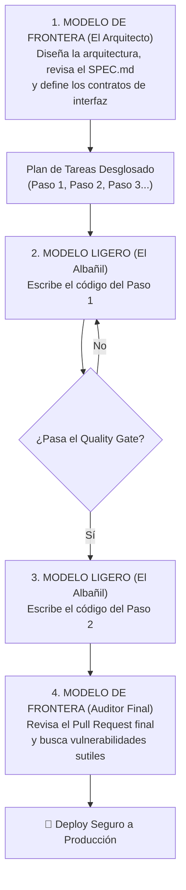

# 🔄 El Flujo Híbrido: Máximo Ahorro y Eficiencia

> *"El mejor desarrollador con IA no es quien usa el modelo más caro todo el tiempo, sino quien sabe armar una cadena de relevos donde cada modelo juega en su posición natural."*

---

## 🏃‍♂️ La Estrategia de Relevos: El Flujo Arquitecto-Albañil

Imagina una obra en construcción:  
No pagas los honorarios del arquitecto jefe para que cargue sacos de cemento durante 8 horas al día. El arquitecto dibuja los planos maestros y verifica la resistencia estructural; los albañiles colocan los ladrillos con rapidez y precisión.

En el desarrollo asistido, este relevo funciona exactamente igual:



---

## 📋 Cómo Ejecutar este Flujo en tu Día a Día

### Sesión 1: Con el Modelo Fuerte (Inicio del Sprint)
- **Herramienta:** Modelo de Frontera (ej. Sonnet / GPT-o1).
- **Prompt:**  
  > *"Aquí tienes mi SPEC.md. Desglosa la implementación en 4 tareas atómicas e independientes. Para cada tarea, define exactamente qué archivo tocar y cuál es el resultado esperado en pruebas."*
- **Entregable:** Una lista de tareas clara y acotada.

### Sesión 2: Con el Modelo Rápido (Construcción Mecánica)
- **Herramienta:** Modelo Ligero (ej. Flash-Lite / GPT-4o-mini / Haiku).
- **Prompt:**  
  > *"Implementa únicamente la Tarea #1 de la lista: crear la función `calcularTotalCarrito(items)`. Debe validar que los precios no sean negativos y retornar un número entero en centavos."*
- **Entregable:** Código rápido, sin gastar tokens costosos.

### Sesión 3: El Quality Gate (El Juez Imparcial)
- Corres tu script de pruebas local:
  ```bash
  npm test # o python -m pytest
  ```
- Si la prueba pasa en 1 segundo, avanzas a la Tarea #2.

### Sesión 4: La Auditoría de Cierre
- Cuando las 4 tareas están listas, vuelves al modelo fuerte para una última inspección:
  > *"Aquí tienes el diff completo de los cambios. Revisa si dejamos alguna llave expuesta, algún bucle ineficiente o alguna fuga de memoria."*

---

## ⚠️ La Trampa de los Reintentos (The Retry Tax)

No caigas en la trampa simplista de pensar que usar el modelo más barato siempre ahorra dinero:

> **Un modelo económico que cuesta 10 veces menos pero necesita 5 intentos fallidos, genera código con errores y te hace perder 20 minutos corrigiendo, termina saliendo mucho más caro que un modelo de frontera que resuelve el problema en una sola llamada.**

El coste real de una tarea depende de:
- **Tokens de entrada y salida acumulados** (sumando todos los reintentos).
- **Longitud del contexto** (si el chat se alarga, cada llamada envía más tokens repetidos).
- **Tasa de éxito a la primera (First-Pass Accuracy).**
- **Tu tiempo humano** revisando y depurando código defectuoso.

---

## 📊 Metodología de Medición Empírica

En lugar de asumir ahorros mágicos en el vacío, aplica esta sencilla metodología de evaluación:

1. **Aísla una tarea concreta:** Por ejemplo, *"escribir un conversor de fechas con 5 casos de prueba"*.
2. **Evalúa con el modelo ligero:** Registra si pasó las pruebas al primer intento, cuántos tokens consumió y cuánto tardó.
3. **Evalúa con el modelo de frontera:** Registra los mismos datos.
4. **Analiza el balance real:** Si el modelo ligero pasa la prueba en 1 o 2 llamadas, es la opción ganadora. Si tropieza más de 3 veces, eleva la tarea al modelo más capaz sin dudarlo.

