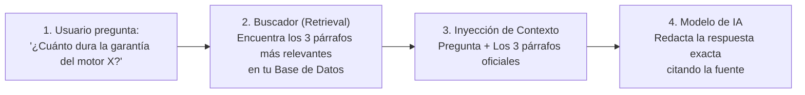
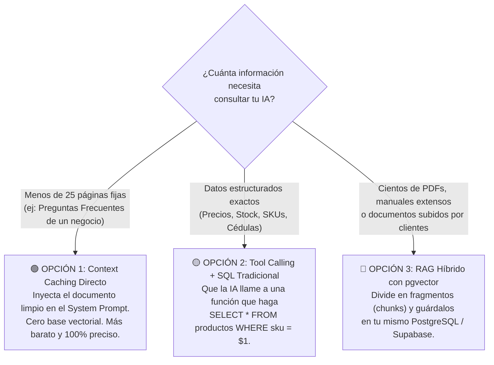

# 📚 RAG y Bases Vectoriales Explicados con Manzanas

> *"Un modelo de lenguaje sabe mucho sobre el mundo en general, pero no sabe absolutamente nada sobre los contratos privados de tu empresa, el catálogo actualizado de tu tienda ni las pólizas de tus clientes. RAG es el arte de abrirle el libro en la página exacta antes de que responda."*

---

## 📖 1. ¿Qué es RAG (*Retrieval-Augmented Generation*)?

Imagina que contratas a un abogado brillante recién graduado:
- **Sin RAG (De memoria):** Le preguntas: *«¿Cuál es la cláusula de penalización en el contrato del cliente Pérez firmado ayer?»*. Como no lo tiene en su memoria, o te dice que no sabe, o **alucina una respuesta inventada para quedar bien**.
- **Con RAG (A libro abierto):** Antes de que el abogado hable, un asistente busca en el archivero la carpeta del cliente Pérez, saca el párrafo exacto de la cláusula 4 y se lo pone sobre el escritorio diciendo: *«Responde a la pregunta del cliente basándote EXCLUSIVAMENTE en este párrafo»*.



---

## 🛒 2. ¿Qué es un *Embedding* y por qué el Buscador Normal a veces Falla?

Si en una base de datos tradicional buscas la palabra `"reembolso"` con `WHERE texto LIKE '%reembolso%'`, pero tu manual de políticas dice `"devolución del dinero"`, **la búsqueda tradicional devuelve 0 resultados** porque las palabras no coinciden letra por letra.

### La Analogía del Supermercado (*Embeddings*):
Un modelo de **Embeddings** convierte cualquier frase en una lista de coordenadas numéricas (por ejemplo: `[0.12, -0.84, 0.45...]`) que representan su **significado**, como si acomodaras productos en los pasillos de un supermercado:
- Las palabras *"Reembolso"*, *"Devolución de dinero"* y *"Reintegro de pago"* quedan guardadas en el mismo estante (muy cerca matemáticamente), aunque no compartan las mismas letras.
- Cuando el usuario pregunta *"¿Cómo me devuelven mi plata?"*, la base de datos busca qué párrafos están **más cerca en ese mapa de significado** y los encuentra al instante.

---

## 🧭 3. El Árbol de Decisión Pragmático: ¿Cuándo SÍ y Cuándo NO usar RAG?

Uno de los errores más costosos es instalar bases de datos vectoriales complejas para problemas que se resuelven en 5 líneas:



> [!TIP]
> **No pagues dos bases de datos si ya tienes PostgreSQL:**  
> No necesitas contratar servicios externos costosos como Pinecone para empezar. PostgreSQL (y Supabase gratis) incluye la extensión nativa **`pgvector`**, que te permite guardar tus tablas normales de usuarios y tus vectores de búsqueda semántica en el mismo lugar, protegidos por las mismas reglas de seguridad RLS.  
> *(Consulta la plantilla lista para usar en [`templates-plug-and-play/rag-pgvector-starter.sql`](../../templates-plug-and-play/rag-pgvector-starter.sql)).*

---

## 🛡️ 4. Las 3 Reglas de Oro para un RAG que NO Alucina (*Corrective RAG*)

1. **Fragmentación con Contexto (*Chunking* inteligente):**  
   Nunca cortes un PDF a machetazos cada 500 caracteres dejando frases a la mitad. Divide por secciones o párrafos completos (300 a 600 palabras) dejando un pequeño traslape (*overlap*) del 10% entre un fragmento y el siguiente para no perder el hilo.
2. **La Cláusula de Honestidad Obligatoria (Freno de Mano):**  
   El prompt de tu RAG siempre debe incluir este candado determinista:
   ```text
   REGLA ESTRICTA: Responde a la pregunta del usuario utilizando ÚNICAMENTE la información 
   proporcionada dentro de las etiquetas <contexto_oficial>. 
   Si la respuesta no se encuentra explícitamente en <contexto_oficial>, responde textualmente:
   "No dispongo de esa información en la documentación oficial" y NO intentes adivinar.
   ```
3. **Aislamiento Multi-Cliente (*Tenant Isolation*):**  
   Si el Cliente A sube sus contratos privados y el Cliente B sube los suyos, la consulta vectorial **debe filtrar primero por `WHERE user_id = $1`** antes de calcular la similitud semántica. Jamás mezcles embeddings de distintos clientes sin filtro de propiedad.
