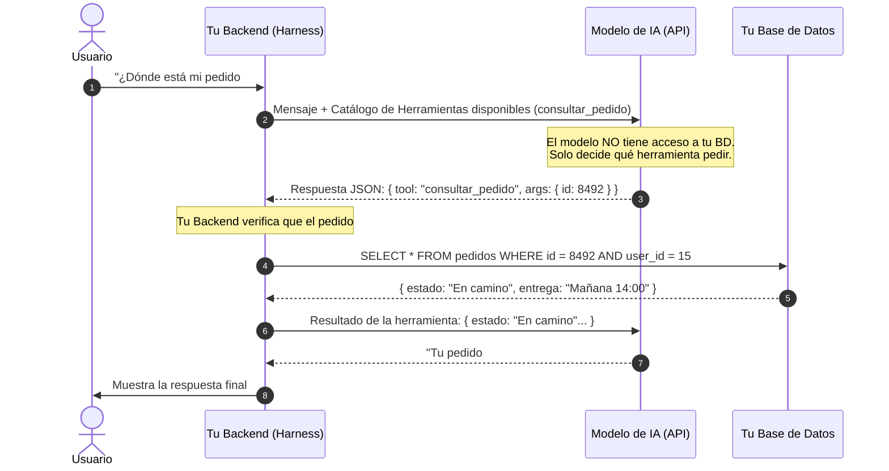

# 🧱 Salidas Estructuradas (JSON Garantizado) y Tool Calling

> *"Si conectas la respuesta de un modelo de IA a tu backend usando `JSON.parse()` y rezando para que el modelo no agregue un saludo antes del JSON, tu aplicación se romperá en producción el primer día."*

---

## 💥 1. El Problema del `JSON.parse()` Frágil

Cuando integras IA dentro de una aplicación real (por ejemplo, para leer la foto de una factura y guardar el monto en tu base de datos, o para clasificar el sentimiento de un reclamo), tu código necesita **datos estructurados exactos**, no una charla amistosa.

Si solo se lo pides por texto en el prompt (*"Devuelve únicamente un JSON sin explicaciones"*), el 98% de las veces funcionará, pero en el 2% restante el modelo responderá:
```text
¡Con mucho gusto! Aquí tienes los datos extraídos de la factura:
```json
{
  "proveedor": "Energía S.A.",
  "total": "1,250.00" // ¡Devolvió un string con coma en vez de un número!
}
```
```
En ese instante, tu `JSON.parse()` lanza una excepción fatal y el proceso de tu usuario se cae.

---

## 🔒 2. La Solución Definitiva: *Structured Outputs* (Esquemas Forzados)

Las APIs modernas (OpenAI, Gemini, Anthropic y OpenRouter) soportan **Salidas Estructuradas Garantizadas (*Structured Outputs*)**.

En lugar de pedirle el formato "por favor" en el prompt, le pasas un **esquema matemático (`Zod` en TypeScript o `Pydantic` en Python)** al motor de inferencia. El motor bloquea físicamente cualquier token que no cumpla con tu esquema:

```typescript
import { z } from 'zod';

// 1. Definimos el contrato de hierro de lo que necesitamos recibir
const FacturaExtraidaSchema = z.object({
  proveedor: z.string().describe("Nombre legal de la empresa emisora"),
  fecha_emision: z.string().describe("Fecha en formato YYYY-MM-DD"),
  moneda: z.enum(["USD", "EUR", "MXN", "CLP", "COP"]),
  subtotal_centavos: z.number().int().nonnegative(),
  impuestos_centavos: z.number().int().nonnegative(),
  total_centavos: z.number().int().positive(),
  es_factura_valida: z.boolean()
}).strict();

// 2. Validación de cordura matemática en tu propio código (Harness)
function verificarConsistenciaContable(factura: z.infer<typeof FacturaExtraidaSchema>) {
  const sumaCalculada = factura.subtotal_centavos + factura.impuestos_centavos;
  if (sumaCalculada !== factura.total_centavos) {
    throw new Error(
      `Discrepancia contable detectada: Subtotal (${factura.subtotal_centavos}) + Impuestos (${factura.impuestos_centavos}) != Total (${factura.total_centavos})`
    );
  }
  return true;
}
```

> [!IMPORTANT]
> **Doble Verificación (Esquema + Lógica):**  
> Que el JSON tenga los tipos correctos (`number`, `string`) **no significa que la matemática interna sea correcta**. Si extraes facturas o cotizaciones con IA, valida siempre con un `if` tradicional que `subtotal + impuestos === total` antes de guardar en la base de datos.

---

## 🛠️ 3. ¿Cómo Funciona el *Tool Calling* (Llamada a Herramientas) bajo el Capó?

Existe un mito común: creer que cuando le das una herramienta a un LLM, *"el modelo se mete a tu base de datos y ejecuta la función"*. **Eso es falso.**

El modelo nunca ejecuta código directamente. El flujo real ocurre en **4 pasos controlados por tu servidor**:



### Las 3 Reglas de Oro del Tool Calling Seguro:
1. **Nunca pases el `userId` como un argumento que decide el modelo:** Si la herramienta es `consultar_mis_facturas`, el `userId` **lo inyecta tu propio backend desde la sesión autenticada**, jamás se lo pidas al modelo como parámetro (evita que un Prompt Injection consulte las facturas de otro usuario).
2. **Solo herramientas de lectura o acciones reversibles en automático:** Las herramientas que borran datos, realizan transferencias o envían mensajes masivos deben detenerse y pedir confirmación en la interfaz.
3. **Límite de iteraciones:** Si el modelo pide llamar herramientas en bucle, pon un contador máximo de `3 llamadas por turno` para evitar bucles infinitos.
