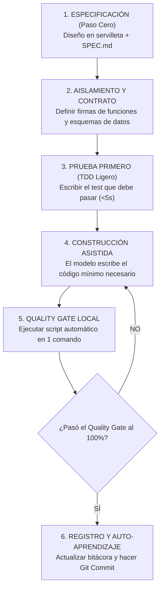

# 🔄 El Ciclo SDLC Agéntico en 6 Pasos

> *"El desarrollo asistido no es un río desbordado sin cauce; es un ciclo disciplinado de pasos cortos, verificables y seguros."*

---

## 🧭 Las 6 Fases del Ciclo de Vida del Software con IA

El ciclo tradicional de desarrollo de software (SDLC) se transforma en un flujo ágil de 6 pasos cuando trabajas mano a mano con agentes de Inteligencia Artificial:



---

### Fase 1: Especificación (Paso Cero)
Nunca empieces sin saber a dónde vas. Lee el `SPEC.md`, define qué vas a construir y qué NO vas a tocar.

### Fase 2: Aislamiento y Contrato
Antes de codificar, acuerda con la IA la **firma de la función**:
- ¿Qué argumentos recibe? (ej. `email: string`, `monto_centavos: number`).
- ¿Qué devuelve exactamente? (ej. `{ exito: boolean, id_transaccion: string }`).

### Fase 3: La Prueba Primero (TDD Ligero)
Crea una prueba pequeña que verifique el contrato acordado. Al principio la prueba dará **ROJO** (porque la función aún no existe).

### Fase 4: Construcción Asistida
Dile a la IA:  
> *"Escribe únicamente el código necesario para que la prueba que acabamos de definir pase a color VERDE. No agregues funciones extra ni reescribas otros archivos."*

### Fase 5: Quality Gate Local
Corres tu script de verificación en un solo comando:
```bash
npm run quality-gate # o python scripts/quality_gate.py
```
Si el script pasa en 3 segundos sin errores de tipos, pruebas rotas ni llaves expuestas, el cambio es sólido.

### Fase 6: Registro y Auto-Aprendizaje
Si durante el proceso descubriste un bug o un comportamiento extraño del modelo, lo anotas en tu catálogo 5-Whys y guardas tu trabajo con un mensaje de git limpio y descriptivo:
```bash
git commit -m "feat: implementar validacion de idempotencia en webhooks de Stripe"
```
