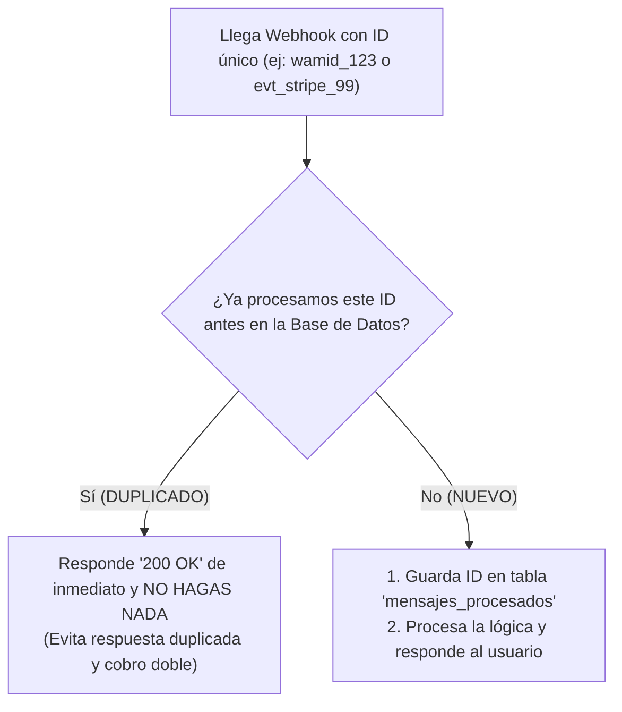

# 🔐 Idempotencia: Cómo Evitar Cobros Dobles y Respuestas Duplicadas

> *"Idempotencia significa que presionar el botón de encendido 10 veces seguidas deja el televisor encendido una sola vez, en lugar de encenderlo y apagarlo como loco."*

---

## 😱 La Pesadilla del Mensaje Duplicado

Imagina esta escena cotidiana en internet:
1. Meta te envía un webhook con un mensaje de WhatsApp de un cliente que pregunta: *«¿Cuánto cuesta el plan mensual?»*.
2. El mensaje lleva un identificador único de mensaje: `wamid.HBgLM...`.
3. Tu servidor recibe el mensaje, pero tarda 6 segundos en procesar la respuesta con IA.
4. Meta, al ver que tardaste más de 5 segundos en responder con un código `200 OK`, asume que el mensaje se perdió en el camino y **vuelve a enviar el mismo mensaje exactamente 3 segundos después**.
5. Tu servidor vuelve a procesarlo, cobra el saldo de tokens dos veces y le responde dos veces al cliente:  
   *«El plan cuesta $20»*  
   *«El plan cuesta $20»*

En el peor de los casos (con pasarelas de pago), ¡podrías cobrarle dos veces la misma tarjeta al cliente por un retraso de red!

---

## 🛡️ La Solución: El Cerrojo de Idempotencia

La **Idempotencia** es la garantía de que ejecutar la misma operación una o diez veces produce exactamente el mismo resultado seguro:



---

## 💻 El Patrón en Código (Simple y Efectivo)

En tu base de datos sólo necesitas una tabla sencilla con restricción única:

```sql
CREATE TABLE eventos_procesados (
    id TEXT PRIMARY KEY, -- El wamid o evt_id único
    procesado_en TIMESTAMP DEFAULT NOW()
);
```

Y en tu backend:
```javascript
async function procesarWebhook(evento) {
  const eventoId = evento.id;
  
  // Intentamos registrar el ID del evento
  const { error } = await db.from('eventos_procesados').insert({ id: eventoId });
  
  if (error && error.code === '23505') { 
    // Código 23505 = Clave duplicada en PostgreSQL
    console.log(`Evento ${eventoId} ya fue procesado anteriormente. Descartando reintento.`);
    return { status: 200, mensaje: 'Ignorado por idempotencia' };
  }

  // Si no estaba duplicado, ejecutamos la acción sensible de forma segura
  await ejecutarLogicaDeNegocio(evento);
  return { status: 200, mensaje: 'Procesado con éxito' };
}
```

Con estas 10 líneas de código, blindas tu sistema contra el 100% de los reintentos duplicados de Meta, Stripe o Shopify.
