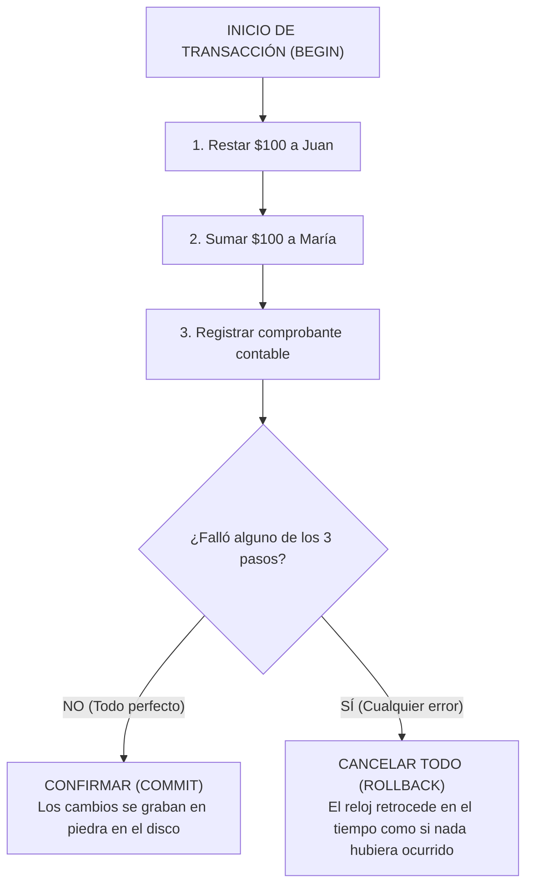

# ⚖️ Atomicidad ACID: La Regla de Oro del Todo o Nada

> *"O se completa toda la operación, o no se hace absolutamente nada. En el dinero y en los datos no existen los puntos medios."*

---

## 🏦 La Tragedia de la Transferencia a Medias

Imagina que estás transfiriendo \$100 dólares de la cuenta de Juan a la cuenta de María:
1. Tu código le resta \$100 a Juan.  
   *(El saldo de Juan baja exitosamente de \$500 a \$400).*
2. En ese instante exacto, **se corta la luz en el servidor**, o la red falla, o se agota la memoria.
3. El paso 2 (sumarle \$100 a María) **nunca se ejecuta**.

¿Cuál es el resultado?  
Juan perdió \$100, María nunca los recibió y ese dinero desapareció en el limbo del sistema. Has creado un desastre contable.

---

## ⚛️ ¿Qué es la Atomicidad (La 'A' de ACID)?

En física, la palabra *átomo* significaba originalmente "indivisible".  
En bases de datos relacionales (como PostgreSQL, MySQL o SQLite), una **Transacción Atómica** es un paquete de instrucciones que se ejecutan como una unidad única e indivisible:



---

## 💡 Cómo Aplicar Transacciones en la Práctica

En SQL estándar:
```sql
BEGIN; -- Iniciamos el bloque atómico

UPDATE cuentas SET saldo = saldo - 100 WHERE usuario_id = 'juan_01';
UPDATE cuentas SET saldo = saldo + 100 WHERE usuario_id = 'maria_02';
INSERT INTO transferencias (de_usuario, a_usuario, monto) VALUES ('juan_01', 'maria_02', 100);

COMMIT; -- Si alguna de las 3 falló, la base de datos automáticamente ejecuta ROLLBACK
```

O usando funciones RPC en Supabase / PostgreSQL:
- En lugar de hacer 3 peticiones separadas desde JavaScript (`await supabase.from('cuentas').update(...)`), creas una pequeña función SQL en la base de datos y la llamas con `supabase.rpc('transferir_fondos', { ... })`.
- Toda la lógica ocurre dentro de una sola transacción atómica protegida por el motor.
- **Garantía absoluta:** Jamás tendrás estados inconsistentes ni saldos fantasmas.
