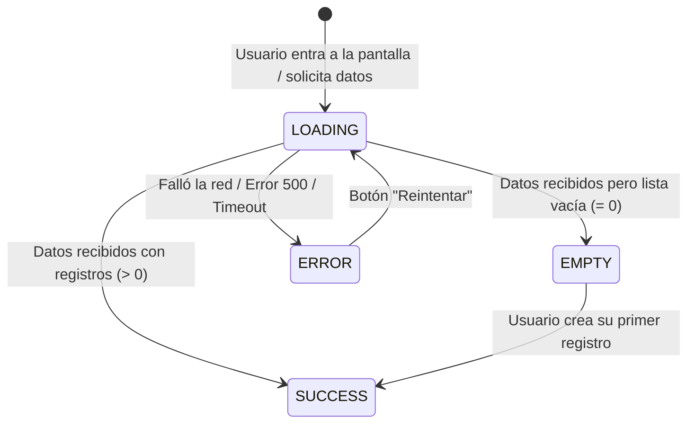

# 🎨 Los Cuatro Estados Sagrados de la UI: Loading, Empty, Error y Success

> *"La diferencia entre una aplicación amateur y una profesional no es el color de los botones, sino cómo reacciona la pantalla en los momentos en que las cosas tardan, no existen o fallan."*

---

## 🚫 El Pecado del "Happy Path" (El Camino Feliz)

Cuando le pides a una Inteligencia Artificial que cree una pantalla (por ejemplo, una lista de pedidos o un catálogo de productos), la IA siempre programa asumiendo el caso perfecto:
- Los datos cargan en 0 milisegundos.
- Siempre hay 10 productos en la lista.
- Nunca se corta el internet.
- Los pagos nunca son rechazados.

Esto se llama el **Happy Path**. En el mundo real, los usuarios navegan en 4G inestable en un autobús, abren su cuenta por primera vez (cuando aún no tienen ningún pedido creado), o su tarjeta de crédito no tiene fondos.

---

## 🏛️ Los Cuatro Estados Sagrados

Toda vista o componente que interactúe con datos debe contemplar obligatoriamente estos cuatro estados:

---

### 1. Estado Loading (Cargando)
* **El error amateur:** Dejar la pantalla congelada en blanco durante 2 segundos. El usuario cree que la app se trabó, hace clic 5 veces seguidas o cierra la pestaña.
* **El estándar:** Mostrar un esqueleto suave (*Skeleton Screen*) o un indicador sutil con texto: *"Cargando tus pedidos..."*. El botón de acción debe deshabilitarse y mostrar un micro-spinner.

### 2. Estado Empty (Vacío / Cero Datos)
* **El error amateur:** Mostrar una tabla completamente vacía o un cuadro gris sin texto.
* **El estándar:** Una ilustración amigable o icono con mensaje claro y llamada a la acción:  
  *«Aún no tienes pedidos registrados. ¡Explora nuestro catálogo y haz tu primera compra!»* con un botón directo a la tienda.

### 3. Estado Error (Fallo)
* **El error amateur:** Una alerta genérica fea en inglés: `Uncaught TypeError: Cannot read property 'map' of undefined` o silencio absoluto.
* **El estándar:** Mensaje humano y constructivo:  
  *«No pudimos cargar tus datos debido a un problema de conexión»*, acompañado de un botón claro de **[Reintentar]**.

### 4. Estado Success (Éxito)
* **El estándar:** La información renderizada de manera limpia, con contraste adecuado y jerarquía visual.

*(Revisa nuestro archivo de estilos CSS listo para copiar en [`templates-plug-and-play/ui-feedback-states.css`](../../templates-plug-and-play/ui-feedback-states.css)).*
