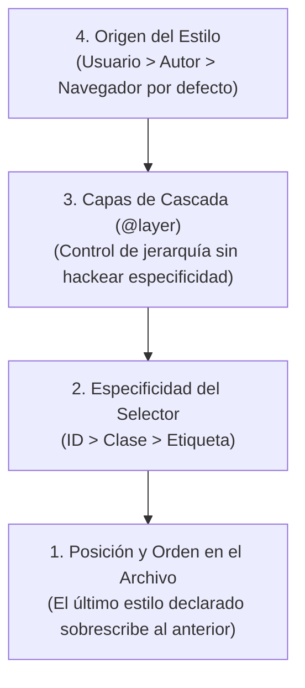

# 🛡️ Harness de UI/UX: La Ley de Cero `!important` y la Cascada Natural

> *"Usar `!important` en CSS es el equivalente arquitectónico a soldar las puertas de un coche con acetileno para que no se abran. Funciona hoy, pero mañana nadie podrá entrar."*

---

## 🌪️ Por Qué la IA Destruye el CSS si no la Gobiernas

Cuando trabajas con un asistente de Inteligencia Artificial (Cursor, Copilot, Claude Code o Antigravity), el modelo comete un pecado clásico al estilizar componentes:
1. Diseña un botón primario con clase `.btn-primary`.
2. Luego creas una barra lateral con clase `.sidebar-nav button`. La especificidad de la barra lateral gana sobre el botón.
3. El botón pierde su color azul.
4. Le pides a la IA: *"El botón de la barra lateral no se ve azul, arréglalo"*.
5. La IA, buscando el camino de menor esfuerzo (*least resistance path*), no analiza la cascada: simplemente le clava `!important` a la propiedad:
   ```css
   /* 🚫 EL ATAJO DESTRUCTIVO DE LA IA */
   .btn-primary {
     background-color: #2563eb !important;
   }
   ```
6. Tres días después, quieres que un botón dentro de un modal sea rojo para cancelar una acción. La IA no puede cambiarlo porque hay un `!important` previo, así que escribe:
   ```css
   /* 💥 LA GUERRA NUCLEAR DE ESPECIFICIDAD */
   .modal-footer .btn-danger {
     background-color: #dc2626 !important;
   }
   ```

Al cabo de un mes, el CSS de tu proyecto es un campo de batalla ingobernable con más de 80 `!important` compitiendo entre sí, selectores de 5 niveles de profundidad y un archivo inflado que nadie comprende.

---

## 🌊 La Cascada Natural de CSS Explicada con Criterio

La "C" de CSS significa **Cascading** (en cascada). El navegador determina qué estilo aplicar siguiendo un algoritmo matemático exacto y predecible:



### Cálculo de Especificidad (Tu Puntuación CSS):
Cada selector tiene un puntaje compuesto por tres columnas `(A, B, C)`:
- **A (IDs):** `#navbar` $\rightarrow (1, 0, 0)$ = 100 puntos.
- **B (Clases, pseudo-clases, atributos):** `.btn`, `:hover`, `[disabled]` $\rightarrow (0, 1, 0)$ = 10 puntos.
- **C (Etiquetas de elemento):** `button`, `div`, `p` $\rightarrow (0, 0, 1)$ = 1 punto.

| Selector | Puntuación | ¿Por qué gana? |
|---|---|---|
| `button` | `(0, 0, 1)` (1 punto) | Estilo base global. |
| `.btn` | `(0, 1, 0)` (10 puntos) | Gana limpiamente sobre la etiqueta `button`. |
| `.btn-primary` | `(0, 1, 0)` (10 puntos) | Empata en puntos con `.btn`, pero si se declara después, **gana por orden natural**. |
| `.sidebar .btn-primary` | `(0, 2, 0)` (20 puntos) | Gana por tener dos clases. |
| `#sidebar .btn-primary` | `(1, 1, 0)` (110 puntos) | ⚠️ Peligro: Especificidad inflada por usar un ID. |

---

## 🚫 La Ley Inquebrantable de Cero `!important`

> [!CAUTION]
> **Mandamiento Constitucional de Diseño:**  
> **Queda estrictamente prohibido el uso de `!important` en cualquier archivo CSS o componente de la aplicación.**  
> El uso de `!important` no es una solución técnica; es la prueba empírica de que la jerarquía de selectores está rota.

### ¿Cómo Resolver Conflictos de Estilos Sin `!important`?

#### Técnica 1: Mantener los Selectores Planos (Flat Selectors)
No anides clases a lo loco. Mantén casi todos tus componentes con especificidad de **una sola clase** `(0, 1, 0)`:
```css
/* ✅ CORRECTO: Especificidad plana y predecible */
.btn {
  padding: var(--space-2) var(--space-4);
  border-radius: var(--radius-md);
  font-weight: 500;
}

.btn-primary {
  background-color: var(--color-primary);
  color: var(--color-primary-contrast);
}

.btn-danger {
  background-color: var(--color-danger);
  color: var(--color-white);
}
```

#### Técnica 2: El Poder de `@layer` (Cascade Layers Moderno)
La web moderna soporta `@layer`, lo que te permite organizar tu CSS en capas jerárquicas explícitas donde **la capa superior siempre gana**, sin importar la especificidad interna de los selectores:

```css
/* Definimos la jerarquía de poder en una sola línea */
@layer reset, base, components, utilities;

@layer reset {
  * {
    margin: 0;
    padding: 0;
    box-sizing: border-box;
  }
}

@layer components {
  .btn {
    padding: 10px 20px;
    background: gray;
  }
}

@layer utilities {
  /* Cualquier clase utilitaria gana automáticamente sobre components sin necesitar !important */
  .bg-blue {
    background-color: var(--color-primary);
  }
}
```

#### Técnica 3: La Pseudo-clase `:where()` para Especificidad Cero
Si quieres crear estilos base que puedan sobrescribirse fácilmente por cualquier otra clase sin resistencia:
```css
/* :where() tiene puntuación (0, 0, 0) */
:where(button, input, select) {
  font-family: inherit;
  font-size: 1rem;
}

/* Ahora .mi-input gana de inmediato sin trucos */
.mi-input {
  font-size: 1.25rem;
}
```

---

## 🤖 El Guardrail Mecánico Anti-`!important`

Para asegurar que los agentes autónomos respeten esta regla sin excepción, no te fíes solo del texto: agrega un chequeo mecánico en tu script de Quality Gate:

```bash
# Comando de inspección: si encuentra !important en css/tsx/vue, arroja error
git grep -n "!important" -- "*.css" "*.tsx" "*.jsx" "*.vue" "*.html"
```

Si el comando devuelve alguna línea, el pipeline de integración o el hook de Git **bloquea el commit** y obliga a la IA a resolver la cascada mediante selectores limpios.
