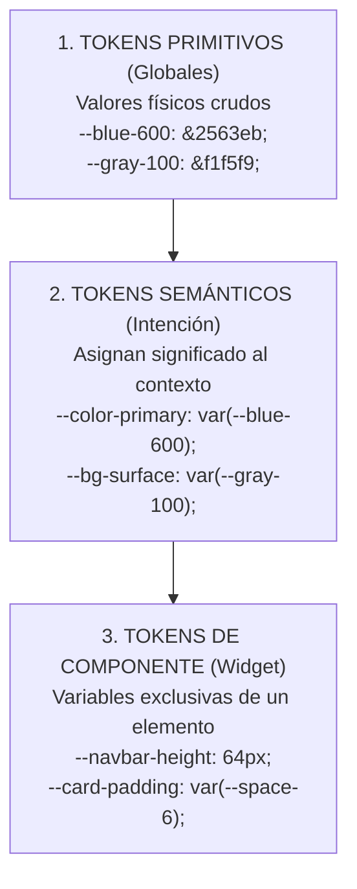

# 📐 Tokenizado Estricto y Cero Código Hardcodeado

> *"Escribir `padding: 13px; color: #3b82f6; z-index: 9999;` en un componente es hardcodear el diseño. En un sistema profesional, ningún valor numérico ni color es arbitrario: todo proviene de un sistema formal de tokens matemáticos."*

---

## 🛑 El Peligro de los "Números Mágicos" (*Magic Numbers*)

Cuando un asistente de IA programa componentes sin un arnés estricto, tiende a inventar valores al azar para cada elemento:
- En un botón pone `padding: 11px 22px;`.
- En una tarjeta pone `border-radius: 9px;`.
- En un modal pone `z-index: 999999;`.
- En un texto pone `font-size: 17.5px;`.

El resultado es una interfaz visualmente disonante, donde los elementos parecen pertenecer a universos diferentes y cambiar el estilo visual de la marca implica editar cientos de archivos a mano.

---

## 🏛️ La Arquitectura de Tokens en 3 Capas

Un sistema de diseño (*Design System*) moderno y escalable organiza sus variables CSS en **tres capas concéntricas**:



### 1. Capa Primitiva (La Paleta Cruda)
Son los valores fundamentales que define el equipo de diseño. No tienen contexto de uso:
```css
:root {
  /* Primitivos de Color */
  --blue-50:  #eff6ff;
  --blue-500: #3b82f6;
  --blue-600: #2563eb;
  --blue-700: #1d4ed8;

  --slate-900: #0f172a;
  --slate-800: #1e293b;
  --slate-100: #f1f5f9;
  --slate-50:  #f8fafc;
}
```

### 2. Capa Semántica (El Propósito del Negocio)
Es la capa que usan los desarrolladores y los agentes en el 90% de los casos. **Permite modo oscuro automático sin reescribir una sola clase**:
```css
:root {
  /* Modo Claro por Defecto */
  --bg-app: var(--slate-50);
  --bg-surface: #ffffff;
  --text-main: var(--slate-900);
  --text-muted: #64748b;
  --border-subtle: #e2e8f0;
  --color-primary: var(--blue-600);
  --color-primary-hover: var(--blue-700);
  --color-primary-contrast: #ffffff;
}

/* Modo Oscuro: Solo reasignamos tokens semánticos */
@media (prefers-color-scheme: dark) {
  :root {
    --bg-app: #0b0f19;
    --bg-surface: var(--slate-800);
    --text-main: #f8fafc;
    --text-muted: #94a3b8;
    --border-subtle: #334155;
    --color-primary: var(--blue-500);
    --color-primary-hover: var(--blue-600);
    --color-primary-contrast: #0f172a;
  }
}
```

---

## 📏 La Escala Matemática de Espaciado (El Ritmo de 4px/8px)

En una interfaz armónica, todos los márgenes, paddings y distancias son múltiplos de **4px u 8px**. Queda prohibido usar distancias arbitrarias como `13px` o `27px`:

```css
:root {
  --space-0:   0;
  --space-1:   0.25rem; /*  4px */
  --space-2:   0.5rem;  /*  8px */
  --space-3:   0.75rem; /* 12px */
  --space-4:   1rem;    /* 16px (Base) */
  --space-6:   1.5rem;  /* 24px */
  --space-8:   2rem;    /* 32px */
  --space-12:  3rem;    /* 48px */
  --space-16:  4rem;    /* 64px */
}
```

---

## 🔠 Tipografía Fluida con `clamp()` (Cero Breakpoints Rotos)

El método arcaico para hacer responsivo el texto era meter decenas de `@media (max-width: 768px)` cambiando fuentes a saltos bruscos.  
El estándar moderno es la **tipografía fluida**, que escala suavemente según el tamaño de la pantalla del usuario:

```css
:root {
  /* Escala tipográfica fluida: clamp(MÍNIMO, PREFERIDO, MÁXIMO) */
  --font-size-sm:   clamp(0.8125rem, 0.2vw + 0.75rem, 0.875rem); /* 13px - 14px */
  --font-size-base: 1rem;                                         /* 16px */
  --font-size-lg:   clamp(1.125rem, 0.5vw + 1rem, 1.25rem);       /* 18px - 20px */
  --font-size-xl:   clamp(1.25rem, 0.8vw + 1.1rem, 1.5rem);       /* 20px - 24px */
  --font-size-2xl:  clamp(1.5rem, 1.5vw + 1.25rem, 2rem);         /* 24px - 32px */
  --font-size-3xl:  clamp(2rem, 3vw + 1.5rem, 3rem);              /* 32px - 48px */
}
```

---

## 🪜 Z-Index Estratificado (El Fin de la Guerra Nuclear `z-index: 999999`)

Cuando la IA coloca `z-index: 9999` para que un menú se vea encima, y luego un modal usa `z-index: 999999`, el orden visual colapsa.

Todo sistema profesional define una **escala de elevación cerrada y estricta**:

```css
:root {
  --z-negative: -1;  /* Fondos decorativos */
  --z-base:     0;   /* Contenido normal de página */
  --z-sticky:   100; /* Headers fijos y barras de navegación */
  --z-dropdown: 200; /* Menús desplegables y popovers */
  --z-backdrop: 300; /* Telón oscuro detrás de modales */
  --z-modal:    400; /* Ventanas modales y diálogos */
  --z-toast:    500; /* Notificaciones flotantes / alertas */
  --z-tooltip:  600; /* Tooltips de ayuda contextual */
}
```

> [!IMPORTANT]
> **Regla de Oro:**  
> Ningún componente puede declarar un `z-index` numérico suelto. Debe invocar exclusivamente una de las variables `--z-...`. Si un elemento requiere una elevación no contemplada, se discute a nivel arquitectónico en el sistema de diseño.

---

## 🚫 La Regla Anti-Hardcodeo para el Asistente

Incluye esta instrucción en tu arnés de desarrollo:

> *"Cero valores de color hexadecimales (`#...`), RGB o HSL hardcodeados en componentes. Cero paddings o márgenes en píxeles arbitrarios. Utiliza exclusivamente los tokens de diseño de `:root` (`var(--color-...)`, `var(--space-...)`, `var(--radius-...)`, `var(--z-...)`)."*
