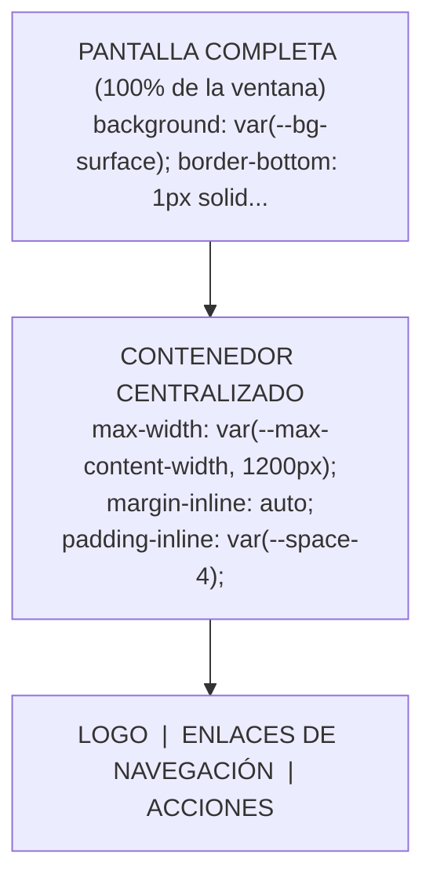

# 🧭 El Navbar Centralizado y el Contenedor Sagrado

> *"El error #1 de los desarrolladores asistidos por IA es crear una barra de navegación que se desborda en móvil, se desparrama hasta los bordes en pantallas 4K o rompe el layout con position: absolute descalibrados."*

---

## 💥 Las 3 Patologías Clásicas del Navbar Creado por IA

Cuando le pides a una IA: *"Hazme un navbar moderno con logo y botones"*, sin darle un arnés arquitectónico estricto, el modelo suele cometer tres desastres comunes:

1. **El Desparrame Ultra-Wide:** El logo queda pegado en el pixel 0 a la izquierda y el botón de perfil en el pixel 3840 a la derecha en monitores grandes.
2. **El Scroll Horizontal Accidental:** Usa `width: 100vw; margin: 0 auto;` y, debido a la barra de desplazamiento del navegador, la página genera un scroll horizontal fantasma de 15 píxeles que la IA intenta parchar con `body { overflow-x: hidden; }` (un parche destructivo que rompe el `position: sticky` en toda la web).
3. **El Salto de Contenido por `position: fixed`:** Hace que el navbar sea flotante pero olvida reservar el espacio superior en el `<main>`, haciendo que el primer título de la página quede oculto detrás de la barra.

---

## 🏛️ La Anatomía del "Contenedor Sagrado"

Todo layout profesional se basa en la separación estricta entre **envolturas de ancho completo (100% de pantalla)** y **contenedores de contenido acotado**:



### La Ecuación Matemática del Centrado Perfecto:
```css
.container {
  width: 100%;
  max-width: var(--max-width-container, 1200px);
  margin-inline: auto;       /* Centrado horizontal automático perfecto */
  padding-inline: var(--space-4); /* Colchón de seguridad para que no toque los bordes en móviles */
}
```

---

## 🧱 Código Canónico del Navbar Centralizado (Plug & Play)

Este patrón HTML5 semántico y CSS puro garantiza alineación milimétrica, soporte móvil y cero desbordamientos:

### HTML Semántico:
```html
<header class="site-header">
  <div class="site-header__container">
    <!-- 1. Marca / Logo -->
    <a href="/" class="site-header__logo" aria-label="Ir al inicio">
      <span class="logo-badge">MiApp</span>
    </a>

    <!-- 2. Navegación Principal -->
    <nav class="site-header__nav" aria-label="Navegación principal">
      <ul class="nav-list">
        <li><a href="#features" class="nav-link">Características</a></li>
        <li><a href="#pricing" class="nav-link">Precios</a></li>
        <li><a href="#docs" class="nav-link">Documentación</a></li>
      </ul>
    </nav>

    <!-- 3. Acciones / CTA -->
    <div class="site-header__actions">
      <a href="/login" class="btn btn-ghost">Iniciar sesión</a>
      <a href="/register" class="btn btn-primary">Comenzar gratis</a>
    </div>
  </div>
</header>
```

### CSS Moderno y Limpio (Cero `!important`, Cascada Natural):
```css
/* 1. La envoltura que se extiende al 100% de la pantalla */
.site-header {
  position: sticky;
  top: 0;
  z-index: var(--z-sticky, 100);
  width: 100%;
  background-color: var(--bg-surface);
  border-bottom: 1px solid var(--border-subtle);
  backdrop-filter: blur(8px); /* Efecto cristal moderno */
}

/* 2. El contenedor interno que centra el contenido */
.site-header__container {
  display: flex;
  align-items: center;
  justify-content: space-between;
  gap: var(--space-4);
  width: 100%;
  max-width: var(--max-width-container, 1200px);
  height: var(--navbar-height, 64px);
  margin-inline: auto;
  padding-inline: var(--space-4);
}

/* 3. Logo con proporción fija */
.site-header__logo {
  display: flex;
  align-items: center;
  font-weight: 700;
  font-size: var(--font-size-lg);
  color: var(--text-main);
  text-decoration: none;
}

/* 4. Lista de navegación horizontal */
.nav-list {
  display: flex;
  align-items: center;
  gap: var(--space-6);
  list-style: none;
  margin: 0;
  padding: 0;
}

.nav-link {
  color: var(--text-muted);
  text-decoration: none;
  font-size: var(--font-size-sm);
  font-weight: 500;
  transition: color 0.15s ease;
}

.nav-link:hover,
.nav-link:focus-visible {
  color: var(--color-primary);
}

/* 5. Bloque de botones a la derecha */
.site-header__actions {
  display: flex;
  align-items: center;
  gap: var(--space-3);
}

/* ==========================================================================
   Adaptabilidad Móvil (Mobile First): Ocultar menú en pantallas pequeñas
   ========================================================================== */
@media (max-width: 768px) {
  .site-header__nav {
    display: none; /* En móvil se activa mediante menú lateral o modal */
  }
}
```

---

## 🛡️ Los 4 Mandamientos del Navbar para Agentes de IA

1. **Jamás uses `position: absolute` para centrar el navbar:** Centrar con `left: 50%; transform: translateX(-50%);` es un antipatrón arcaico que causa parpadeos y desalineación subpíxel. Usa siempre `margin-inline: auto`.
2. **Prohibido `width: 100vw`:** El valor `100vw` no descuenta el grosor del scrollbar en Windows, provocando el molesto scroll horizontal. Usa siempre `width: 100%`.
3. **Reserva la altura en el layout:** Si el navbar es `position: sticky` o `fixed`, el elemento `<main>` debe tener `padding-top: var(--space-6);` o respetar el flujo natural sin colapsar.
4. **Accesibilidad semántica obligatoria:** Usa `<header>` y `<nav>` con atributo `aria-label`, nunca un simple `<div class="navbar">`.
