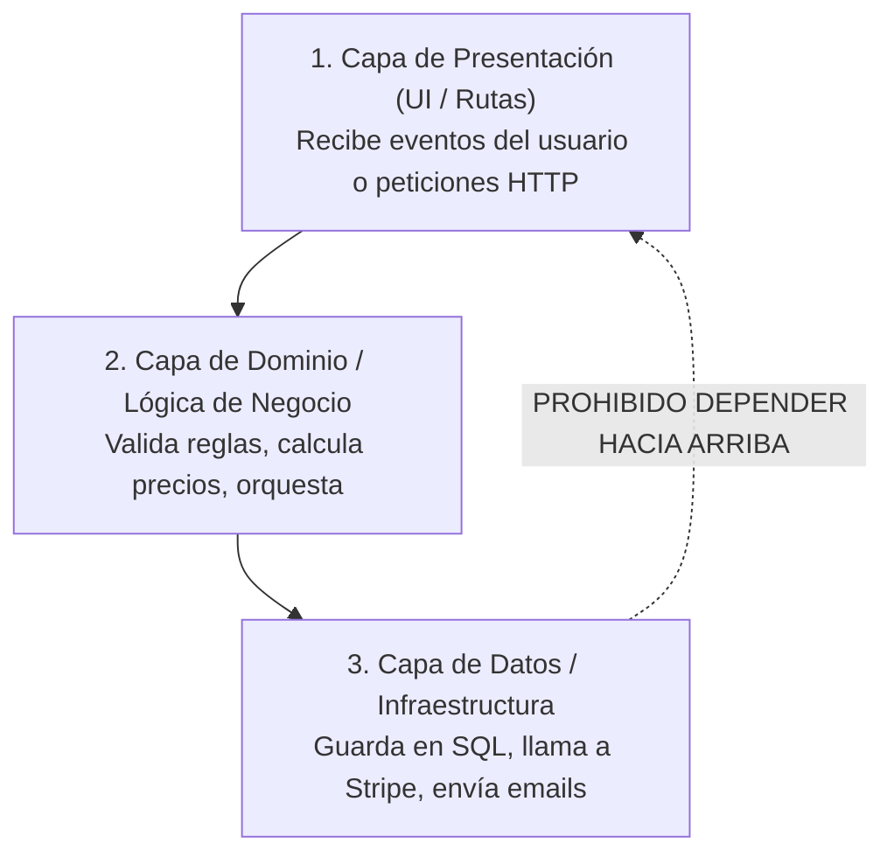

# 🧩 Separación de Responsabilidades: El Grafo Acíclico (DAG)

> *"El botón no debe saber cómo se calcula el impuesto; el calculador de impuestos no debe saber qué color tiene el botón."*

---

## 🏗️ La Arquitectura de Tres Capas Esencial

Para que tu código sea inmune a roturas accidentales causadas por la IA, organiza tus funciones en un **Grafo Acíclico Dirigido (DAG)**, donde las dependencias fluyen siempre en una sola dirección:

---

### La Regla de la Dependencia Unidireccional:
* **La Capa 1** puede importar y usar la **Capa 2**.
* **La Capa 2** puede importar y usar la **Capa 3**.
* **Pero la Capa 3 NUNCA debe saber quién la llamó:** No sabe si la invocó un clic en la web, un mensaje de WhatsApp, una prueba automática o un script de terminal.

---

## 🧪 El Gran Beneficio: Probar con Mocks en 10 Milisegundos

Cuando la lógica de negocio (Capa 2) está desacoplada de la base de datos real (Capa 3):
- Puedes probar cómo reacciona tu tienda ante un cliente moroso simplemente pasándole un repositorio simulado (*Mock*).
- No tienes que crear usuarios reales en Stripe ni registrar tarjetas falsas en cada test.
- Tus pruebas corren a la velocidad del rayo y tu sistema se vuelve extremadamente fácil de mantener.
