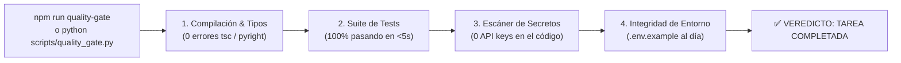

# 🚪 Quality Gates en un Solo Comando: Tu Juez Imparcial

> *"La única forma de saber si la tarea de la IA está realmente terminada es apretar una tecla y que un robot imparcial diga: '100% aprobado'."*

---

## 🚦 ¿Qué es un Quality Gate?

Un **Quality Gate (Compuerta de Calidad)** es un script automatizado que corre en tu terminal y ejecuta todas las inspecciones de ingeniería necesarias de forma encadenada:

---

## 👑 El Mandato Supremo para el Asistente

En tu arnés (`AGENTS.md`), incluye esta regla de oro:

> **«Una tarea NO se considera completada cuando la IA dice 'listo'. Una tarea solo se considera completada cuando el comando de Quality Gate reporta 100% de verificaciones superadas en verde.»**

Si el script falla en el paso 3 porque la IA dejó una clave de pruebas hardcodeada en el archivo, o en el paso 1 porque olvidó tipar un argumento:
- El modelo **NO puede dar por cerrada la tarea**.
- Está obligado a corregir la causa raíz hasta que el Quality Gate sea totalmente verde.

*(Encuentra los scripts listos para Python y Node en [`templates-plug-and-play/quality_gate_python.py`](../../templates-plug-and-play/quality_gate_python.py) y [`templates-plug-and-play/quality_gate_node.ts`](../../templates-plug-and-play/quality_gate_node.ts)).*
