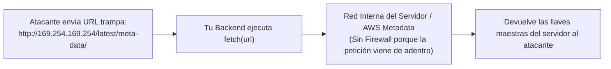

# ⚔️ Blindaje Backend: IDOR, Mass Assignment, SSRF y Path Traversal

> *"Los modelos de IA están entrenados para que el código 'funcione' en el camino feliz. Pero un atacante nunca camina por el camino feliz: busca exactamente lo que tu código olvidó prohibir."*

---

## 🕳️ Las 4 Vulnerabilidades Favoritas de los Asistentes de IA

Cuando le pides a un LLM: *"Créame el CRUD de usuarios, facturas y subida de archivos"*, el código que te devuelve suele verse limpio, moderno y ordenado. Sin embargo, casi siempre esconde **cuatro agujeros de seguridad críticos** que encabezan la lista mundial de hackeos a APIs (OWASP API Top 10).

---

## 1. IDOR / BOLA (*Broken Object Level Authorization*)

Es la vulnerabilidad número uno en aplicaciones web modernas. Ocurre cuando tu backend comprueba que el usuario **inició sesión**, pero olvida comprobar que el recurso que está pidiendo **le pertenece a él**.

### ❌ El Código Vulnerable que Genera la IA:
```typescript
// La IA pone el middleware requireAuth y cree que ya es seguro
app.get('/api/facturas/:id', requireAuth, async (req, res) => {
  const factura = await db.factura.findUnique({
    where: { id: Number(req.params.id) } // 💀 VULNERABILIDAD CRÍTICA (IDOR)
  });
  return res.json(factura);
});
```

### ¿Cómo te hackean?
Un usuario se registra legalmente, ve que su factura está en `/api/facturas/1045`, cambia el número en la barra de direcciones por `/api/facturas/1044`, `/api/facturas/1043`... y **descarga las facturas, direcciones y teléfonos de todos tus clientes**.

### ✅ La Solución Inquebrantable (Doble Candado):
1. **Usa siempre UUIDs (`f47ac10b-58cc-...`)** en lugar de IDs autoincrementales (`1, 2, 3`) para que sean imposibles de adivinar.
2. **Incluye SIEMPRE el `userId` del token autenticado dentro de la consulta a la base de datos:**

```typescript
// ✅ SEGURO: Filtra por ID del recurso Y por el ID del dueño autenticado
app.get('/api/facturas/:id', requireAuth, async (req, res) => {
  const factura = await db.factura.findFirst({
    where: {
      id: req.params.id,
      usuarioId: req.user.id // 🔒 Candado de propiedad obligatorio
    }
  });

  if (!factura) {
    return res.status(404).json({ error: 'Factura no encontrada' });
  }
  return res.json(factura);
});
```

---

## 2. Mass Assignment (*Asignación Masiva*)

Ocurre cuando la IA toma todo el objeto `req.body` que envía el navegador y lo mete directamente en la función `.create()` o `.update()` del ORM (Prisma, Mongoose, Sequelize, TypeORM) para ahorrarse líneas de código.

### ❌ El Atajo Mortal de la IA:
```typescript
// El endpoint para que el usuario edite su nombre y biografía
app.put('/api/perfil', requireAuth, async (req, res) => {
  const usuarioActualizado = await db.usuario.update({
    where: { id: req.user.id },
    data: req.body // 💀 PELIGRO EXTREMO: Pasa todo el body sin filtrar
  });
  return res.json(usuarioActualizado);
});
```

### ¿Cómo te hackean?
El formulario de tu página solo tiene los campos `nombre` y `bio`. Pero un atacante intercepta la petición con F12 o Postman y envía este JSON:
```json
{
  "nombre": "Hacker",
  "rol": "SUPER_ADMIN",
  "saldo_billetera": 999999,
  "plan_pagado": true
}
```
Como la base de datos tiene esas columnas, el ORM las actualiza obedientemente. **El atacante acaba de convertirse en dueño del sistema y recargar un millón de dólares gratis.**

### ✅ La Solución: Whitelisting con Esquemas Estrictos (`Zod`)
```typescript
import { z } from 'zod';

// Solo permitimos explícitamente los campos que el usuario tiene derecho a tocar
const ActualizarPerfilSchema = z.object({
  nombre: z.string().min(2).max(60),
  bio: z.string().max(300).optional()
}).strict(); // .strict() rechaza cualquier campo extra no autorizado

app.put('/api/perfil', requireAuth, async (req, res) => {
  const datosLimpios = ActualizarPerfilSchema.parse(req.body);

  const usuarioActualizado = await db.usuario.update({
    where: { id: req.user.id },
    data: {
      nombre: datosLimpios.nombre,
      bio: datosLimpios.bio
    }
  });
  return res.json(usuarioActualizado);
});
```

---

## 3. SSRF (*Server-Side Request Forgery*)

Muy común en aplicaciones de IA que permiten *"Analizar una página web desde una URL"*, *"Descargar imagen de perfil desde un link"* o *"Probar un Webhook del cliente"*.



### ¿Cómo ocurre?
Si tu servidor hace `fetch(urlDelUsuario)` sin validar a dónde apunta esa URL, el atacante no pondrá `https://google.com`. Pondrá:
- `http://localhost:6379` (para atacar tu Redis interno).
- `http://localhost:5432` (para escanear tu base de datos).
- `http://169.254.169.254/latest/meta-data/` (la dirección secreta de AWS, Google Cloud y DigitalOcean que entrega las credenciales de administración del servidor a quien pregunte desde adentro).

### ✅ La Solución: Validador Anti-SSRF
Antes de que tu backend haga `fetch` a cualquier URL proporcionada por un usuario:
1. Verifica que el protocolo sea exclusivamente `https:`.
2. Resuelve el DNS de la URL y **bloquea cualquier IP privada o local** (`127.0.0.1`, `0.0.0.0`, `10.x.x.x`, `172.16.x.x`, `192.168.x.x`, `169.254.x.x`, `::1`).

---

## 4. Path Traversal (*Salto de Directorio*)

Ocurre cuando tu aplicación permite leer, descargar o borrar archivos usando el nombre que envía el usuario:

```typescript
// ❌ VULNERABLE: Concatenación directa de rutas
app.get('/api/descargar', (req, res) => {
  const ruta = `./archivos_publicos/${req.query.nombre}`;
  res.sendFile(ruta);
});
```
Si el atacante pide `/api/descargar?nombre=../../.env` o `../../../../etc/passwd`, el sistema operativo sube de carpeta y **entrega el archivo `.env` con todas las contraseñas de tu empresa**.

### ✅ La Solución: Sanitización de Rutas con `path.basename` y `path.resolve`
```typescript
import path from 'path';

const DIRECTORIO_SEGURO = path.resolve('./archivos_publicos');

app.get('/api/descargar', (req, res) => {
  // 1. path.basename elimina cualquier '../' o barra diagonal
  const nombreLimpio = path.basename(String(req.query.nombre));
  const rutaFinal = path.resolve(DIRECTORIO_SEGURO, nombreLimpio);

  // 2. Verificación matemática: la ruta final DEBE empezar dentro de la carpeta segura
  if (!rutaFinal.startsWith(DIRECTORIO_SEGURO + path.sep)) {
    return res.status(403).json({ error: 'Acceso denegado: Intento de Path Traversal' });
  }

  return res.sendFile(rutaFinal);
});
```
