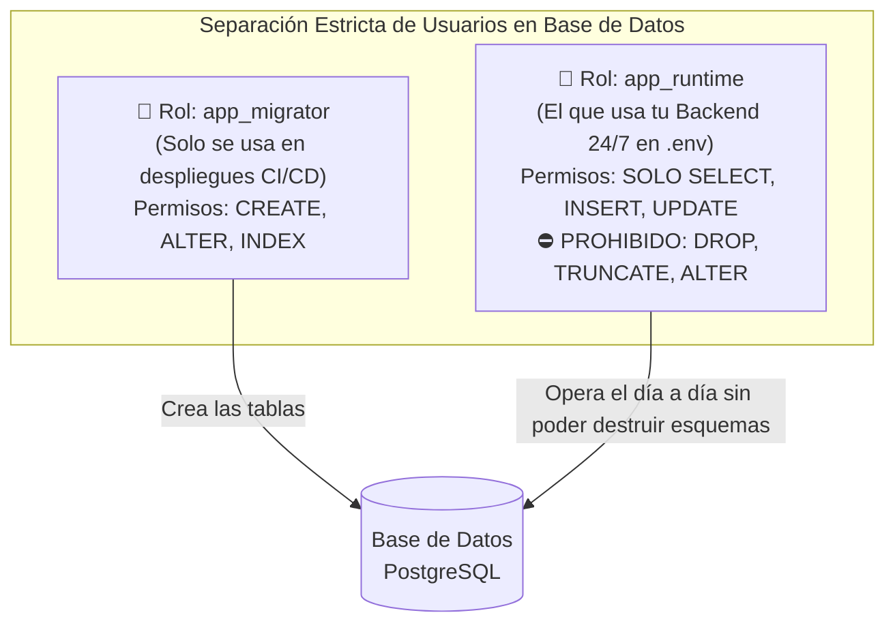

# 🗄️ Blindaje Profundo de Bases de Datos: SQL Injection, Roles y Criptografía

> *"Conectar tu aplicación web a la base de datos usando el usuario maestro `postgres` es como darle al cajero de una sucursal la llave de la bóveda central y una carga de dinamita."*

---

## 💉 1. Inyección SQL (SQLi) en la Era de la IA

Muchos desarrolladores creen que la Inyección SQL es cosa del pasado porque usan un ORM (como Prisma, Drizzle o SQLAlchemy). **Grave error.**

Cuando le pides a un asistente de IA que construya un buscador avanzado, un reporte complejo o un filtro con ordenamiento dinámico, la IA suele abandonar los métodos seguros del ORM y recurrir a **consultas SQL crudas concatenando texto**:

```typescript
// ❌ PELIGRO MORTAL: Template string directo dentro de SQL
const productos = await prisma.$queryRawUnsafe(
  `SELECT * FROM productos WHERE categoria = '${req.query.cat}' ORDER BY precio ASC`
);
```

### ¿Qué pasa si el atacante envía `cat = "' OR '1'='1' UNION SELECT email, password_hash FROM usuarios --"`?
La base de datos interpreta el texto del usuario como una orden SQL legítima y **devuelve la tabla completa de usuarios y contraseñas en pantalla**.

### ✅ La Regla de Hierro: Consultas 100% Parametrizadas (*Prepared Statements*)
Nunca concatenes variables con `${...}` o `+` dentro de una cadena SQL. Usa siempre marcadores de posición (`$1, $2` o plantillas etiquetadas seguras):

```typescript
// ✅ SEGURO CON PRISMA (Tagged Template)
// El motor envía la consulta y el dato por canales separados; es matemáticamente imposible inyectar SQL
const productos = await prisma.$queryRaw`
  SELECT * FROM productos WHERE categoria = ${req.query.cat}
`;

// ✅ SEGURO CON NODE-POSTGRES (pg)
const resultado = await pool.query(
  'SELECT * FROM productos WHERE categoria = $1 AND activo = $2',
  [req.query.cat, true] // Los datos viajan en un arreglo separado
);
```

---

## 🔑 2. Separación de Roles: Nunca Uses `postgres` en tu App

Por defecto, cuando creas una base de datos en un VPS, Docker o servicio cloud, te entregan el usuario superadministrador (`postgres` o `root`). Si pones ese usuario en el archivo `.env` de tu backend:
- Si la IA comete un error, puede hacer `DROP TABLE` o `TRUNCATE` y borrar toda tu empresa.
- Si sufres un ataque, el hacker tiene permisos de superusuario para tomar control del servidor entero.

### 🛡️ La Arquitectura de Dos Usuarios (Mínimo Privilegio):



### Script SQL Listo para Copiar y Blindar tu PostgreSQL:
```sql
-- 1. Crear el usuario limitado que usará tu backend en el archivo .env
CREATE ROLE app_runtime WITH LOGIN PASSWORD 'TuPasswordLargoYAleatorio_2026!';

-- 2. Permitirle conectarse a la base de datos y usar el esquema público
GRANT CONNECT ON DATABASE mi_produccion TO app_runtime;
GRANT USAGE ON SCHEMA public TO app_runtime;

-- 3. Darle permiso SOLO para leer, insertar y actualizar (NO puede hacer DROP ni TRUNCATE)
GRANT SELECT, INSERT, UPDATE, DELETE ON ALL TABLES IN SCHEMA public TO app_runtime;
GRANT USAGE, SELECT ON ALL SEQUENCES IN SCHEMA public TO app_runtime;

-- 4. Asegurar que las tablas futuras también tengan estos mismos permisos limitados
ALTER DEFAULT PRIVILEGES IN SCHEMA public
GRANT SELECT, INSERT, UPDATE, DELETE ON TABLES TO app_runtime;
```

---

## 🔐 3. Contraseñas y Secretos Guardados en la Base de Datos

Hay dos tipos de secretos que tu aplicación puede necesitar guardar en la base de datos, y **jamás deben tratarse igual**:

| Qué quieres guardar | ¿Necesitas volver a leer el valor original? | Algoritmo Obligatorio | Prohibido Usar |
|---|---|---|---|
| **Contraseñas de Usuarios** | **NO** (Solo necesitas comparar si coincide cuando hace login) | **Hash Irreversible con Sal:** `Argon2id` o `bcrypt` (cost factor $\ge 12$) | ❌ Texto plano, MD5, SHA-1, SHA-256 sin sal |
| **API Keys de Clientes** (ej: el token de Stripe o OpenAI de tu cliente) | **SÍ** (Tu servidor necesita desencriptarlo para llamar a la API en su nombre) | **Encriptación Simétrica Autenticada:** `AES-256-GCM` con llave en `.env` | ❌ Base64 (no es encriptación, cualquiera lo decodifica) |

> [!WARNING]
> **Base64 NO es encriptación:**  
> A veces las IAs sugieren "ocultar" un dato sensible pasándolo a `Buffer.from(texto).toString('base64')`. Cualquier persona decodifica Base64 en 1 segundo en su navegador. Usa siempre `crypto.createCipheriv('aes-256-gcm', ...)` para datos que deban desencriptarse en el servidor.

---

## 💾 4. La Regla 3-2-1 de Respaldos (Tu Seguro de Vida)

Ningún sistema de ciberseguridad está completo si un fallo de disco o un error humano puede dejarte en cero:
- **3 copias de tus datos:** Tu base de datos en vivo + 2 copias de respaldo.
- **2 medios diferentes:** Una copia en el mismo proveedor y otra en un almacenamiento externo independiente (ej. Cloudflare R2 o AWS S3).
- **1 copia probada:** Un backup que nunca has intentado restaurar en un entorno de prueba **no es un backup, es un deseo**. Programa un `pg_dump` automático diario encriptado.
