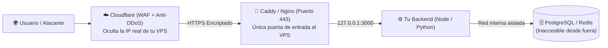

# 🏰 Hardening de VPS: SSH, Firewalls y la Trampa Mortal de Docker

> *"Desde el primer segundo en que alquilas un VPS y recibe una IP pública, miles de bots automatizados en todo el mundo empiezan a golpear tu puerta 24 horas al día buscando un descuido."*

---

## ⏱️ Los Primeros 15 Minutos de Vida de tu Servidor

Cuando compras un servidor VPS (en Hetzner, DigitalOcean, AWS, Linode o Hostinger), viene configurado para ser "fácil de usar", no para ser seguro: te entrega el usuario `root` con acceso por contraseña en el puerto 22 y todos los puertos abiertos.

Si despliegas tu proyecto así, es cuestión de días para que un bot adivine la contraseña o explote un puerto abierto. Aquí tienes el protocolo exacto de **Hardening (Blindaje de Servidor)** paso a paso.

---

## 🔐 Paso 1: Blindaje de SSH (Adiós a las Contraseñas)

Las contraseñas humanas se pueden adivinar por fuerza bruta; una llave criptográfica **Ed25519** es matemáticamente imposible de adivinar.

1. **En tu computadora local**, genera tu llave (si aún no tienes una):
   ```bash
   ssh-keygen -t ed25519 -C "mi-computadora"
   ```
2. **Copia tu llave pública al servidor** y crea un usuario sin privilegios de `root` directo:
   ```bash
   # Dentro del VPS: crear usuario 'deploy' con permiso sudo
   adduser deploy
   usermod -aG sudo deploy
   mkdir -p /home/deploy/.ssh
   cp /root/.ssh/authorized_keys /home/deploy/.ssh/
   chown -R deploy:deploy /home/deploy/.ssh
   chmod 700 /home/deploy/.ssh
   chmod 600 /home/deploy/.ssh/authorized_keys
   ```
3. **Desactiva para siempre el login por contraseña y el acceso directo de `root`:**  
   Edita `/etc/ssh/sshd_config`:
   ```text
   PermitRootLogin no
   PasswordAuthentication no
   PubkeyAuthentication yes
   ```
   Reinicia SSH con `sudo systemctl restart ssh`. A partir de este instante, ningún bot de fuerza bruta podrá entrar jamás.

---

## 🔥 Paso 2: El Muro de Fuego (`UFW` + `Fail2ban`)

La regla de oro de redes es: **Todo está cerrado a menos que sea estrictamente necesario abrirlo.**

```bash
# 1. Bloquear todo tráfico entrante y permitir el saliente
sudo ufw default deny incoming
sudo ufw default allow outgoing

# 2. Abrir ÚNICAMENTE SSH, HTTP y HTTPS
sudo ufw allow 22/tcp
sudo ufw allow 80/tcp
sudo ufw allow 443/tcp

# 3. Activar el firewall
sudo ufw enable

# 4. Instalar Fail2ban (bloquea automáticamente IPs que intenten ataques repetidos)
sudo apt update && sudo apt install -y fail2ban
sudo systemctl enable --now fail2ban
```

---

## 🚨 Paso 3: LA TRAMPA MORTAL DE DOCKER + UFW (El Error #1 en VPS)

> [!CAUTION]
> **Lee esto con máxima atención:**  
> Esta es la causa número uno por la que miles de bases de datos PostgreSQL, MySQL, MongoDB y Redis en servidores VPS son secuestradas cada semana, **incluso teniendo el firewall UFW activado**.

### ¿Qué ocurre cuando la IA genera tu `docker-compose.yml`?
Le pides a la IA un archivo Docker Compose para tu base de datos y te entrega esto:

```yaml
# ❌ PELIGRO CATASTRÓFICO: Base de datos expuesta a todo Internet
services:
  db:
    image: postgres:16-alpine
    ports:
      - "5432:5432" # 💀 ¡ESTO SE SALTA EL FIREWALL UFW!
```

### ¿Por qué pasa esto?
Docker manipula directamente las reglas internas del kernel de Linux (`iptables`) **antes** de que pasen por UFW. Cuando escribes `"5432:5432"`, Docker interpreta `"0.0.0.0:5432:5432"`, abriendo el puerto 5432 de tu base de datos al mundo entero e ignorando por completo que UFW lo tenía bloqueado.

### ✅ Cómo Blindar Docker en 5 Segundos:

Tienes dos formas seguras de hacerlo:

#### Opción A: Red Interna de Docker (Recomendada si el Backend también corre en Docker)
No uses `ports:` en la base de datos. Conéctala solo por red interna:
```yaml
services:
  backend:
    build: .
    networks:
      - red_interna
  db:
    image: postgres:16-alpine
    # Cero sección 'ports:'. Invisible desde fuera de Docker.
    networks:
      - red_interna

networks:
  red_interna:
    driver: bridge
```

#### Opción B: Atar el Puerto a `127.0.0.1` (Si necesitas conectarte desde el propio VPS o por Túnel SSH)
```yaml
services:
  db:
    image: postgres:16-alpine
    ports:
      - "127.0.0.1:5432:5432" # 🔒 SOLO escucha dentro del propio servidor, invisible desde internet
```

> **Tip de Auditoría:** Corre `sudo ss -tulpn` en tu VPS. Ningún servicio interno (Postgres `5432`, Redis `6379`, ni el puerto `3000` de tu Node.js) debe decir `0.0.0.0:puerto`. Todos deben decir `127.0.0.1:puerto`.

---

## 🛡️ Paso 4: Arquitectura de Cero Puertos Abiertos con Reverse Proxy y Cloudflare

Nunca expongas tu aplicación de Node.js, Python o Go directamente al tráfico de internet. Coloca siempre un **Reverse Proxy** (como **Caddy** o **Nginx**) y el escudo de **Cloudflare** delante:



1. **Oculta la IP de tu VPS:** Activa la "nube naranja" (Proxy) en el DNS de Cloudflare y configura el firewall de tu VPS para que los puertos 80 y 443 **solo acepten conexiones provenientes de las IPs oficiales de Cloudflare**. Así nadie podrá atacar la IP de tu servidor saltándose el WAF.
2. **Actualizaciones Automáticas de Seguridad:** Ejecuta `sudo apt install unattended-upgrades && sudo dpkg-reconfigure --priority=low unattended-upgrades` para que tu servidor instale parches críticos del sistema operativo automáticamente mientras duermes.
