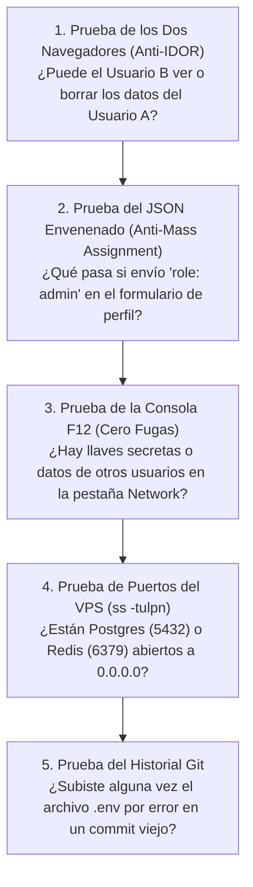

# 🛡️ SECURITY.md y Protocolo de Pentesting Defensivo Pre-Producción

> *"La seguridad no es un parche que se agrega el viernes a las 11 de la noche antes de lanzar; es un arnés de restricciones mecánicas que acompaña al proyecto desde el primer commit."*

---

## 📜 1. `SECURITY.md`: El Arnés de Ciberseguridad para tus Agentes

Cuando trabajas con asistentes agénticos (Claude Code, Cursor, Antigravity, Copilot), el modelo prioriza que el código compile rápido y a menudo ignora las mejores prácticas de seguridad a menos que se las impongas explícitamente.

Al colocar el archivo **[`SECURITY.md`](../../templates-plug-and-play/SECURITY.md)** en la raíz de tu proyecto y enlazarlo desde tu `AGENTS.md`, estableces una frontera constitucional que la IA no puede cruzar.

### Cómo Vincularlo en tu `AGENTS.md`:
```markdown
### 🔐 Directiva Constitucional de Ciberseguridad
- Antes de crear rutas de API, consultas a bases de datos, autenticación, subida de archivos o configuraciones de Docker/VPS:
  👉 **Lee y aplica OBLIGATORIAMENTE todas las reglas de `SECURITY.md`.**
- Está terminantemente prohibido usar `cors({ origin: '*' })` en rutas con sesión, concatenar strings en SQL, pasar `req.body` directo a la base de datos o exponer puertos de bases de datos en `0.0.0.0`.
```

---

## 🕵️‍♂️ 2. El Pentesting Defensivo de 15 Minutos (Hazlo tú mismo antes de lanzar)

No necesitas ser un hacker profesional para detectar el 95% de los fallos críticos de una aplicación. Antes de publicar tu proyecto al mundo, realiza estas **5 pruebas de fuego manuales**:



### Paso a Paso de las 5 Pruebas:

1. **La Prueba de los Dos Navegadores (Caza de IDOR y RLS roto):**
   - Abre Chrome normal y crea la **Cuenta A** (sube una factura o nota privada con ID `xyz`).
   - Abre una ventana de Incógnito y crea la **Cuenta B**.
   - Desde la Cuenta B, intenta pedir o borrar el recurso `xyz` de la Cuenta A.
   - **Resultado esperado:** El servidor DEBE responder `403 Forbidden` o `404 Not Found`. Si te devuelve los datos de la Cuenta A, tu seguridad está rota.

2. **La Prueba del JSON Envenenado (Caza de Mass Assignment):**
   - Abre F12 -> pestaña *Network*, edita tu perfil en la web, haz clic derecho en la petición `PUT / POST` -> *Copy as fetch*.
   - Pégala en la consola agregando campos prohibidos: `{"nombre": "Test", "role": "admin", "isVerified": true, "balance": 50000}`.
   - **Resultado esperado:** El servidor debe rechazar la petición con `400 Bad Request` o ignorar por completo los campos no autorizados.

3. **La Prueba del Escáner de Puertos en tu VPS:**
   - Entra por SSH a tu servidor y ejecuta:
     ```bash
     sudo ss -tulpn
     ```
   - Revisa la columna `Local Address:Port`.
   - **Resultado esperado:** Solo los puertos `80`, `443` y `22` pueden tener `0.0.0.0:*`. Tus bases de datos (`5432`, `3306`, `6379`) y tu app interna (`3000`, `8000`) **deben decir `127.0.0.1:...`**.

4. **La Prueba de Arqueología en Git (Fugas en el Pasado):**
   - Aunque hoy hayas borrado una contraseña de tu código, si hiciste un commit ayer con ella, **sigue pública para siempre en el historial de `.git`**.
   - Ejecuta este comando antes de hacer público un repositorio:
     ```bash
     git log -S "sk_" -p
     git log --all --full-history -- "**/.env*"
     ```
   - Si aparece alguna llave en el historial, **no basta con borrar el archivo**: debes ir inmediatamente al panel de Stripe/OpenAI/Supabase, **revocar la llave vieja y generar una nueva**.

---

## 🤖 3. Script de Auditoría Mecánica de Seguridad (`security_gate.sh`)

Agrega este script a tu flujo de calidad para detectar los errores más graves que la IA pudiera haber introducido en el código:

```bash
#!/bin/bash
# security_gate.sh - Escáner rápido de vulnerabilidades comunes generadas por IA

echo "🛡️ Ejecutando Auditoría Mecánica de Ciberseguridad..."
ERRORES=0

# 1. Verificar que .env esté en .gitignore y no esté rastreado por Git
if git ls-files --error-unmatch .env >/dev/null 2>&1; then
  echo "❌ CRÍTICO: El archivo .env está siendo rastreado por Git. Ejecuta: git rm --cached .env"
  ERRORES=$((ERRORES + 1))
fi

# 2. Detectar consultas SQL crudas inseguras ($queryRawUnsafe o concatenación evidente)
if git grep -nE "\$queryRawUnsafe|\$executeRawUnsafe" -- "*.ts" "*.js" >/dev/null 2>&1; then
  echo "❌ CRÍTICO: Se detectó uso de queryRawUnsafe (Riesgo de Inyección SQL):"
  git grep -nE "\$queryRawUnsafe|\$executeRawUnsafe" -- "*.ts" "*.js"
  ERRORES=$((ERRORES + 1))
fi

# 3. Detectar puertos de bases de datos expuestos a 0.0.0.0 en docker-compose
if git grep -nE '^\s*-\s*["'\'']?(5432|3306|6379|27017):(5432|3306|6379|27017)' -- "*docker-compose*.yml" >/dev/null 2>&1; then
  echo "❌ CRÍTICO: Puerto de Base de Datos expuesto a todo internet en docker-compose.yml."
  echo "👉 Cámbialo por '127.0.0.1:PUERTO:PUERTO'"
  git grep -nE '^\s*-\s*["'\'']?(5432|3306|6379|27017):(5432|3306|6379|27017)' -- "*docker-compose*.yml"
  ERRORES=$((ERRORES + 1))
fi

# 4. Detectar secretos reales hardcodeados (Stripe, OpenAI, GitHub, Private Keys)
if git grep -nE "(sk_live_[0-9a-zA-Z]{24,}|sk-proj-[0-9a-zA-Z]{20,}|ghp_[0-9a-zA-Z]{36}|BEGIN (RSA|OPENSSH|EC) PRIVATE KEY)" -- ":!*.md" ":!*security_gate*" >/dev/null 2>&1; then
  echo "❌ CRÍTICO: Se detectó una llave secreta real hardcodeada en el código fuente."
  ERRORES=$((ERRORES + 1))
fi

if [ $ERRORES -gt 0 ]; then
  echo "🚨 Auditoría FALLIDA con $ERRORES errores críticos de seguridad."
  exit 1
fi

echo "✅ Security Gate: APROBADO sin vulnerabilidades críticas detectadas."
exit 0
```
