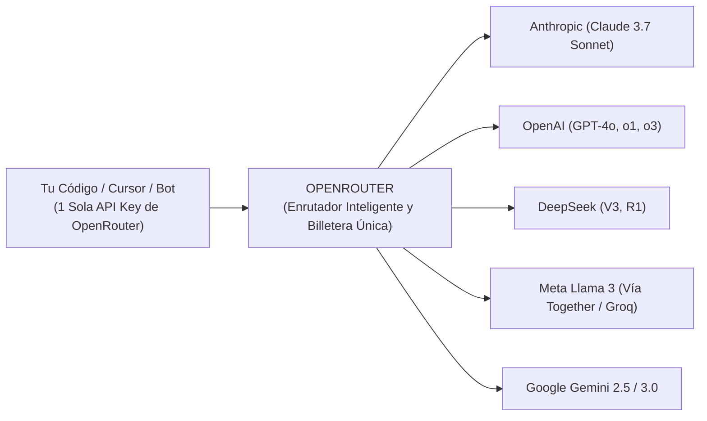

# 🌐 ¿Qué es OpenRouter? El Mercado Central de Modelos

> *"Tener que abrir 6 cuentas bancarias distintas, poner tu tarjeta en 6 empresas diferentes y manejar 6 APIs incompatibles es una pesadilla. OpenRouter lo resuelve con una sola llave y un solo saldo."*

---

## 🏬 La Metáfora del Supermercado Central

Imagina que para hacer las compras de la semana tuvieras que:
- Ir a una granja especial para comprar huevos y firmar un contrato mensual.
- Ir a otro estado para comprar pan y recargar \$20 dólares mínimos.
- Ir a un puerto lejano para conseguir café y lidiar con un sistema de pago distinto.

Sería una locura ineficiente. Por eso existen los **Supermercados**: un solo lugar donde entras, llenas tu carrito con productos de 50 marcas distintas y pagas todo en una sola caja registradora.

**OpenRouter (`openrouter.ai`) es el supermercado central de los modelos de Inteligencia Artificial.**

---

## 🔑 Las 4 Ventajas Decisivas de OpenRouter



---

### 1. Una Sola API Key para Más de 200 Modelos
En lugar de crear claves en OpenAI, Anthropic, Google, Mistral y Groq, creas **una única API Key en OpenRouter**. Con esa sola clave puedes invocar a Claude Sonnet, a GPT-4o, a DeepSeek R1 o a Llama 3 simplemente cambiando el nombre del modelo en el texto.

### 2. Una Sola Billetera Prepagada ($5 USD alcanzan para semanas)
Recargas \$5 o \$10 USD con tarjeta o criptomonedas en OpenRouter. Ese saldo se descuenta automáticamente sin importar a qué proveedor llames. Si hoy usas Claude por 2 centavos y mañana DeepSeek por medio centavo, todo sale del mismo fondo.

### 3. Enrutamiento con Respaldo Automático (Fallback Routing)
¿Qué pasa si los servidores de Anthropic se caen un martes por la tarde?
En tu configuración de OpenRouter puedes definir un modelo de respaldo:
```json
"models": ["anthropic/claude-3.7-sonnet", "deepseek/deepseek-r1", "openai/gpt-4o"]
```
Si el primer modelo no responde en 5 segundos, OpenRouter envía la petición automáticamente al segundo **sin que tu usuario final perciba la caída**.

### 4. Transparencia Absoluta de Costos
OpenRouter muestra en tiempo real cuántos centavos te costó cada llamada individual, cuál es el proveedor más rápido en ese minuto (latencia en milisegundos) y qué modelo ofrece la mejor relación calidad-precio para tu caso.

---

## 🛠️ Cómo se Usa en Código (Es 100% Compatible con OpenAI)
OpenRouter utiliza exactamente el mismo estándar de la librería oficial de OpenAI. Solo cambias la URL base:

```typescript
import OpenAI from 'openai';

const ai = new OpenAI({
  baseURL: 'https://openrouter.ai/api/v1',
  apiKey: process.env.OPENROUTER_API_KEY,
});

const respuesta = await ai.chat.completions.create({
  model: 'deepseek/deepseek-r1', // O 'anthropic/claude-3.7-sonnet'
  messages: [{ role: 'user', content: 'Explícame qué es una clave foránea en SQL' }],
});

console.log(respuesta.choices[0].message.content);
```
