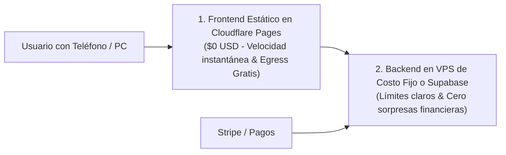

# 🍎 ¿Qué es un Hosting vs. VPS vs. Serverless?

> *"No le pagues \$100 dólares al mes a un proveedor de servidores si tu sistema solo necesita un escaparate gratuito en la calle."*

---

## 🏘️ La Gran Comparación Cotidiana de Servidores

Toda aplicación necesita vivir en algún lugar conectado a internet las 24 horas del día. Existen tres modelos principales:

| Modelo | Analogía Cotidiana | ¿Qué es técnicamente? | ¿Cuándo usarlo? | Costo Típico |
|---|---|---|---|---|
| **Hosting Estático / Edge** *(Cloudflare Pages, GitHub Pages, Vercel Estático)* | **Un escaparate de carteles en la plaza.** Solo exhibe afiches fijos; no hay cocina adentro. | Red mundial de servidores (CDN) que reparten tus archivos HTML, CSS y JS ya compilados a ultra velocidad. | Para la web pública, landings, dashboards frontend, blogs. | **$0 USD / mes** (Ancho de banda ilimitado y predecible). |
| **VPS (Servidor Privado Virtual)** *(Hetzner, DigitalOcean, Linode)* | **Tu propia oficina o apartamento alquilado 24/7.** Tienes tu propia llave y haces lo que quieras adentro. | Una máquina Linux virtual con su propia CPU, RAM y disco duro donde puedes correr procesos continuos. | APIs de backend, bots de WhatsApp/Telegram, tareas cron continuas, bases de datos propias. | **$4 – $10 USD / mes** (Costo fijo inamovible). |
| **Serverless / Funciones Cloud** *(Supabase Edge Functions, AWS Lambda)* | **Un chef a domicilio que solo viene 30 segundos, cocina un plato y se va.** | Servidores que solo se encienden durante los milisegundos exactos que tarda tu función en ejecutarse. | Procesar webhooks esporádicos, enviar correos, micro-tareas aisladas. | **$0 USD** para los primeros llamados, pero **riesgo de cobro por consumo** si no se limita. |

---

## 🗺️ La Combinación Ganadora para Empezar

Para el 95% de los proyectos asistidos por IA, la combinación más económica, rápida y profesional es desacoplar el sistema:

* **Cero mantenimiento de servidores en frontend:** No tienes que preocuparte por caídas ni configuraciones complejas para tu interfaz.
* **Costes blindados:** Puedes lanzar tu producto al mercado con una arquitectura donde tu tarjeta de crédito jamás sufrirá cobros sorpresa por ataques o bucles de código.

> 📖 *Lectura obligatoria sobre finanzas y servidores:* **[La Trampa del Pago por Uso y la Arquitectura Desacoplada](06-la-trampa-del-pago-por-uso-y-arquitectura-desacoplada.md)**.
