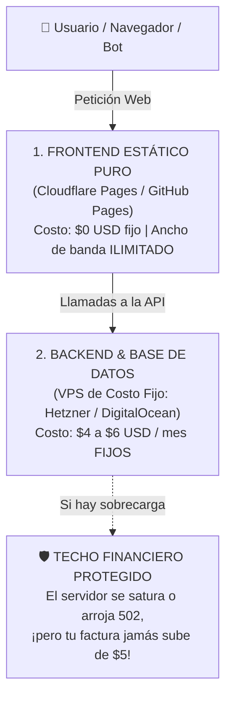

# 💸 La Trampa del Pago por Uso y la Arquitectura Desacoplada
### Cómo blindar tu tarjeta de crédito y evitar facturas sorpresa de servidores

> *"En la nube, el botón 'Ingresa tu tarjeta de crédito para continuar' es un cheque en blanco si no entiendes cómo funciona el modelo de facturación."*

---

## 😱 Historias de Terror Reales: El Susto del "Pay-As-You-Go"

Uno de los mayores peligros para creadores y desarrolladores que incursionan en el desarrollo asistido con IA es desplegar aplicaciones completas en plataformas gestionadas basadas en el modelo **Serverless o Pago por Consumo** (*Pay-as-you-go*, como Vercel Pro, AWS Lambda, Google Cloud Run o Supabase).

En internet abundan historias de desarrolladores independientes que se fueron a dormir con un proyecto que costaba \$0 y despertaron con una factura de **\$1,200, \$4,500 o más de \$10,000 USD**.

¿Por qué ocurre esto?
1. **El bucle infinito de la IA:** Un asistente de IA genera un componente en React o Vue con un gancho (`useEffect`) mal estructurado. Cada vez que el componente se dibuja, invoca a una función del backend. En cuestión de minutos, tu propia web se auto-hace 5 millones de peticiones por segundo.
2. **Bots y Scrapers:** Un rastreador web de una empresa de IA o un bot malicioso empieza a indexar tu sitio web sin descanso.
3. **El costo invisible: *Egress* (Ancho de Banda de Salida):** Muchas plataformas te regalan la CPU, pero te cobran tarifas astronómicas por cada gigabyte de datos que sale de sus servidores hacia los usuarios.

---

## 🧱 La Solución Maestra: La Arquitectura Desacoplada

Para dormir con total tranquilidad financiera, la mejor estrategia es **desacoplar** tu sistema en dos capas con responsabilidades y esquemas de cobro completamente separados:

### Capa 1: Frontend Estático Puro ($0 USD / mes)
* **¿Qué es?** Tu interfaz visual (HTML, CSS, JavaScript e imágenes) compilada como archivos planos (usando Vite, React, Astro o Next.js con exportación estática `output: 'export'`).
* **Dónde alojarlo:** **Cloudflare Pages** o **GitHub Pages**.
* **La gran ventaja:** Ambas plataformas ofrecen **ancho de banda gratuito e ilimitado**. Si un bot o 1 millón de personas visitan tu sitio de golpe, Cloudflare absorbe el impacto en su red global. Tu costo sigue siendo exactamente **$0 USD**.

### Capa 2: Backend en VPS de Costo Fijo ($4 a $6 USD / mes)
* **¿Qué es?** Tu servidor de Node.js, Python, Go o tu base de datos PostgreSQL/SQLite ejecutándose dentro de una máquina virtual propia en proveedores como **Hetzner Cloud** (desde €3.50/mes), **DigitalOcean**, **Linode** u **OVH**.
* **El salvavidas financiero (Techo Rígido):**  
  A diferencia de las funciones serverless que escalan infinitamente cobrándote cada invocación, **un VPS tiene un precio pactado inamovible**.  
  Si cometes un error en tu código o te atacan:
  * El VPS consumirá el 100% de la CPU.
  * Tu API se pondrá lenta o responderá `502 Bad Gateway`.
  * **Pero tu tarjeta de crédito jamás pagará más de los $4 o $6 dólares que contrataste.** No hay sorpresas bancarias.

---

## 🤔 ¿Se puede desacoplar TODO o hay servicios que "a juro" hay que pagar?

La respuesta honesta de trinchera es: **El 95% de los proyectos se pueden desacoplar y correr con costos fijos y mínimos. Solo un 5% requiere servicios gestionados externos.**

### ✅ Lo que SÍ puedes desacoplar y auto-alojar en un VPS ($5/mes):
* Tu API REST o GraphQL (Express, FastAPI, NestJS, Go).
* Tu base de datos relacional (PostgreSQL, SQLite con Turso/Litestream).
* Bots y automatizaciones 24/7 (WhatsApp, Telegram, Discord).
* Paneles administrativos y dashboards internos.
* Tareas programadas y colas de trabajo (BullMQ, Redis).

### ⚠️ Lo que NO conviene auto-alojar (El 5% donde sí se usan plataformas externas):
Hay ciertas áreas donde intentar auto-alojar el servicio en tu VPS es contraproducente:

1. **Envío de correos electrónicos transaccionales:**  
   Si intentas enviar correos directamente desde la IP de tu VPS, el 99% de los correos irán directo a la carpeta de SPAM de Gmail y Outlook.  
   * *Solución recomendada:* Usa servicios dedicados como **Resend**, **Postmark** o **Amazon SES**. Todos tienen niveles gratuitos generosos (ej. 3,000 correos gratis al mes) y protegen la entregabilidad.
2. **Pasarelas de Cobro:**  
   Nunca proceses tarjetas de crédito en tu propio servidor por normativas de seguridad (PCI-DSS).  
   * *Solución recomendada:* Delega siempre en **Stripe** o **MercadoPago**, que cobran solo una comisión por venta exitosa (sin costos fijos mensuales).
3. **Almacenamiento masivo de archivos de usuarios (Gigabytes/Terabytes):**  
   Si tus usuarios suben fotos de alta resolución o videos pesados, el disco de tu VPS se llenará en días.  
   * *Solución recomendada:* Usa almacenamiento de objetos como **Cloudflare R2** (compatible con S3, pero **sin costo alguno por descarga de ancho de banda/egress**).

---

## 🛑 Las 3 Reglas de Oro para Proteger tu Bolsillo

1. **Activa siempre el "Spend Cap" o "Límite Duro" en plataformas PaaS:**  
   Si decides usar Supabase, Vercel o Firebase, ve a la configuración de facturación el primer día y activa la opción de **Spend Cap** (Límite de gasto). Si la plataforma no ofrece la opción de detener el servicio automáticamente al llegar a $0 o a un presupuesto máximo, **no ingreses tu tarjeta de crédito**.
2. **Frontend desacoplado por defecto:**  
   No uses Server-Side Rendering (SSR) dinámico para páginas que solo muestran información estática o que pueden consultar la API desde el navegador mediante `fetch()`. Si tu frontend es estático, tu costo de distribución siempre es cero.
3. **Configura alertas de facturación por correo:**  
   En cualquier proveedor que use cobro por consumo (AWS, Google Cloud, OpenAI, OpenRouter), configura alertas para que te llegue un correo si el consumo diario supera los \$2 USD.
