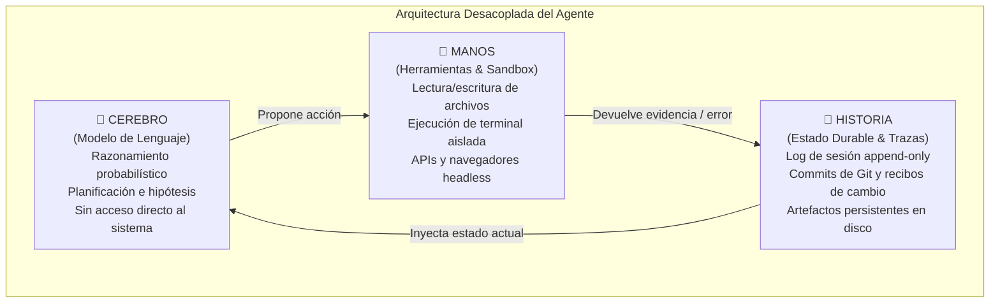

# 🪢 La Fórmula Fundamental: Modelo + Harness

> *"Un modelo recibe texto y devuelve texto. Eso es todo lo que hace. No abre archivos, no ejecuta órdenes, no calcula matemáticas en tiempo real ni tiene memoria de estado. Todo lo que rodea al modelo para convertirlo en un agente fiable es el HARNESS."*

---

## 🏛️ La Ecuación de la Ingeniería Agéntica

Durante mucho tiempo se creyó erróneamente que para mejorar el desempeño de una aplicación basada en Inteligencia Artificial lo único necesario era cambiar a un modelo más grande o refinar las palabras del prompt (*Prompt Engineering*).

La ingeniería de sistemas contemporánea ha demostrado empíricamente una realidad radicalmente distinta:

$$\text{Agente Fiable de Producción} = \text{Modelo de Lenguaje (Razonamiento)} + \text{Harness de Ingeniería (Entorno)}$$

El modelo es **únicamente el motor probabilístico de razonamiento**. El **harness** (arnés) es la infraestructura determinista completa que lo rodea y decide:
- **Qué información puede ver** (filtrado, progressive disclosure, documentos del repositorio).
- **Qué puede tocar y modificar** (herramientas, comandos de terminal, APIs, archivos autorizados).
- **Qué estado persiste entre sesiones** (memoria durable, git, bases de datos, logs de sesión).
- **Qué cuenta como evidencia válida** (pruebas automatizadas, linters, screenshots, contratos de esquema).
- **Cuándo debe detenerse o escalar** (límites de presupuesto, bucle de reintentos acotado, intervención humana).

> [!IMPORTANT]
> **El problema no es la inteligencia:**  
> Cuando un agente de IA falla de forma reiterada, el 95% de las veces **no se debe a una falta de inteligencia o capacidad del modelo**, sino a un entorno operativo **incompleto o poco definido (*underspecified*)**.  
> La respuesta profesional ante un agente atascado jamás es *"escribe un prompt más largo"* o *"pídele que lo intente más fuerte"*, sino preguntarse:  
> **¿Qué capacidad, contexto, herramienta o restricción mecánica le falta al entorno, y cómo la hacemos legible y exigible?**

---

## ⚖️ Distinción Clave: Prompt vs. Context vs. Harness Engineering

Para entender dónde reside el verdadero valor técnico a largo plazo, conviene contrastar las tres disciplinas del desarrollo con inteligencia artificial:

| Enfoque | Qué se modifica | Alcance | Resultado típico | Durabilidad |
|---|---|---|---|---|
| **Prompt Engineering** | La redacción de la instrucción | Una llamada puntual | Mejor respuesta en una ventana de chat | ⚠️ Efímera (cambia con cada versión del modelo) |
| **Context Engineering** | Qué información ve el modelo en un paso | Una ventana de contexto | Mejor contexto y menos alucinación inmediata | 🟡 Media (depende del tamaño de contexto y tokens) |
| **Harness Engineering** | **El entorno operativo completo de ejecución** | **Todo el ciclo de vida del agente** | **Un agente que ejecuta trabajo real de forma repetible, auditable y segura** | 🟢 **Permanente y acumulativa** (independiente del modelo) |

El mismo modelo de lenguaje puede comportarse como un generador de código torpe y caótico, o como un ingeniero de software implacable y meticuloso, **según la calidad del harness en el que se ejecute**. El arnés es el auténtico multiplicador de capacidad.

---

## 🧭 El Principio Operativo Dominante

Los equipos de ingeniería de frontera (tanto en OpenAI como en Anthropic) coinciden en una máxima rectora de diseño:

> ### 👑 *"Los humanos dirigen. Los agentes ejecutan."*

1. **El humano** formula la intención de negocio, diseña el entorno, establece las fronteras arquitectónicas, define los contratos de entrada/salida y crea los bucles de retroalimentación (*feedback loops*).
2. **El agente** desglosa la tarea, escribe el código, ejecuta las herramientas, inspecciona los resultados de las pruebas y corrige los desvíos.
3. **El harness** arbitra la relación: impide que el agente viole las reglas, mide el progreso con sensores objetivos y detiene la ejecución si se excede el presupuesto asignado.

---

## 🧠 Separar Cerebro, Manos e Historia

Un arnés profesional desacopla estrictamente tres capas que los principiantes suelen mezclar en un solo prompt:

- **Cerebro (Modelo):** Se encarga de la inferencia. Se puede cambiar de proveedor (de Claude a GPT o a Gemini) de un día para otro sin alterar el resto del sistema.
- **Manos (Herramientas y Sandbox):** Ejecutan acciones deterministas con límites estrictos de permisos.
- **Historia (Estado durable y Trazas):** Asegura que si la computadora se apaga, la API se cae o la sesión se reinicia, el progreso no se pierde.

---

## 🏆 La Conclusión Económica y Técnica

Un modelo modesto, económico y ultra-rápido (como Gemini Flash, Claude Haiku o GPT-4o-mini) equipado con un **Harness robusto** (con contratos, sensores y compuertas automáticas) supera sistemáticamente en precisión, confiabilidad, velocidad y costos a un modelo gigante de frontera operando sobre un chat improvisado.

La ventaja competitiva durable en el desarrollo asistido por IA **no está en el prompt ni en el modelo de turno; está en el harness**.
