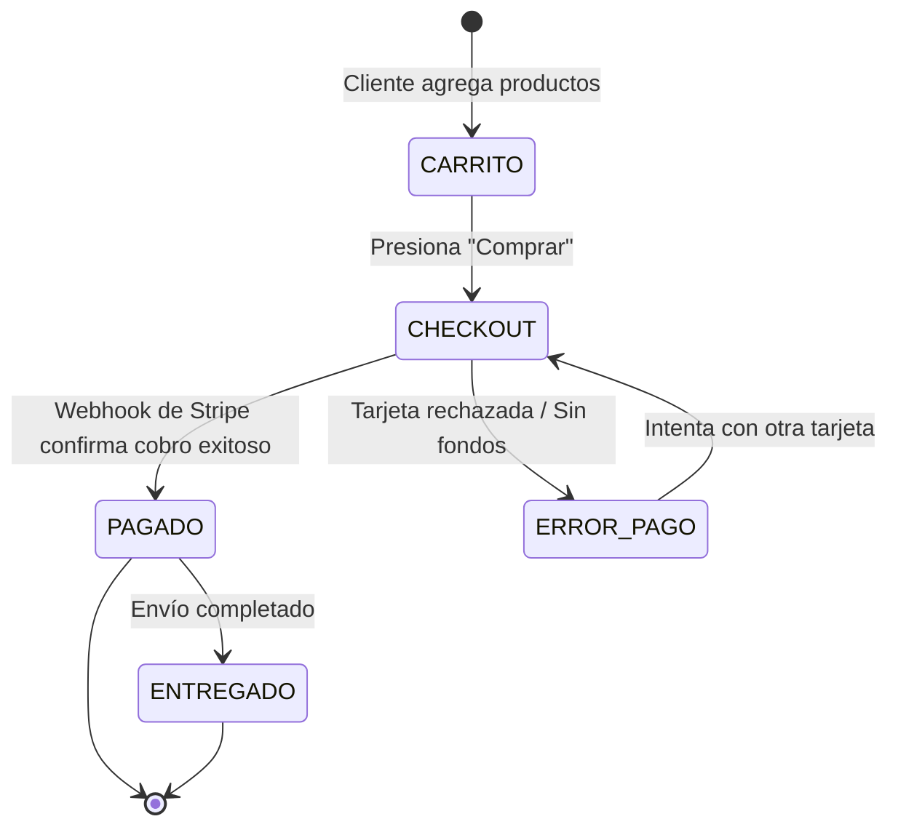

# ⚙️ Máquinas de Estado Finito en Flujos de Negocio

> *"Si dejas que la IA decida libremente cuál es el siguiente paso de un proceso de compra o registro, tarde o temprano le entregará el producto al cliente antes de que haya pagado."*

---

## 🚦 ¿Qué es una Máquina de Estados Finitos (FSM)?

Una **Máquina de Estados Finitos** es un modelo matemático muy simple:
- Un sistema solo puede estar en **UN estado a la vez** (por ejemplo: `CARRITO`, `PAGANDO`, `PAGADO`, `CANCELADO`).
- Solo se permiten transiciones válidas y predecibles entre estados.



---

## 🚫 La Transición Prohibida

Fíjate en el diagrama anterior:
- ¿Existe alguna flecha que vaya directo desde `CARRITO` hacia `ENTREGADO`?  
  **NO.** Es matemáticamente imposible.
- ¿Existe alguna flecha que vaya desde `ERROR_PAGO` hacia `ENTREGADO`?  
  **NO.**

### ¿Por qué esto es vital al trabajar con IA?
Si le dices a un asistente de IA: *"Maneja la lógica del pedido"*, la IA podría escribir código que, ante un mensaje del usuario diciendo *"Ya te pagué por transferencia, créeme"*, marque la orden como `ENTREGADO` sin consultar la base de datos ni a Stripe.

Al forzar una máquina de estados por código en tu backend:
- Incluso si el modelo de lenguaje se confunde o es engañado por un usuario (*Prompt Injection*), el motor de estados **bloquea la transición con un error**:
  ```javascript
  if (pedido.estado !== 'PAGADO') {
    throw new Error('Transición ilegal: No se puede entregar un pedido sin pago confirmado.');
  }
  ```
- Tu lógica de negocio permanece 100% incorruptible.

---

## ⚖️ ¿Cuándo Usarlo y Cuándo es Sobre-Ingeniería?

* **¿Cuándo vale la pena?**  
  En procesos multi-paso que involucran dinero, contratos, reservas de citas o inventario físico (donde pasar al estado equivocado causa pérdidas económicas).
* **¿Cuándo NO debes usarlo?**  
  En flujos lineales sencillos de 1 o 2 pasos (por ejemplo: enviar un formulario de contacto o cambiar un nombre de usuario). No instales librerías pesadas como XState para un formulario común.
* **Alternativa más simple:**  
  Un simple enum o validación condicional con `if` en tu controlador:
  ```javascript
  const ESTADOS_VALIDOS = ['pendiente', 'pagado', 'cancelado'];
  ```
  Menos de 5 líneas de código, cero dependencias adicionales y total control.

