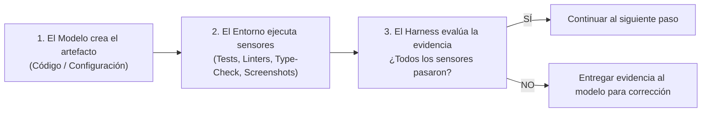

# ⚙️ Las 8 Funciones de un Harness de Producción

> *"Un modelo probabilístico aislado es un generador de sugerencias. Un modelo encapsulado dentro de un arnés de 8 funciones es un sistema de ingeniería autónomo, seguro y auditable."*

---

## 🏗️ La Anatomía del Entorno Operativo

Para que un modelo de lenguaje pueda operar como un agente de software fiable en entornos reales de producción, no basta con darle una consola de comandos y pedirle que trabaje. 

Tanto la investigación de Anthropic como la experiencia empírica de OpenAI y pioneros del área convergen en **8 funciones fundamentales** que el software determinista que rodea al modelo debe desempeñar:

```mermaid
flowchart TD
    subgraph ENTORNO ["El Arnés de Producción (8 Funciones)"]
        F1["1. Contrato Acotado\n(Previene redefinición de objetivos)"]
        F2["2. Mapa de Conocimiento\n(Progressive disclosure & repo como verdad)"]
        F3["3. Herramientas con Interfaz Clara\n(Propósito único, salida y fallos explícitos)"]
        F4["4. Memoria Durable Externa\n(Archivos y estado fuera del chat)"]
        F5["5. Sensores de Evidencia\n(Tests, linters, logs & screenshots)"]
        F6["6. Autorización Fuera del Modelo\n(Sandbox, credenciales protegidas & blast radius)"]
        F7["7. Trazas & Recibos de Cambio\n(Observabilidad y auditoría paso a paso)"]
        F8["8. Bucle de Control & Presupuesto\n(Reintentos acotados y escalada humana)"]
    end

    F1 --> F2 --> F3 --> F4 --> F5 --> F6 --> F7 --> F8
```

---

## 1. Convertir la Petición en un Contrato (Intención Acotada)

Antes de que el agente ejecute cualquier acción destructiva o escriba código, la solicitud humana debe transformarse en un **objeto formal, acotado y verificable**.

### ¿Qué previene?
Evita el fenómeno de la **redefinición silenciosa del objetivo (*Goal Drift*)**: cuando un modelo se encuentra con una dificultad técnica imprevista, tiende naturalmente a modificar el alcance de la tarea, simplificar los requerimientos y declarar "¡Éxito!" habiendo resuelto un problema totalmente distinto al solicitado.

### Elementos del Contrato:
- **Entrada obligatoria:** Qué archivos o especificaciones se toman como base.
- **Invariantes innegociables:** Qué no se puede romper ni modificar (ej: *"no tocar la estructura de la base de datos sin migración"*).
- **Criterio de salida (*Definition of Done*):** Qué prueba mecánica objetiva certifica que la tarea está realmente terminada.

---

## 2. Dar al Agente un Mapa de Conocimiento (Progressive Disclosure)

Proporcionar una guía raíz pequeña, clara y condensada (`AGENTS.md`, `CLAUDE.md` o equivalente) que actúe como un **mapa de orientación**, en lugar de vaciar una enciclopedia de documentación en el prompt inicial.

### Principio:
> *"Un manual gigante de 50 páginas devora la ventana de contexto y diluye la atención; un mapa pequeño preserva el contexto y guía al modelo hacia la verdad."*

- **El repositorio es el sistema de registro:** La documentación vive en carpetas estructuradas del proyecto (`docs/`, `specs/`).
- **Carga bajo demanda:** El arnés le enseña al agente a leer únicamente los documentos específicos que conciernen al módulo que va a modificar en ese turno.

---

## 3. Exponer las Herramientas Correctas con Interfaz Clara

Cada herramienta (*tool*) expuesta al modelo debe diseñarse con rigor de API tradicional:

| Requisito de la Herramienta | Explicación Técnica |
|---|---|
| **Propósito claro** | Debe hacer una sola cosa bien (ej: `read_file`, `run_linter`). Evitar herramientas ambiguas multiuso. |
| **Salida predecible** | Estructuras de respuesta consistentes y tipadas (JSON o texto plano delimitado). |
| **Estado de fallo explícito** | Si un comando falla, debe retornar el código de salida exacto (`exit code != 0`) y el `stderr` sin camuflarlo como éxito. |
| **Límite de permisos** | La herramienta solo debe tener acceso al directorio de trabajo permitido (*least privilege*). |

> [!TIP]
> **Herramientas afiladas vs. Sets inflados:**  
> Llenar al agente con 40 herramientas complejas aumenta exponencialmente la probabilidad de que elija la herramienta equivocada. Un set mínimo de 4 a 6 herramientas limpias y robustas genera agentes infinitamente más fiables.

---

## 4. Externalizar la Memoria en Estado Durable

**La conversación en el chat no es el sistema de registro.** La memoria del chat es volátil, sufre de pérdida de contexto (*Lost in the Middle*) y desaparece ante un error de red o al alcanzar el límite de tokens.

Un arnés de producción obliga al agente a persistir su estado fuera de la ventana de contexto:
- **En el sistema de archivos:** Documentos como `task_progress.md`, `feature_list.json` o bitácoras de auditoría.
- **En Git:** Commits incrementales atómicos que registran cada micro-avance funcional.
- **En bases de datos de sesión:** Estados estructurados que sobreviven a caídas, reinicios y transferencias entre agentes (*handoffs*).

---

## 5. Añadir Sensores antes de Añadir Autonomía

> ### 🔭 *"El agente no puede corregir lo que no puede observar."*

Otorgarle a un modelo la capacidad de editar archivos sin antes dotar al entorno de sensores de inspección es una receta para el desastre. Los sensores convierten la calidad del código en **evidencia objetiva e incontestable**:

- **Sensores sintácticos:** Linters (`eslint`, `ruff`, `tsc`).
- **Sensores de comportamiento:** Tests unitarios e integración (`vitest`, `pytest`).
- **Sensores visuales:** Capturas de pantalla headless (`Playwright`, `Puppeteer`).
- **Sensores de esquema:** Validadores deterministas (`zod`, `pydantic`).

---

## 6. Aplicar Permisos y Autorización Fuera del Modelo

El modelo de lenguaje es un sistema probabilístico: **jamás se le debe otorgar la autoridad final para autorizar sus propias acciones de alto riesgo**.

> [!CAUTION]
> **Regla de Separación de Poderes:**  
> El modelo puede **recomendar o proponer** una acción. El arnés (un sistema determinista regido por políticas mecánicas o aprobación humana) debe **autorizarla**.

- **Acciones críticas bloqueadas:** `DROP DATABASE`, `git push --force`, eliminar directorios raíz, publicar paquetes a producción, o enviar correos reales a clientes.
- **Aislamiento en Sandbox:** La ejecución de comandos se realiza dentro de contenedores o entornos con red restringida.
- **Credenciales fuera del alcance:** Las claves de API maestras y secretos de base de datos nunca deben inyectarse en el entorno de texto donde el modelo ejecuta código arbitrario.

---

## 7. Registrar Trazas y Permitir Recuperación Local

Cada ejecución del agente debe generar un rastro estructurado y reproducible:

- **Sin trazas:** Cuando un agente falla, el motivo es un misterio opaco y el desarrollador no sabe si falló el razonamiento, el comando o los datos de prueba.
- **Con trazas:** El fallo se convierte en telemetría de alto valor para mejorar el arnés.
- **El Recibo de Cambio (*Change Receipt*):**  
  Un arnés maduro no solo guarda el archivo modificado; genera un registro compacto de **cómo se produjo el cambio**:
  - ¿Qué comando ejecutó?
  - ¿Cuántos reintentos requirió?
  - ¿Qué sensor arrojó error y cómo lo reparó?
  - ¿Cuántos tokens y tiempo insumió?

Esto permite realizar auditorías de seguridad, comparar el desempeño entre diferentes modelos de lenguaje y detectar regresiones de inmediato.

---

## 8. Bucle de Control, Presupuesto y Escalada

El bucle (*loop*) de ejecución debe pertenecerle al arnés, no al modelo.

Un bucle productivo cuenta con cuatro salvaguardas explícitas:
1. **Evidencia:** No se avanza por la palabra del modelo (*"Ya quedó listo"*), sino por la aprobación de los sensores.
2. **Reintentos acotados:** Si tras 3 intentos el agente no logra resolver un bug, el arnés corta el bucle para evitar ciclos infinitos de alucinación iterativa.
3. **Presupuesto asignado (*Budget Caps*):** Límites rígidos de tokens consumidos, costo en dólares o tiempo de cómputo por tarea.
4. **Camino de escalada humana:** Cuando el presupuesto se agota o un invariante se viola, el arnés congela el estado y le presenta al humano una solicitud de intervención con el diagnóstico exacto del problema.
