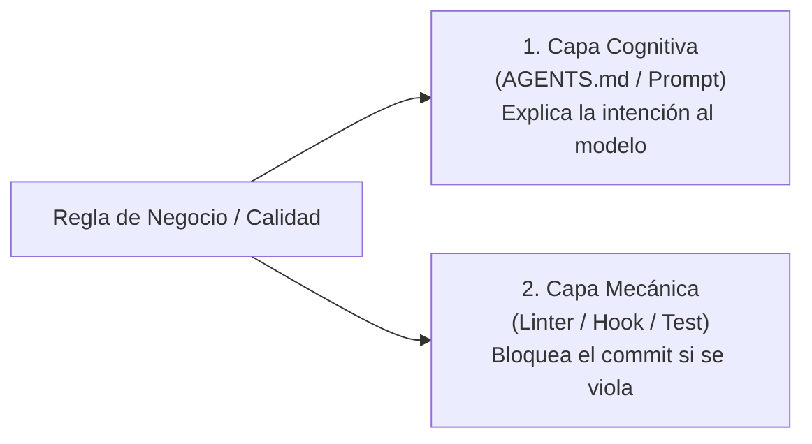
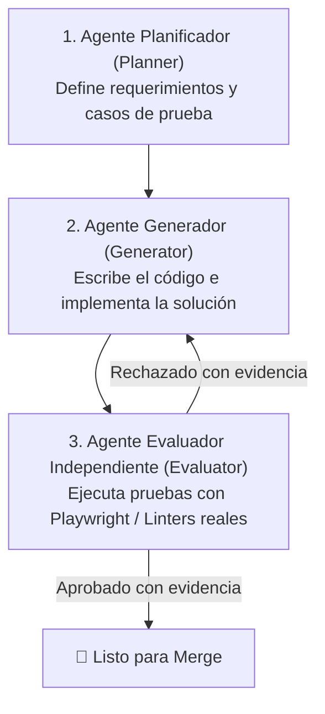
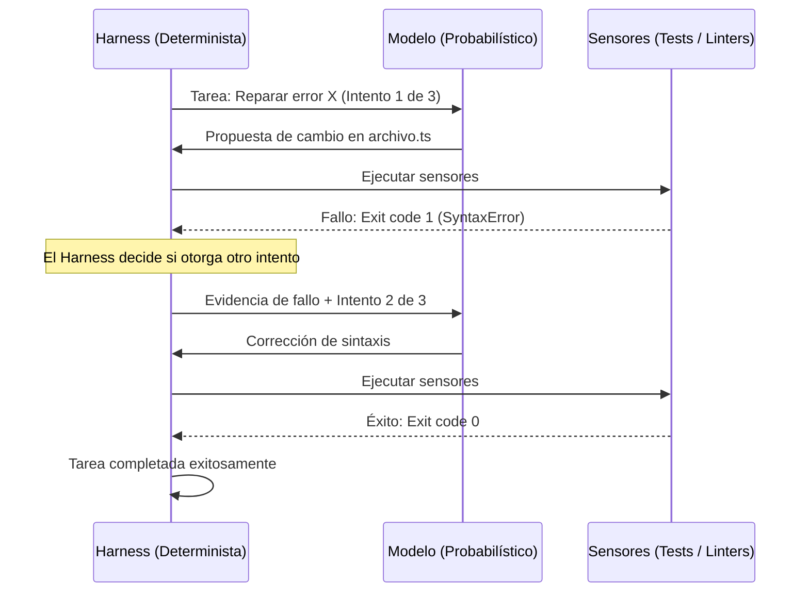

# 🛡️ Patrones de Diseño y Guardrails Mecánicos para Agentes

> *"Reparar el output actual de un agente arregla un bug hoy. Reparar la CLASE de fallo en la infraestructura del arnés previene miles de bugs para siempre."*

---

## 🏛️ De la Corrección Manual a la Inmunidad Sistémica

Cuando trabajamos con asistentes de código tradicionales, el desarrollador suele quedar atrapado en un ciclo infinito de correcciones: la IA rompe un tipo, el desarrollador le pide que lo arregle; la IA olvida una variable de entorno, el desarrollador se lo recuerda.

El **Harness Engineering** rompe este desgaste mediante **patrones de diseño y controles mecánicos**: principios probados en la industria para blindar el entorno y hacer que los agentes operen con rigor industrial sin necesidad de micro-supervisión constante.

---

## 1. Instrucciones como Infraestructura (La Regla de Doble Codificación)

Uno de los patrones más potentes consiste en no confiar jamás en una regla escrita únicamente en texto:

> ### 🧱 *Toda regla importante debe codificarse dos veces:*
> 1. **Como guía comprensible en lenguaje natural** (en `AGENTS.md` o la especificación), para que el modelo entienda el *porqué* y la intención.
> 2. **Como chequeo mecánico determinista** (un script, un linter, un pre-commit hook o un test estructural) que el modelo **no pueda saltarse bajo ninguna circunstancia**.

### Ejemplo Práctico:
- **Capa Cognitiva:** En `AGENTS.md`: *"No uses CSS inline en componentes de React; utiliza exclusivamente clases de Tailwind"*.
- **Capa Mecánica:** Una regla en ESLint (`eslint-plugin-react`) que arroja error si detecta la propiedad `style={{...}}`.
- **Resultado:** Si el modelo intenta tomar el atajo del CSS inline, el chequeo mecánico intercepta el error al instante, devuelve el mensaje de fallo exacto al modelo y este se ve forzado a autocorrregirse antes de entregar el trabajo.

---

## 2. Invariantes en lugar de Micromanagement

Intentar controlar cada variable, nombre de función o línea de código que escribe un agente de IA (*micromanagement*) anula la ventaja de velocidad de la automatización y agota al desarrollador.

La alternativa profesional es definir **Invariantes Arquitectónicos**:

| Micromanagement (Frágil e ineficiente) | Invariante Arquitectónico (Robusto y escalable) |
|---|---|
| *"En la línea 45 declara una variable `const x` y luego usa un ciclo `for` con índice `i`..."* | *"Cualquier consulta a la base de datos debe pasar por la capa de repositorios; está prohibido invocar el cliente SQL directo desde los componentes UI."* |
| *"Por favor no olvides ponerle `try/catch` a cada función que escribas."* | *"Todas las excepciones no controladas se capturan en el middleware global de errores y se devuelven en formato JSON RFC 7807."* |

Al fijar fronteras arquitectónicas claras e infranqueables, el agente tiene **total autonomía creativa** para resolver el problema dentro de esos límites seguros.

---

## 3. Evaluación Separada e Independiente (Inspirada en GANs)

> [!WARNING]
> **La Trampa de la Autoevaluación Leniente:**  
> Cuando le pides al mismo agente que escribió el código que verifique si su trabajo es correcto, el modelo sufre de un sesgo de complacencia innato: asume que su lógica inicial es válida, realiza pruebas superficiales y concluye prematuramente que *"todo funciona a la perfección"*.

Para superar esto, la arquitectura moderna de agentes desacopla la generación de la evaluación:

- **El Generador:** Enfocado en producir la solución.
- **El Evaluador:** No tiene empatía con el generador. No mira las disculpas del chat; ejecuta herramientas de interacción real en un navegador headless (como Playwright), analiza respuestas HTTP y audita los logs. Si encuentra un fallo visual o funcional, **rechaza el cambio y adjunta la evidencia objetiva**.

---

## 4. Filosofía Default-Fail (Fallo por Defecto)

En un arnés riguroso:
- **Todos los criterios de aceptación arrancan en estado `FALSE` / `FAIL`.**
- Ningún criterio puede marcarse como `PASSED` simplemente porque el modelo afirme *"He verificado mentalmente que el código compila"*.
- Un criterio solo cambia de estado si existe un **resultado empírico emitido por el entorno** (un test en verde, una respuesta HTTP 200 verificada, un schema parse exitoso).

---

## 5. Sandboxing y Blast Radius (Radio de Explosión)

La autonomía debe estar estrictamente acotada a una zona de impacto seguro (*blast radius*):

1. **Aislamiento de Ejecución:** El agente ejecuta sus comandos en un contenedor o sandbox local con permisos limitados.
2. **Red Restringida:** El sandbox no puede realizar conexiones arbitrarias hacia servidores externos no homologados.
3. **Credenciales Fuera del Sandbox:** Las claves maestras de despliegue, tokens de producción y credenciales bancarias residen en el arnés anfitrión; el entorno del agente solo recibe tokens efímeros con permisos mínimos de lectura o prueba.

---

## 6. El Loop Pertenece al Harness

El bucle iterativo de resolución no debe ser controlado por el modelo de lenguaje:

- **El modelo:** Decide *cómo* reparar el hueco local del código.
- **El arnés:** Decide *si se permite otro intento*, si el presupuesto de tokens o tiempo se ha agotado, o si es momento de congelar la ejecución y escalar la alerta a un humano.

---

## 7. Reparar la Clase de Fallo, No Solo la Instancia

Cuando un agente de IA introduce un bug, el desarrollador inexperto le dice: *"Corrige la línea 12"*.  
El ingeniero de arneses se pregunta: **¿Por qué el sistema permitió que esa línea existiera?**

- Si la IA envió `null` a una función que esperaba un objeto, no solo parches la función: **activa `strictNullChecks` en el compilador de TypeScript**.
- Si la IA usó una librería obsoleta, no solo la desinstales: **agrégala a la lista de dependencias prohibidas en el linter**.
- Al reparar la **clase de fallo en la infraestructura**, aseguras que ningún modelo (ni ningún humano) vuelva a cometer ese mismo error jamás.

---

## 8. Empezar Pequeño y Proporcional

Un arnés hipertrofiado de 50 herramientas y 20 validadores lentos es tan contraproducente como no tener ningún arnés.

> [!TIP]
> **La Regla de Proporcionalidad del Harness:**  
> El arnés inicial debe ser el **sistema mínimo que pueda observar, verificar y recuperarse**. La complejidad se añade solo cuando la tarea lo justifica. El arnés siempre debe ser más simple y confiable que la superficie de fallo que controla.
