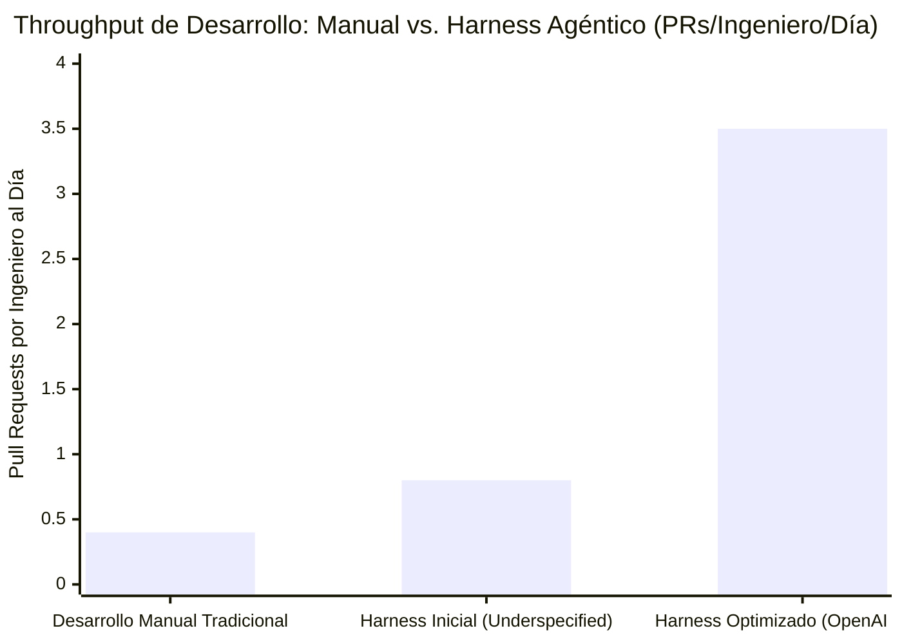
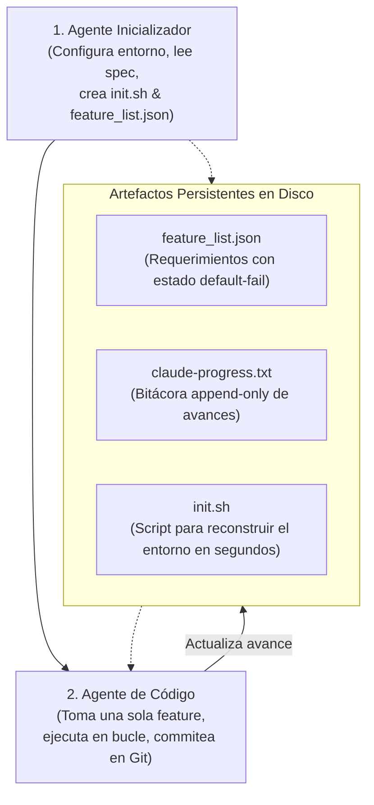
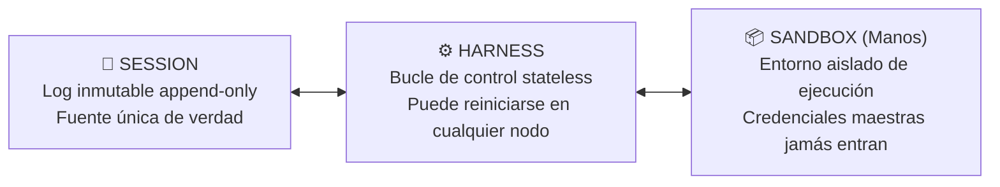

# 🔬 Casos de Estudio Reales: OpenAI y Anthropic

> *"La teoría de la inteligencia artificial predice lo que es matemáticamente posible. El Harness Engineering en los laboratorios de frontera demuestra lo que funciona cuando el software debe ponerse en producción sin excusas."*

---

## 🚀 Lecciones de la Frontera Agéntica

El desarrollo de software mediante agentes autónomos dejó de ser un experimento de laboratorio para convertirse en una disciplina operativa de ingeniería. Dos de los hitos más documentados y rigurosos provienen directamente de **OpenAI** y **Anthropic**.

Estudiar sus aprendizajes, fallos iniciales y arquitecturas definitivas permite ahorrarnos meses de tropiezos y frustraciones.

---

## 🏛️ Caso 1: OpenAI – El Experimento Codex (Febrero 2026)

A inicios de 2026, un equipo pequeño dentro de OpenAI (que comenzó con 3 ingenieros y creció hasta 7) logró construir y poner en producción un producto interno masivo con una marca sin precedentes: **cero líneas de código escritas a mano**.

### Las Métricas del Proyecto:
- **~1.000.000 de líneas de código** creadas y desplegadas.
- **~1.500 Pull Requests (PRs)** procesados, revisados y mergeados.
- **Tiempo total de desarrollo:** Estimado en **$\sim 1/10$ del tiempo** que hubiera demandado el desarrollo manual tradicional con un equipo convencional.
- **Throughput:** Promedio de **~3,5 PRs por ingeniero al día**, con una anomalía histórica: la productividad por persona **aumentó** conforme el equipo creció (desafiando la clásica Ley de Brooks).

### La Dinámica de Trabajo Real:
1. **Los humanos no tiraban código:** Los ingenieros pasaron de ser programadores manuales a arquitectos de arnés. Su jornada consistía en:
   - Especificar intenciones claras en lenguaje estructurado.
   - Diseñar las herramientas y entornos de ejecución.
   - Construir sensores objetivos (*feedback loops*) que detectaran inconsistencias.
2. **Los agentes hacían el trabajo operativo:** Escribían el código, ejecutaban los tests locales, generaban diffs, realizaban revisiones automatizadas entre pares y enviaban los PRs.
3. **El Repositorio como Sistema de Registro:**
   - La documentación arquitectónica estructurada vivía dentro del repo.
   - Se utilizaba un archivo `AGENTS.md` **muy corto y conciso**, funcionando como un mapa de carreteras para orientar al modelo, jamás como una enciclopedia abrumadora.

> [!IMPORTANT]
> **El Tropiezo Inicial y la Gran Lección:**  
> Durante las primeras semanas, el avance era sumamente lento y frustrante. Los agentes se atascaban, generaban bucles o resolvían cosas equivocadas.  
> La causa no era la capacidad del modelo de lenguaje, sino que **el entorno estaba poco definido (*underspecified*)**.  
> En cuanto el equipo humano dejó de intentar afinar los prompts y se concentró en **especificar mejor el arnés** (herramientas con fallos explícitos, sensores mecánicos y contratos acotados), la velocidad del sistema se multiplicó por diez.

---

## 🏛️ Caso 2: Anthropic – Domando a los Agentes de Larga Duración

En sus investigaciones sobre agentes autónomos que deben operar durante horas o días sobre bases de código complejas (*Long-Running Agents*), Anthropic identificó un patrón recurrente de patologías cuando los modelos operaban sin arnés adecuado:

### Las 4 Patologías del Agente sin Harness:
1. **Pérdida de contexto entre sesiones:** Al reiniciarse la ventana de chat, el modelo pierde el hilo de las decisiones tomadas y vuelve a empezar de cero.
2. **Tendencia al *One-Shot* superficial:** Intentar resolver un problema de arquitectura compleja en una sola respuesta apresurada sin planificar ni descomponer.
3. **Declaración prematura de "Éxito":** El modelo asume que el trabajo está concluido tras hacer el cambio más obvio, ignorando casos de borde o pruebas secundarias.
4. **Autoevaluación complaciente:** Cuando el mismo modelo que generó el código se evalúa a sí mismo, se autocalifica con aprobación total pasando por alto errores graves.

---

### La Evolución de la Solución en Anthropic (2025 - 2026)

Para erradicar estas patologías, Anthropic documentó una evolución arquitectónica en dos grandes saltos:

#### 1. Primera Generación: Arnés de Artefactos Estructurados (*Effective Harnesses*, Nov 2025)
Desacopló el flujo de trabajo en dos agentes especializados apoyados en archivos persistentes en disco:

- **`feature_list.json`:** Lista estructurada de todos los casos de uso requeridos, todos inicialmente marcados como `status: false`.
- **`claude-progress.txt`:** Registro secuencial de decisiones tomadas, archivos editados y problemas encontrados.
- **`init.sh`:** Script determinista que permite a cualquier agente reconstruir el entorno y ejecutar las pruebas desde cero tras una caída.

---

#### 2. Segunda Generación: Arquitectura Tripartita Inspirada en GANs (*Harness Design*, Mar 2026)
Inspirándose en las Redes Generativas Antagónicas (GANs), Anthropic evolucionó hacia una separación de poderes entre tres roles autónomos:

1. **El Planificador (*Planner*):** Recibe la intención humana y la expande en una especificación técnica formal y detallada.
2. **El Generador (*Generator*):** Escribe el código necesario para cumplir con la especificación.
3. **El Evaluador Independiente (*Evaluator*):** Un agente completamente separado del generador. No se fía de lo que el generador dice; utiliza herramientas de interacción real (como **Playwright** para interactuar en un navegador headless real, hacer clics, validar formularios y capturar errores de consola). Si algo falla, el evaluador emite un reporte de rechazo con evidencia irrefutable.

---

#### 3. El Paradigma de *Managed Agents*: Sesión, Harness y Sandbox
En sus plataformas agénticas más avanzadas, la arquitectura divide explícitamente el sistema en tres capas impermeables:

- **Session:** Un log append-only que almacena cada evento, pensamiento y comando. Si el servidor se apaga, la sesión permanece intacta.
- **Harness:** Un bucle puramente *stateless* (sin estado propio) que puede recrearse en cualquier máquina sin perder contexto.
- **Sandbox:** El contenedor donde se corre el código. Las credenciales de base de datos de producción y llaves maestras de API **jamás entran al sandbox**, impidiendo cualquier intento de filtración o fuga de datos.

---

## 💡 Las 3 Conclusiones Maestras para tu Proyecto

1. **Tu repositorio debe ser auto-contenido:** Si un nuevo agente no puede clonar el repositorio, ejecutar un comando de inicio simple (como `./init.sh` o `npm test`) y verificar el estado actual, el arnés está incompleto.
2. **Desconfía de la autoevaluación:** Separa las pruebas de la generación. Configura tus compuertas de calidad automáticas para que juzguen el código con datos empíricos.
3. **Invierte en la definición del entorno:** Cada hora que dediques a mejorar tus linters, tus herramientas y tus scripts de prueba te ahorrará decenas de horas de frustración dialogando con modelos en el chat.
