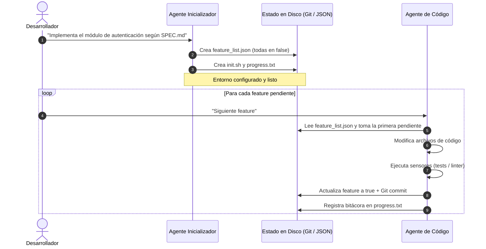
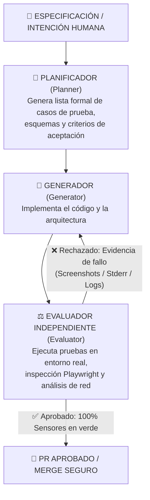
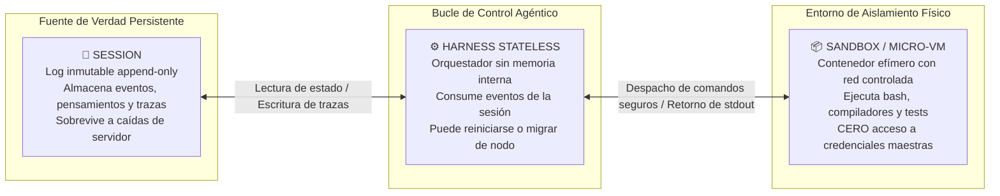
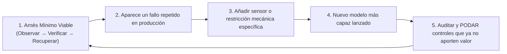

# 📐 Arquitecturas de Referencia y Principios de Evolución del Harness

> *"El arnés codifica supuestos sobre lo que el modelo NO puede hacer. A medida que los modelos avanzan, esos supuestos caducan y el arnés debe simplificarse. Diseñar un arnés de alto nivel consiste tanto en saber qué controles construir hoy, como en saber qué burocracia podar mañana."*

---

## 🏛️ Tres Patrones Arquitectónicos Comprobados

No existe una única arquitectura válida para todos los casos de uso. Dependiendo de si estás programando en tu máquina local, automatizando un pipeline de CI/CD o construyendo un servicio agéntico en la nube, la industria ha consolidado **tres arquitecturas de referencia**:

---

### Arquitectura 1: Initializer + Coding Agent (Progreso Incremental)

Diseñada para desarrollo iterativo y sesiones prolongadas de programación asistida en terminal o IDE (el modelo adoptado por herramientas como Claude Code o Antigravity).

- **Sesión de Inicialización:** Un agente rápido analiza la especificación y crea los artefactos estructurados base:
  - `init.sh` (script de arranque determinista).
  - `feature_list.json` (desglose de requerimientos en estado inicial de fallo).
  - `progress.txt` (bitácora de decisiones).
- **Sesiones de Ejecución:** El agente de código toma **una sola característica a la vez**, ejecuta el cambio, corre los tests, actualiza el estado en disco, crea un commit limpio en Git y finaliza su turno dejando el entorno en perfecto orden.

---

### Arquitectura 2: Triángulo Planner + Generator + Evaluator (Patrón Antagónico)

Inspirada en el balance entre generador y discriminador de las redes GANs, esta arquitectura es la más sólida para tareas autónomas complejas donde la calidad y la seguridad no pueden negociarse.

| Rol | Responsabilidad Principal | Herramientas Típicas |
|---|---|---|
| **Planificador (*Planner*)** | Descomponer la intención en requerimientos técnicos atómicos y definir el contrato de éxito. | Lectura de documentación, analizador de esquemas. |
| **Generador (*Generator*)** | Escribir código limpio, modular y apegado a los contratos. | Escritura y edición de archivos, creación de componentes. |
| **Evaluador (*Evaluator*)** | Juzgar el trabajo con escepticismo radical; jamás confiar en palabras. | Navegador headless (Playwright), linters, suites de tests, llamadas cURL. |

---

### Arquitectura 3: Session / Harness / Sandbox (Managed Agents en la Nube)

La arquitectura estándar para desplegar flujos agénticos en servidores, entornos multi-inquilino (*multi-tenant*) y plataformas de infraestructura en la nube:

- **Session (Persistencia Inmutable):** Es un registro append-only de cada paso ejecutado. Si una máquina falla, cualquier otro worker puede leer el log y reanudar la tarea en el milisegundo exacto donde se detuvo.
- **Harness (Lógica Desacoplada):** No guarda variables en memoria volátil; es completamente reemplazable y escalable horizontalmente.
- **Sandbox (Seguridad Estricta):** El código generado por la IA corre en un entorno estanco. Las credenciales de nube jamás ingresan al contenedor; el sandbox solo puede interactuar con el mundo mediante las APIs intermediadas por el harness.

---

## ✂️ Principios de Evolución del Harness (La Regla de la Poda)

El mayor peligro al construir sistemas con IA no es quedarse corto de herramientas, sino **acumular burocracia técnica innecesaria**.

> [!IMPORTANT]
> **La Ley de Obsolescencia de Supuestos:**  
> Todo arnés codifica supuestos sobre lo que el modelo de lenguaje **no es capaz de hacer**.  
> Conforme los modelos de frontera evolucionan y adquieren mayores ventanas de contexto y mejor razonamiento causal, **muchos de esos supuestos caducan**. Si no podas tu arnés, terminarás asfixiando al modelo con restricciones obsoletas.

### Ejemplos Reales de Poda en la Industria:
1. **Eliminación de Context Resets Forzados:** Antes se reseteaba la memoria cada 5 mensajes por miedo a la degradación de atención; con modelos modernos con atención de millones de tokens y baja pérdida intermedia, este reseteo artificial se eliminó.
2. **Eliminación de Micro-Sprints Burocráticos:** Forzar a un modelo avanzado a pedir permiso humano para cada creación de archivo individual ralentiza el flujo sin aportar seguridad real si ya cuentas con un linter y Git diff.
3. **Poda de Prompts Redundantes:** Quitar recordatorios como *"recuerda importar React from 'react'"* cuando el modelo ya lo hace de forma nativa por entrenamiento.

---

## 🎯 La Regla de Oro para el Constructor

1. **Arranca con el arnés mínimo que cierre el ciclo:** Un linter, un comando de test y un script de rollback.
2. **Añade complejidad solo cuando una clase de error real lo exija.**
3. **Poda sin piedad:** Cada línea en tu arnés consume tokens y atención. Mantén tu arnés tan afilado y liviano como sea posible.
