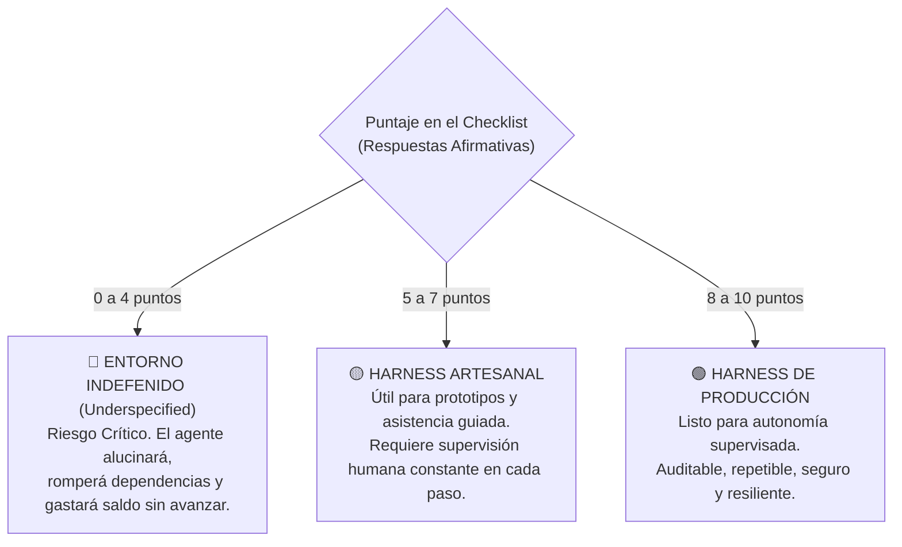

# 📋 Checklist de Validación Previa a Producción para Agentes Autónomos

> *"Si varias respuestas a este checklist son 'NO', sustituir tu modelo por uno más grande, potente o costoso no hará que el sistema sea más fiable. Solo logrará que el fallo sea infinitamente más caro."*

---

## 🚦 La Compuerta Final antes de Confiar Trabajo Real

Antes de asignarle a un agente de Inteligencia Artificial tareas críticas en tu base de código (como refactorizar un módulo sensible, conectarse a pasarelas de pago o automatizar despliegues), el entorno operativo debe someterse a esta **auditoría de 10 puntos**.

Aplica el principio de **Default-Fail**: cada casilla comienza desmarcada y solo se considera aprobada si existe una garantía mecánica verificable en tu repositorio.

---

## 🧭 Las 10 Preguntas Críticas del Harness

| # | Pregunta de Control | ¿Qué riesgo mitiga? | Criterio de Aprobación Mecánica |
|:---:|---|---|---|
| **1** | **¿Existe un contrato claro y acotado de la tarea?** | Evita la redefinición silenciosa del objetivo (*Goal Drift*) y que el agente declare éxito en una tarea más fácil. | Existe un archivo `SPEC.md` o contrato con requerimientos de entrada, invariantes innegociables y criterio de 'done'. |
| **2** | **¿Tiene un mapa de conocimiento en lugar de un dump de docs?** | Evita la pérdida en el medio (*Lost in the Middle*) y el consumo excesivo de tokens por saturación de contexto. | Existe un `AGENTS.md` corto que orienta al modelo hacia carpetas específicas bajo demanda (*Progressive Disclosure*). |
| **3** | **¿El repositorio es el sistema de registro accesible?** | Evita que el agente invente convenciones al no tener acceso al código fuente real. | El agente puede leer el árbol de archivos, esquemas de BD y configuraciones directamente desde el repo. |
| **4** | **¿Las herramientas tienen propósito, salida predecible y fallo explícito?** | Evita que el modelo asuma éxito cuando un comando falló silenciosamente con código de salida oculto. | Cada herramienta reporta `exit code`, `stdout` y `stderr` sin camuflar los errores. |
| **5** | **¿La memoria y el estado viven fuera de la ventana de contexto?** | Evita que un reinicio de sesión, caída de red o límite de tokens destruya el avance logrado. | El progreso se respalda en disco (`progress.txt`, `feature_list.json`) y commits atómicos de Git. |
| **6** | **¿Hay sensores que generen evidencia objetiva e independiente?** | Evita que el modelo se autoevalúe con complacencia y apruebe código roto o no testeado. | Existen linters, type-checks o suites de pruebas (`vitest`, `pytest`) que emiten veredictos deterministas. |
| **7** | **¿Los permisos y autorizaciones están fuera del modelo?** | Evita que un sistema probabilístico apruebe sus propias acciones de riesgo o ejecute comandos destructivos. | Operaciones irreversibles (`DROP TABLE`, `push --force`) requieren autorización humana o política estricta. |
| **8** | **¿El entorno cuenta con sandboxing y blast radius acotado?** | Evita fugas de secretos y que un fallo afecte archivos o servicios fuera del alcance del proyecto. | La ejecución corre en contenedor local o sandbox con red restringida y claves maestras protegidas. |
| **9** | **¿Cada ejecución genera trazas legibles y recuperables?** | Evita que los errores sean misterios inexplicables; convierte cada fallo en insumo para mejorar el arnés. | Se registran bitácoras de comandos ejecutados, tiempo, tokens insumidos y recibos de cambio (*change receipts*). |
| **10** | **¿El bucle tiene límites mecánicos, presupuesto y escalada humana?** | Evita bucles infinitos de alucinación iterativa que devoren saldo de API sin resolver el problema. | Límite estricto de reintentos (máximo 3), tope de gasto económico y congelamiento con alerta al humano. |

---

## 🩺 Diagnóstico y Matriz de Madurez

Revisa cuántas respuestas afirmativas reúne actualmente tu entorno:

- **0 a 4 puntos (Entorno Underspecified):** No le confíes tareas multi-archivo a la IA. La falta de sensores y contratos te obligará a pasar horas depurando código roto a mano.
- **5 a 7 puntos (Harness Artesanal):** Adecuado para programar en pareja (*pair-programming*), pero aún vulnerable a redefinición de tareas o complacencia en las pruebas.
- **8 a 10 puntos (Harness de Producción):** Nivel industrial. El modelo puede ejecutar tareas largas de forma confiable, documentada y segura.

---

## 🏛️ Conclusión Operativa de la Disciplina

> ### 💎 *"La ventaja durable no está en el prompt ni en el modelo del mes. Está en el harness."*

Los modelos de lenguaje son piezas intercambiables de un ecosistema en constante rotación: hoy utilizas un modelo, en seis meses saldrá otro tres veces más rápido y a la mitad de precio. Si tu estrategia depende de "un prompt mágico", tu conocimiento caducará en la siguiente actualización de la API.

En cambio, las herramientas sólidas, los esquemas de validación matemática, los sensores de calidad, las máquinas de estado, las políticas de permisos y los registros de auditoría **permanecen y se acumulan con el tiempo**.

Los mejores equipos de ingeniería de software asistido no se limitan a preguntar:  
*«¿Qué modelo es más inteligente?»*  

Preguntan:  
**«¿Qué entorno operativo hace que la inteligencia del modelo sea repetible, segura y acumulativa?»**
