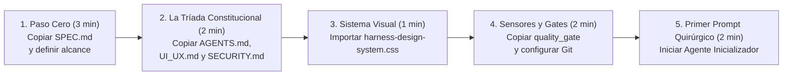

# 🚀 El Ritual de Despegue: Cómo Iniciar tu Próximo Proyecto en 10 Minutos

> *"La diferencia entre un proyecto amateur que colapsa al tercer día y un sistema profesional listo para escalar se decide en los primeros 10 minutos, antes de escribir la primera línea de código funcional."*

---

## 🧰 Cómo Usar Este Repositorio como tu Plantilla Maestra (*Starter Kit*)

Este manual fue diseñado no solo para leerse, sino para funcionar como tu **fábrica de proyectos**. Cada vez que vayas a iniciar una nueva aplicación web, un SaaS, un bot o un sistema para un cliente, sigue este ritual exacto de **5 pasos en 10 minutos**.



---

## 📋 Los 5 Pasos del Ritual de Inicio

### Paso 1: Crea la Carpeta y Define el Contrato (`SPEC.md`)
Antes de abrir Cursor, Antigravity o Claude Code, crea la carpeta de tu proyecto, inicia Git y copia la plantilla de especificación:
```bash
mkdir mi-nuevo-proyecto && cd mi-nuevo-proyecto
git init
```
Copia [`templates-plug-and-play/spec-de-proyecto-starter.md`](../../templates-plug-and-play/spec-de-proyecto-starter.md) a la raíz como **`SPEC.md`** y rellena en lenguaje claro:
- ¿Qué problema resuelve la aplicación?
- ¿Cuáles son las 3 a 5 pantallas o flujos principales?
- ¿Qué tablas esenciales lleva la base de datos?
- ¿Qué cosas están **fuera de alcance** en esta primera versión?

---

### Paso 2: Instala la Tríada Constitucional en la Raíz
Copia los tres arneses de gobernanza desde la carpeta [`templates-plug-and-play/`](../../templates-plug-and-play/) a la raíz de tu nuevo proyecto:

| Archivo en tu Raíz | Origen en esta Plantilla | Qué Protege |
|---|---|---|
| **`AGENTS.md`** *(y/o `CLAUDE.md`, `.cursorrules`)* | [`AGENTS-universal.md`](../../templates-plug-and-play/AGENTS-universal.md) | Evita archivos monstruo, protege la arquitectura y exige pasar los Quality Gates. |
| **`UI_UX.md`** | [`UI_UX.md`](../../templates-plug-and-play/UI_UX.md) | Prohíbe `!important`, exige tokens semánticos, centra el Navbar y exige los 4 estados (Loading, Empty, Error, Success). |
| **`SECURITY.md`** | [`SECURITY.md`](../../templates-plug-and-play/SECURITY.md) | Bloquea IDOR, Mass Assignment, SQL Injection, `CORS: *` y puertos expuestos en Docker. |

---

### Paso 3: Conecta el Sistema de Diseño Base
Copia [`templates-plug-and-play/harness-design-system.css`](../../templates-plug-and-play/harness-design-system.css) y [`templates-plug-and-play/ui-feedback-states.css`](../../templates-plug-and-play/ui-feedback-states.css) dentro de tu carpeta `src/styles/`.
- Desde el minuto uno tendrás modo claro/oscuro automático, escala matemática de espaciados, tipografía fluida con `clamp()`, el `.container-sagrado` y botones con ergonomía táctil de 44px.

---

### Paso 4: Activa los Sensores Mecánicos (*Quality Gates*)
Según el lenguaje de tu proyecto, copia a tu carpeta `scripts/`:
- **Para Node.js / TypeScript:** [`quality_gate_node.ts`](../../templates-plug-and-play/quality_gate_node.ts)
- **Para Python:** [`quality_gate_python.py`](../../templates-plug-and-play/quality_gate_python.py)
- **Para GitHub Actions (CI gratuito en la nube):** Copia [`github-actions-ci.yml`](../../templates-plug-and-play/github-actions-ci.yml) en `.github/workflows/ci.yml`.

Crea tu primer punto de guardado sagrado en Git:
```bash
git add -A
git commit -m "chore: bootstrap project with SPEC, AGENTS, UI_UX and SECURITY harness"
```

---

### Paso 5: El Primer Prompt de Inicialización para tu Agente
Ahora sí, abre tu entorno agéntico y lánzale este prompt inaugural:

```text
Hola. Antes de escribir código, lee obligatoriamente:
1. SPEC.md (alcance y modelo de datos del proyecto)
2. AGENTS.md (reglas de arquitectura y calidad)
3. UI_UX.md (sistema de tokens, cascada natural y cero !important)
4. SECURITY.md (reglas innegociables de seguridad defensiva)

Tu única tarea en este primer turno es actuar como Agente Inicializador:
- Propón la estructura de carpetas limpia y modular del proyecto.
- Genera el archivo .harness/feature_list.json desglosando el SPEC.md en tareas atómicas verificables (todas con status: false).
- No implementes todas las vistas de golpe; espera mi confirmación sobre el plan antes de programar la primera feature.
```

---

## 🏆 El Resultado Final

Con este ritual de 10 minutos acabas de transformar el comportamiento de cualquier modelo de Inteligencia Artificial:
- Ya no es un chatbot improvisando código espagueti a ciegas.
- Es un **ingeniero de software operando dentro de un Harness de nivel industrial**, guiado por tu visión, contenido por tus guardrails de diseño y seguridad, y auditado por tus sensores automáticos.
