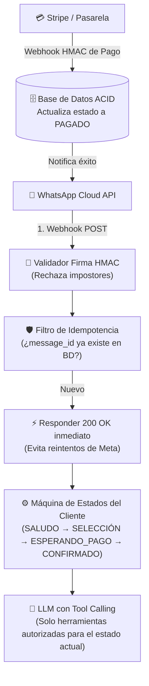
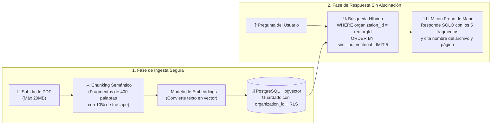
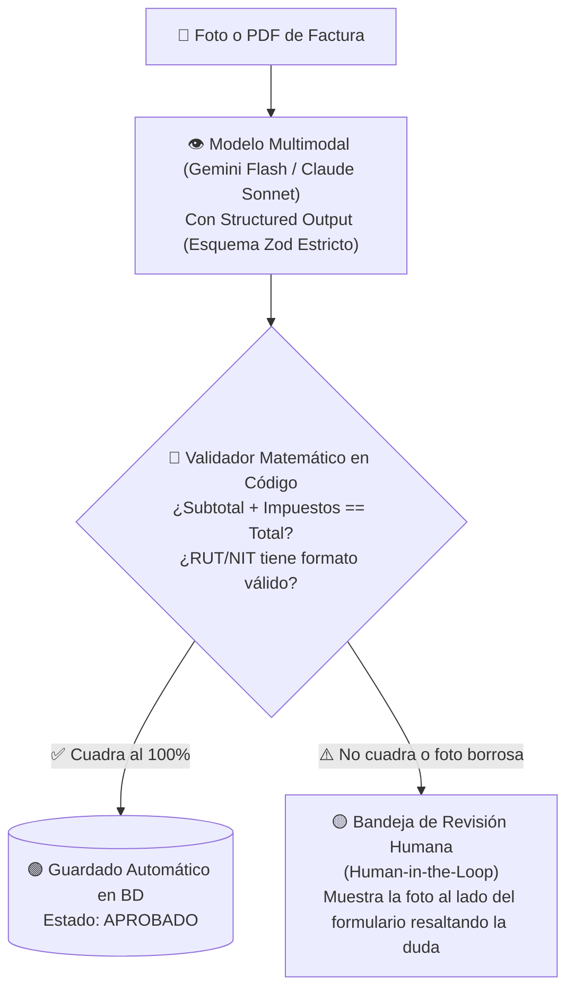

# 🏗️ Blueprints de Arquitectura: 3 Proyectos Reales Listos para Construir

> *"Los repositorios de demos te enseñan a hacer un juguete de fin de semana que se cae con el tercer usuario. Estos tres blueprints te muestran cómo diseñar los sistemas con IA más rentables del mercado con arquitectura de producción real."*

---

## 🎯 Cómo Usar Estos Blueprints

Cuando vayas a construir cualquiera de estos tres sistemas para tu propio negocio o para un cliente, copia el diagrama y las reglas del blueprint directamente dentro del archivo **`SPEC.md`** de tu nuevo proyecto. Así tu agente codificador arrancará con una arquitectura blindada desde el minuto cero.

---

## 💬 Blueprint 1: Bot Transaccional de WhatsApp con IA, Citas y Pagos

El error amateur al conectar WhatsApp Cloud API con un LLM es dejar que el modelo converse libremente sin control de estado ni protección contra webhooks duplicados.

### Arquitectura de Producción:

### Guardrails Obligatorios para tu `SPEC.md`:
1. **Idempotencia por `message_id`:** Meta reenvía el mismo mensaje si tu servidor tarda más de 3 segundos. Guarda siempre el `wamid` en una tabla con restricción `UNIQUE` antes de llamar a la IA.
2. **La IA jamás confirma un pago por palabras del usuario:** Aunque el usuario envíe un mensaje diciendo *"Ya pagué, aquí está el comprobante"*, el estado del pedido **solo cambia a `PAGADO` cuando entra el webhook criptográfico de la pasarela de cobro** o un administrador humano aprueba la transferencia en su panel.
3. **Ventana de Historial Acotada:** Pásale al modelo únicamente los últimos **10 mensajes** de la conversación + el resumen del carrito actual (nunca los 500 mensajes del año pasado, o agotarás tu saldo de tokens).

---

## 📚 Blueprint 2: SaaS Multi-Cliente de Consulta Documental (RAG con `pgvector` y RLS)

Ideal para despachos legales, clínicas, soporte técnico empresarial o academias que necesitan consultar cientos de PDFs privados sin que los documentos del Cliente A se filtren jamás al Cliente B.

### Arquitectura de Producción:

### Guardrails Obligatorios para tu `SPEC.md`:
1. **Filtro de Inquilino Antes del Vector:** Toda consulta a la tabla `document_chunks` debe exigir `WHERE organization_id = $1` (extraído del token autenticado) y tener **Row Level Security (RLS)** activo.
2. **Umbral Mínimo de Similitud (*Similarity Threshold*):** Si los fragmentos encontrados en la base de datos tienen una similitud menor a `0.72` (es decir, no hablan de lo que preguntó el usuario), tu código **ni siquiera llama al LLM**: responde directamente *"No se encontraron documentos relacionados con tu consulta"*, ahorrando tokens y evitando alucinaciones.
3. **Citas Verificables:** Obliga al modelo mediante `Structured Outputs` a devolver `{ respuesta: string, fuentes: [{ archivo: string, pagina: number }] }`.

---

## 🧾 Blueprint 3: Automatizador Multimodal de Back-Office (Extractor de Facturas y Recibos)

Ideal para sistemas administrativos, contables o de logística donde los empleados suben fotos o PDFs de facturas, recibos o albaranes y el sistema los carga automáticamente al ERP.

### Arquitectura de Producción:

### Guardrails Obligatorios para tu `SPEC.md`:
1. **La IA extrae, el código tradicional suma:** Nunca confíes en una suma hecha por un modelo de lenguaje. Extrae `items[]`, `subtotal`, `impuestos` y `total` como números enteros (centavos), y haz que una función tradicional en TypeScript/Python compruebe que la suma de las líneas coincida exactamente con el total.
2. **Bandeja de Excepciones (*Human-in-the-Loop*):** Ningún sistema de visión acierta el 100% de las veces ante tickets arrugados o manchados. En lugar de fallar o meter datos corruptos a la contabilidad, crea siempre el estado `REQUIERE_REVISION_HUMANA` para que un operador corrija el campo dudoso en 5 segundos.
